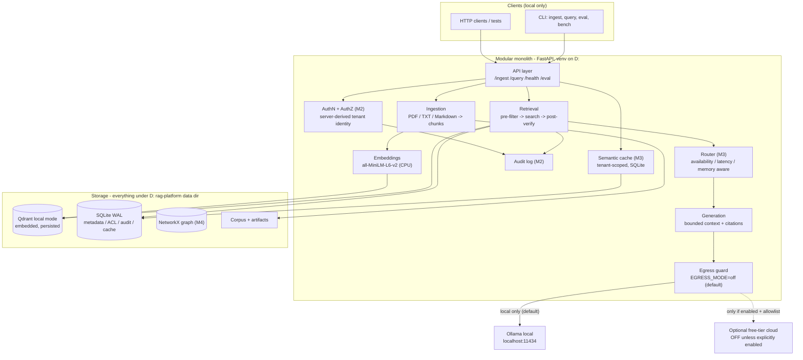

# RAG Platform — Master Plan (Zero-Cost, Local-First, Resource-Conscious)

**Project root:** `D:\rag-platform`
**Document:** `RAG_Platform_Master_Plan.md` — version 1.0, 2026-10-18
**Status:** Final planning deliverable. **Implementation has NOT started.** No code, Git, packages, models, services, or system changes exist yet. Work begins only after explicit approval of the open decisions in §12.

**Priority order (never violated):** 1) correctness & security → 2) low resource usage → 3) reproducibility → 4) performance.

---

## 1. Project Goals and Zero-Cost Guarantees

### 1.1 Goals
Build a working, demonstrable, permission-aware RAG platform in four milestones on a single Windows laptop, with deterministic offline evaluation and honest reporting.

### 1.2 Non-negotiable rules
| # | Rule |
|---|------|
| Z1 | **No paid APIs, subscriptions, paid hosting, paid managed databases, trial credits, or expiring promotional credits** — ever, in any component or test. |
| Z2 | **Core platform works with zero cloud accounts and zero API keys.** No account-based service may be required for any acceptance test. |
| Z3 | **Local inference is the default:** Ollama on `localhost:11434`, reusing models already installed. |
| Z4 | **`EGRESS_MODE=off` by default.** No documents, queries, prompts, embeddings, or user data leave the machine unless the user explicitly enables egress. |
| Z5 | **Never** enable billing, use paid models, or silently fall back to a paid endpoint. Fallbacks must be recorded (`served_by`, reason) and are local-only. |
| Z6 | **No new model downloads** without demonstrated need **and** explicit approval. Benchmark what exists first. |
| Z7 | **No unnecessary infrastructure:** no Docker requirement, no Redis/Neo4j/PostgreSQL/rerankers/dashboards/agents unless a milestone's measured need justifies it (escalation rules in Appendix C). |
| Z8 | **Never fabricate results.** Every metric is a measured number or marked `not-measured`. Reports distinguish `passed / failed / skipped / blocked`. |
| Z9 | **All new artifacts on D:** venv, caches, databases, corpora, artifacts. C: must not grow. Docker data is never relocated and Docker is not used without approval. |
| Z10 | Cloud providers (Groq, Gemini, OpenRouter) are **documentation-only, opt-in, optional** integrations (Appendix A) — never requirements, never enabled by default. |
| Z11 | Retrieval and ingestion must keep working when Ollama is stopped (**retrieval-only degraded mode**). |

---

## 2. Environment: Verified Facts, Assumptions, Unresolved Decisions

### 2.1 Verified facts (confirmed this session by direct inspection)
| Fact | Evidence |
|---|---|
| Workspace `D:\rag-platform` is empty (0 items), not a Git repo | Directory listing |
| OS: Windows 11, x86_64; PowerShell shell | System info |
| CPU: AMD Ryzen 7 7445HS, **6 cores / 12 threads observed** | WMI |
| RAM: 16 GB class — 15.2 GB total, **~1.9 GB free at inspection time** | System info |
| GPU: NVIDIA RTX 3050 laptop, **6 GB VRAM**, driver 610.88, **no CUDA toolkit installed** | `nvidia-smi`-class query |
| PyTorch installed is a **CPU-only build** (`2.13.0+cpu`) → **no torch GPU acceleration** | pip metadata |
| Disk: **C: 4.6 GB free** (nearly full), **D: 194.5 GB free** | Disk info |
| Python 3.14.5, uv 0.11.32 available | `python --version`, `uv --version` |
| Ollama v0.40.4 installed and running at `localhost:11434` | Live API |
| Ollama models on C: total **9.23 GB**: `qwen3:8b`, `qwen3:latest`, `qwen2.5-coder:7b` | `ollama list` |
| `all-MiniLM-L6-v2` embedding model cached (87.3 MB) at `C:\Users\joelj\.cache\huggingface\hub\models--sentence-transformers--all-MiniLM-L6-v2` | Path listing |
| **No LLM API keys set** (`GROQ/GEMINI/OPENROUTER/MISTRAL/COHERE/GITHUB` inference keys absent) | Env query |
| Docker Desktop installed, **daemon stopped**, WSL2 Ubuntu-24.04 present; Docker data `docker_data.vhdx` = 7.5 GB **on C:** | Path/system inspection |
| **GitHub Models was retired 2026-07-30** — endpoint returns `200 text/plain: "OK"` (tombstone), not inference; official docs confirm retirement | Live probe + official docs |
| Groq / Gemini / OpenRouter endpoints exist and are auth-gated (HTTP 401/403/200 without key) — relevant only to optional Appendix A | Live probe |
| **Qdrant local mode is embedded and persistent:** official source `qdrant_client/local/qdrant_local.py` — `location` accepts *"a path to a directory or `:memory:`"*, docstring *"Everything Qdrant server can do, but locally."* → no server, no Docker for M1 | Official qdrant-client source |
| Licenses verified: Qwen3 (4B/1.7B) Apache-2.0 · Ollama MIT · llama.cpp MIT · Qdrant Apache-2.0 · NetworkX BSD-3 · SQLite public domain · Redis ≥7.4 RSALv2/SSPLv1 (conditional) · Neo4j CE GPLv3 (conditional) | Upstream license pages |

### 2.2 Assumptions (plausible but **unverified until benchmarked**)
| # | Assumption | How it gets verified |
|---|---|---|
| A1 | `qwen3:latest` is an alias of `qwen3:8b` (i.e., only **two distinct models** installed: an 8B general model and a 7B code model) | `ollama list` digests in Phase 0 |
| A2 | `qwen3:8b` Q4 (~5.2 GB weights) **cannot fully fit 6 GB VRAM** alongside Windows/browser use → expect **partial GPU offload or full CPU** | `ollama ps` during M1 benchmark — **never assumed** |
| A3 | Ollama's bundled CUDA runtime can offload to the 3050 **without** a CUDA toolkit (torch's CPU-only build is irrelevant to Ollama) | `ollama ps` during M1 benchmark |
| A4 | 8B CPU generation on 6C/12T ≈ **roughly 5–15 tok/s** (range is an estimate) | M1 benchmark — measured number replaces estimate |
| A5 | mmap'd Ollama weights are page-cache backed, so OS can reclaim under pressure at a perf cost | Observed in benchmark |
| A6 | Free-tier quotas cited in Appendix A (Oct 2026) are correct **today** and may change without notice | Re-verify only if egress ever enabled |
| A7 | `pypdf` covers the user's PDFs (text-based; **no OCR in scope**) | M1 ingestion test on user's sample |
| A8 | All RAM/disk numbers in §6 are **estimates until measured** | M1 perf tests record real numbers |
| A9 | sentence-transformers/transformers availability on Python 3.14 — MiniLM cache exists, but package compatibility must be checked | Phase 0 dependency install; contingency §11-R7 |
| A10 | A single-user, single-process laptop app keeps SQLite WAL comfortably within concurrency limits | M2 concurrency tests |

### 2.3 Unresolved decisions requiring user approval (details in §12)
| ID | Decision | Recommendation |
|---|---|---|
| D1 | Approve implementation start (Phases 0–8 → M1) | Approve |
| D2 | Copy MiniLM cache C: → D: and set `HF_HOME` **project-locally** (no system env changes) | Approve |
| D3 | Model strategy **after** `qwen3:8b` benchmark (if a download is needed: approval required, would target D:) | Defer to measured data |
| D4 | Optional: relocate `OLLAMA_MODELS` (9.2 GB) from C: to D: — **system env change** | Approve or defer; does not block M1 |
| D5 | Confirm **SQLite** for M1–M3 (PostgreSQL only if Appendix C criteria trip) | Approve |
| D6 | Auth mechanism for M2: **API keys, PBKDF2-hashed, server-derived tenant** (no cloud IdP) | Approve |
| D7 | Eval corpus: **author a small synthetic corpus + frozen Q/A set locally** (no downloads) | Approve |
| D8 | Git: `git init` at Phase 0 vs later | Approve at Phase 0 |

---

## 3. Architecture

Modular monolith — one Python process, one API, one CLI. No microservices, no message queues, no containers.



**Request flow (M1+):** authenticate (M2) → semantic-cache lookup (M3, authz-checked) → pre-retrieval tenant/document filter → vector search → **independent post-retrieval authorization verify** → bounded context assembly → local generation with citations → audit + `served_by` record → response. Any stage may degrade to retrieval-only; degradation is explicit, logged, never silent.

**Why a modular monolith:** one process to start, one venv, low RAM, trivially debuggable on Windows; module boundaries (`ingestion/`, `retrieval/`, `generation/`, `auth/`, `cache/`, `graph/`) preserve a later split path without paying distributed-systems cost now.

---

## 4. Repository Structure

```
D:\rag-platform\
├── README.md                     # quickstart + status badges (real, not aspirational)
├── pyproject.toml                # uv-managed, pinned deps
├── uv.lock
├── .env.example                  # placeholders ONLY: OLLAMA_BASE_URL, EGRESS_MODE=off, PORT, ...
├── .gitignore                    # .env, data/, *.db, *.sqlite, *.pdf corpus, models, caches, artifacts/
├── src\rag_platform\
│   ├── __init__.py
│   ├── config.py                 # pydantic-settings; validated; egress + allowlist enforcement
│   ├── main.py                   # FastAPI app factory
│   ├── cli.py                    # argparse: ingest | query | eval | bench  (stdlib, zero extra deps)
│   ├── api\                      # routes: ingest, query, health, eval
│   ├── ingestion\                # loaders (pdf/txt/md), chunker
│   ├── embeddings\               # MiniLM wrapper (lazy load, CPU, batched)
│   ├── vectorstore\              # Qdrant-local adapter (interface behind it: add/remove/search/filter)
│   ├── retrieval\                # top-k, payload filter, post-retrieval verify, score threshold
│   ├── generation\               # Ollama HTTP client, prompts, citations, bounded context
│   ├── router\                   # M3: availability/latency/memory-aware routing, concurrency semaphore
│   ├── cache\                    # M3: SQLite semantic cache, tenant-scoped, invalidation
│   ├── auth\                     # M2: API-key auth, tenant derivation, ACL enforcement
│   ├── graph\                    # M4: NetworkX store, extraction, bounded traversal, hybrid search
│   ├── db\                       # sqlite3 wrapper, schema.sql, versioned migrations (PRAGMA user_version)
│   ├── eval\                     # datasets, metrics, harness, report writer
│   └── observability\            # structured secret-safe logging, health, resource snapshots
├── tests\
│   ├── unit\                     # chunker, config validation, metrics, allowlist, authz logic
│   ├── integration\              # ingest→retrieve→generate e2e; restart persistence
│   ├── adversarial\              # M2: forged IDs, cross-tenant, revocation, injection, cache isolation
│   ├── perf\                     # resource budgets, latency, model benchmark (marked @benchmark)
│   └── egress\                   # zero-outbound-when-off; allowlist + redirect rejection
├── datasets\                     # frozen JSONL + SHA256 manifest (generated locally, committed)
├── scripts\                      # PowerShell: setup.ps1, run.ps1, bench_model.ps1, run_eval.ps1, env.ps1
├── docs\
│   ├── SETUP_WINDOWS.md          # copy-paste PowerShell commands
│   ├── ARCHITECTURE.md
│   ├── SECURITY.md               # invariants + threat model
│   ├── EVALUATION.md             # metrics, datasets, honest-reporting rules
│   ├── RESOURCE_BUDGET.md        # measured numbers + methodology
│   └── CLOUD_OPTIONAL.md         # Appendix A, opt-in only, honest limits/privacy
└── data\                         # GITIGNORED, all on D:
    ├── cache\uv\  cache\huggingface\
    ├── qdrant\  sqlite\  corpus\  graph\  artifacts\
```

---

## 5. Technology Choices (with alternatives considered)

| Concern | **Chosen** | Alternatives considered | Why chosen (simplicity/safety first) |
|---|---|---|---|
| Language/runtime | Python 3.14 (fallback 3.12/3.13 via uv-managed install **on D:**) | 3.11 LTS | Already installed; uv can pin another version to D: if deps break (§11-R7) |
| Package/venv | **uv** (`UV_CACHE_DIR` → D:) | poetry, pip, conda | Installed, fastest, lockfile for reproducibility |
| Web framework | **FastAPI + pydantic-settings** | Flask, Django | Typed validation, async, spec'd from the start; Django far too heavy for a single-user API |
| Pipeline framework | **Hand-rolled thin modules** | LangChain, LlamaIndex | Full auditability, no hidden remote calls/telemetry, far fewer deps, small RAM |
| Embeddings | **sentence-transformers `all-MiniLM-L6-v2` (CPU)** | HF Inference API (network+key → violates Z2), ONNX Runtime, bge-base (2× size) | Cached (87 MB), 384-dim, ~90 MB RAM, fast on CPU; internet only if cache missing |
| Vector store M1–M4 | **Qdrant client local mode** (embedded, `path=` on D:) | native Qdrant binary (Windows zip), FAISS+SQLite, Chroma, pure-NumPy cosine | Verified: persists to directory, full API incl. filters, **zero services/ports/RAM daemons**; adapter interface allows promoting to native Qdrant binary without code change; Chroma ships server telemetry defaults; FAISS = write our own filtering |
| Metadata/ACL/cache store | **SQLite (WAL) via stdlib `sqlite3`** | PostgreSQL from day one, SQLAlchemy+Alembic, Redis | Zero ops, single-process ACID, file on D:, stdlib (no dep); raw SQL keeps the security path auditable; **PostgreSQL only when Appendix C criteria trip**; SQLAlchemy enters only with that promotion |
| LLM runtime | **Ollama (installed, MIT, running)** | llama.cpp server, vLLM (Linux-only), LM Studio | Already installed with models; single endpoint; configurable load/unload |
| Generation model (M1) | **Benchmark `qwen3:8b` first**; evaluate already-installed alternatives if too heavy | Qwen3-4B/1.7B downloads | Z6: no downloads without demonstrated need + approval; honest caveat: **no small general model is currently installed** (see D3) |
| Cache (M3) | **SQLite + embedding similarity, tenant-scoped** | Redis, in-memory LRU only | Measurements first (Appendix C); persists across restarts, zero new infra |
| Graph (M4) | **NetworkX (BSD-3), persisted JSON on D:** | Neo4j CE (GPLv3, ~1–2 GB JVM), TigerGraph, RDF stores | Lightweight, in-process, no service; Neo4j only if NetworkX measurably fails (Appendix C + license approval) |
| HTTP client | **httpx** | requests | Fits async FastAPI; used only for Ollama (and optional cloud if ever enabled) |
| PDF parsing | **pypdf** | PyMuPDF, pdfplumber, OCR (tesseract) | Pure-Python, lightweight, BSD-family (license verified at install); **no OCR scope** |
| CLI | **argparse** (stdlib) | typer, click | Zero extra deps |
| Tests | **pytest + pytest-cov** | unittest | Standard, fixtures fit adversarial matrix |
| Resource measurement | **psutil** | manual WMI scripts | Cross-platform counters for perf tests |
| Migrations | **versioned `.sql` + `PRAGMA user_version`** | Alembic | Adequate for SQLite; Alembic arrives only with PostgreSQL |
| Dashboard | **None** — API + CLI + `/health` | Streamlit/Gradio | Explicitly deferred (Z7) |
| Docker | **Not used** | Qdrant/Ollama containers | Native installs already exist; avoids 7.5 GB C: vhdx growth (Z9) |
| Reranker | **Deferred** | cross-encoder MiniLM | +100–400 MB RAM + CPU per query; only if eval shows recall gain (Appendix C) |
| Judge | **Optional local judge (Ollama), marked non-deterministic** | hosted judge (forbidden) | Never a hard gate |

**Dependency list (setup-time downloads only, pinned via `uv.lock`):** fastapi, uvicorn, pydantic, pydantic-settings, httpx, sentence-transformers (pulls torch CPU, transformers, numpy), qdrant-client, pypdf, psutil, pytest, pytest-cov, networkx. Plus dev-only: pip-audit (vulnerability check). Every install runs a license review (Z1, Z9).

---

## 6. Resource Budgets and Disk Strategy

### 6.1 Resource budget table — **all values ESTIMATES until measured in M1** (measured numbers replace them in `docs/RESOURCE_BUDGET.md`)
| Component | RAM (est.) | VRAM (est.) | Disk (D: unless noted) | CPU (est.) | Startup |
|---|---|---|---|---|---|
| FastAPI + uvicorn (1 worker) | 150–300 MB | 0 | — | idle ~0% | <3 s |
| venv (torch CPU ~1.5–2 GB installed + transformers + qdrant-client + fastapi) | — | — | ~3–4 GB | — | — |
| torch import + MiniLM (lazy) | 300–700 MB | 0 | 87 MB model (copied from C:) | burst on embed; ~10 ms/chunk | 2–5 s first embed |
| Qdrant local mode (in-process) | 50–300 MB (grows with vectors) | 0 | ~1.5 KB/chunk incl. payload → 100k chunks ≈ 150–300 MB | idle 0% | instant |
| SQLite (WAL: metadata/ACL/audit/cache) | 10–50 MB | 0 | MB-scale initially | I/O bursts | instant |
| Ollama service (idle) | 200–400 MB | 0 | — (models: 9.23 GB **already on C:**, unchanged) | ~0% | already running |
| `qwen3:8b` loaded — CPU path | +5–6.5 GB resident (mmap caveat A5) | 0 | — | all cores during gen | 3–15 s load |
| `qwen3:8b` loaded — partial/full GPU | ~0.5–1 GB host | up to ~5.5 GB (weights + KV @ 4k ctx) | — | GPU + some cores | 3–15 s |
| NetworkX (M4, small graph) | 50–300 MB | 0 | MB-scale | 0% idle | instant |
| **Steady state (ingest/query, no generation)** | **~0.8–1.5 GB total** | 0 | — | low | — |
| **During CPU generation (worst case)** | **~7–9 GB total** | 0 | — | high burst | — |

**Laptop-comfort rule:** the machine must stay usable with VS Code + browser + college work open. Observed free RAM was ~1.9 GB, so:
- generation concurrency = **1** (semaphore); API single worker; requests beyond capacity → `503` immediately (**no unbounded queue**);
- `keep_alive` configurable (default short/0 → model unloads when idle, returning RAM;
- bounded `num_ctx` (default 4096), bounded output (`num_predict` ≤ 512 default);
- perf test asserts **generation spike leaves ≥ 3 GB system RAM free**, else the budget is revised downward (smaller ctx / unload policy), never by silently degrading security.

### 6.2 Operational bounds (config-validated, hard caps)
| Bound | Default | Hard max |
|---|---|---|
| Chunk size / overlap | ~1000 chars / 150 chars, sentence-aware | 2000 / 400 |
| Retrieval `top_k` | 8 | 20 |
| Chunks placed in prompt | 6 | 8 |
| Prompt context chars | ~6000 | 8000 |
| Ollama timeout (first token / total) | 15 s / 60 s | fixed |
| Retries per request | 1 | 2, then fail/degrade |
| Concurrent generations | 1 | 1–2 |
| Cache cosine threshold | 0.40 retrieval-score floor (tuned on eval); cache-hit ≥ 0.95 (initial, tune) | tune → freeze |
| Graph traversal depth / nodes visited (M4) | 2 / 50 | 3 / 100 |
| Graph size (M4) | 10k nodes / 50k edges | escalate per Appendix C |
| Ingest file size / per-request docs | 50 MB / 10 | — |
| Semantic cache entry text cap | 4 KB | — |

### 6.3 Disk management strategy (C: must not grow)
1. All project state under `D:\rag-platform\` — venv (`.venv`), data, artifacts, uv cache, HF cache, temp.
2. `env.ps1` (project-local, dot-sourced by scripts; **not** system env) sets `UV_CACHE_DIR`, `HF_HOME`, `TEMP/TMP` to D: paths → downloads/extracts land on D:.
3. MiniLM cache: **copy** the 87 MB folder C: → `D:\rag-platform\data\cache\huggingface\` (D2). The C: original is left untouched (deletion needs separate approval).
4. `OLLAMA_MODELS` stays on C: (9.23 GB) for M1 — no new downloads planned; relocation (D4) is an optional system-env change requiring explicit approval.
5. **Docker is not used**; `docker_data.vhdx` (7.5 GB on C:) is never touched, never relocated, never grown (Z9).
6. `.gitignore` excludes `.env`, `data/`, `*.db`, corpora, models, caches, artifacts — nothing large or secret enters Git.

---

## 7. The Four Milestones

### 7.1 M1 — Baseline RAG
**Scope:** ingestion (PDF/TXT/Markdown) → sentence-aware bounded chunking → MiniLM embeddings (CPU) → Qdrant local mode (persisted on D:, filtering **verified by tests**) → top-k retrieval with score threshold → Ollama generation with **source citations** → FastAPI endpoints (`/ingest`, `/query`, `/health`, `/eval`) → argparse CLI → reproducible offline eval harness → model benchmark.
**Dependencies:** Python/uv (present), Ollama (present), MiniLM cache (present), `qdrant-client` + `pypdf` + `sentence-transformers` (Phase 0 installs → D:).
**Explicit exclusions:** auth, cache, routing, graph, reranker, dashboard, cloud, OCR, downloads.

**Acceptance criteria (all measured, no fabrication):**
1. E2E: ingest sample corpus → `/query` returns answer **with citations whose chunk IDs are validated to exist** (citation-validity = 100% on eval set).
2. **Ollama stopped → `/query` still returns retrieved passages + explicit `generation: unavailable`** (Z11); all ingestion/retrieval/eval-lexical tests pass with Ollama off.
3. Restart persistence: process restart → same corpus searchable (Qdrant dir + SQLite on D:).
4. Filtering test: payload filter (tenant/document/page) returns exactly the expected set on a labeled fixture.
5. Egress test (§8-I3): **zero outbound HTTP** during the entire test suite with `EGRESS_MODE=off`.
6. Offline eval report produced with **actual** Recall@5, Recall@10, MRR, nDCG@10, token-F1, citation coverage, unanswerable refusal metrics; dataset SHA256 recorded; commands reproducible.
7. `bench_model.ps1` reports real tok/s (CPU vs GPU — `ollama ps` evidence), time-to-first-token, peak RAM/VRAM for `qwen3:8b`; results in `docs/RESOURCE_BUDGET.md`, replacing §6.1 estimates.
8. Perf test: steady-state app RAM ≤ 1.5 GB; generation spike leaves ≥ 3 GB system RAM free (or budget revised per §6.1 rule).
9. No test, script, or runtime step downloads models or calls external services (pip/uv installs are setup-only).

**Gate M1 → M2:** criteria 1–9 green; `docs/SETUP_WINDOWS.md` + `ARCHITECTURE.md` written; pinned `uv.lock`; license + `pip-audit` report clean or findings documented.

### 7.2 M2 — Permission-Aware Multi-Tenancy
**Scope:** authentication (D6: per-tenant **API keys, PBKDF2-hashed** in SQLite, stdlib only) → **server-derived tenant identity** (client-supplied tenant IDs are ignored, then asserted-against-key) → document-level ACL (allow/deny rows) → **pre-retrieval filtering** in the vector query → **independent post-retrieval verification** re-checking every returned chunk → append-only **audit log** (ts, request_id, actor, action, resource, decision, reason — never secrets) → adversarial test suite.
**Dependencies:** M1 storage + retrieval interfaces; SQLite schema extension (`users/api_keys`, `permissions`, `audit_log`).
**Design note (SQLite justification):** single-process, single-user app; WAL handles it. PostgreSQL promotion criteria are documented in Appendix C so the schema never traps us.

**Acceptance criteria:**
1. **Invariant holds under test (§8-I1):** instrumented assembly asserts unauthorized content never enters generation context, cache response, or returned payload — cross-tenant and unauthorized-doc cases all blocked pre-context.
2. Forged identity matrix fails closed: forged tenant header/param/body, tampered/expired/replayed key, key from other tenant, missing key → correct 401/403, correct audit entries, **no data leakage in error bodies**.
3. **Permission revocation takes effect immediately** — next request (and cache lookup) denies; no stale allow.
4. Cross-tenant retrieval test: zero foreign chunks even at `top_k` boundaries.
5. Prompt-injection corpus: injected instructions inside documents never become instructions (content delimited + labeled as data; no tool execution exists).
6. Audit completeness: every allow/deny produces one immutable record; spot-check correlation with request IDs.
7. All adversarial tests in §8.3 green; regression suite M1 still green.

**Gate M2 → M3:** criteria 1–7 green; `docs/SECURITY.md` finalized (invariants + threat model incl. egress risk).

### 7.3 M3 — Semantic Caching and Resource-Aware Routing
**Scope:** tenant-scoped **semantic cache** (SQLite; candidate lookup by tenant + embedding cosine ≥ threshold; exact-match short-circuit) → **invalidation/bypass on document change or permission change** → **router** (M3) choosing among **actually available** models: checks Ollama reachability + `ollama ps` state + recent measured latency + memory pressure (psutil) + answer-quality need → concurrency semaphore (protects the laptop) → full `served_by` + fallback-reason recording. **No Redis** unless measurements trip Appendix C. **No pretending multiple models exist** — if only `qwen3:8b` is installed, the router exposes one model plus retrieval-only, and says so in `/health`.
**Dependencies:** M2 identity/ACL (cache keys are identity-scoped), M1 benchmark numbers.

**Acceptance criteria:**
1. **Cache never bypasses authorization:** hit path re-checks ACL with current permissions (test: revoke → cached answer still denied).
2. Isolation: tenant B never receives tenant A's cached entry (collision + adversarial tests).
3. Ingest of updated doc / ACL change → affected entries invalidated or bypassed (test asserts no stale serve).
4. Measured: cache hit rate, latency p50/p95 (hit vs miss), RAM delta, disk growth — reported with real numbers.
5. **Answer-quality delta measured** (cached vs uncached on eval set): any degradation beyond agreed tolerance (≤2% absolute token-F1, tune) → raise threshold and re-measure; report honest numbers either way.
6. Concurrency: N parallel `/query` → at most 1 generation in flight; excess fast-fails `503`; laptop stays responsive (perf test).
7. Router honesty: `/health` lists only installed models; with Ollama down → automatic retrieval-only + `served_by=retrieval_only`, reason recorded.
8. (Only if user later enables cloud — Appendix A) rate-limit/429 → local fallback with recorded reason; **no paid fallback possible** (allowlist + no billing creds); `cloud_requests_avoided` reported for cache hits.

**Gate M3 → M4:** criteria 1–7 green; numbers added to `RESOURCE_BUDGET.md` and eval report.

### 7.4 M4 — Lightweight GraphRAG
**Scope:** provenance-aware extraction (entities + relationships via **local** LLM, bounded JSON output, each edge/node stores `chunk_id`/`doc_id`/span provenance) → **NetworkX** graph persisted as JSON on D: → **bounded traversal** (depth ≤ 2, ≤ 50 nodes visited) → **hybrid retrieval** (vector top-k + graph neighborhood expansion, RRF fusion, re-bounded) → multi-hop eval subset comparing **graph vs M1 vector-only baseline**.
**Dependencies:** M1 retrieval, M2 tenancy (graph queries are tenant-scoped), local generation for extraction, M3 bounds discipline.
**Explicit exclusions:** Neo4j (Appendix C gate + GPLv3 approval required), full Text2Cypher, community detection/summarization layers (only if measured need), distributed anything.

**Acceptance criteria:**
1. Extraction provenance: every node/edge traceable to source chunk; orphan/unjustified nodes rejected by test.
2. Traversal bounds enforced (depth/nodes/time caps) — test with adversarial dense graph.
3. **Head-to-head, honest:** hybrid vs vector-only on frozen multi-hop subset — report actual nDCG/Recall/answer-quality numbers; **a win is not assumed** (Z8). Single-hop subset: no regression beyond 2% absolute nDCG (else tune fusion).
4. Cross-tenant graph isolation test (tenant B cannot traverse into tenant A's subgraph).
5. Graph build time + RAM + disk measured and within §6-style budget (or budget revised with data).
6. Full regression: M1–M3 suites green.

**Gate M4 → Done:** criteria 1–6 green; `README.md` presents honest final status; all eval artifacts + SHA256 reproducible end-to-end from a clean clone + `scripts/setup.ps1`.

---

## 8. Security Requirements, Invariants, and Adversarial Tests

### 8.1 Security invariants (I-numbered; referenced by milestone gates)
| ID | Invariant |
|---|---|
| **I1** | **Authorization precedes context.** Unauthorized document content never enters the generation context, any cache response, or any returned result — enforced pre-retrieval by filtering AND post-retrieval by independent verification (defense in depth; neither alone suffices). |
| **I2** | **Server-derived identity.** Tenant/principal come only from the credential; client-supplied identity fields are never trusted. |
| **I3** | **Zero egress by default.** With `EGRESS_MODE=off` (default), **no** HTTP request containing documents, chunks, queries, prompts, embeddings, or identifiers leaves the machine. Outbound traffic is limited to the local Ollama socket. |
| **I4** | **Egress allowlist when explicitly enabled.** Opt-in requires hostname allowlist (exact host, no wildcards), TLS, **redirects to non-allowlisted hosts rejected**, free-eligibility verified, keys read from env only and never logged — plus an explicit warning that paid fallback is structurally impossible. |
| **I5** | **No silent substitution.** Every response records `served_by` (model/host/mode) and every fallback records the reason (429/timeout/not_configured/unavailable/degraded). |
| **I6** | **Secret-safe by construction.** `.env` gitignored; `.env.example` placeholders only; logs redact keys/tokens; health checks report `configured: true/false` only; error bodies never echo internals. |
| **I7** | **Bounded everything.** Input length, chunk count, top-k, context, traversal, concurrency, retries, queues, cache entry size — all hard-capped (§6.2); unbounded growth is a bug. |
| **I8** | **Data is data.** Retrieved content is delimited and labeled as untrusted; it can never issue instructions; the platform executes no tools defined by content. |
| **I9** | **Integrity of state.** SQLite (WAL) + Qdrant directory are the sole local sources of truth; audit log is append-only; cache correctness never outranks I1. |

### 8.2 Configuration-level enforcement
- `config.py` **fails startup** if: `EGRESS_MODE` invalid; egress enabled without a valid allowlist; a non-allowlisted host appears in provider config; a paid/unknown provider is referenced; required bounds exceed hard maxima.
- Provider endpoints are **constructed from config only** — no hardcoded fallback host anywhere (test greps the source for URL literals outside the allowlist module).

### 8.3 Adversarial / security test matrix
| # | Test | Milestone |
|---|---|---|
| T-ADV-01 | Forged tenant ID in header/param/body/claim → ignored, correct owner enforced | M2 |
| T-ADV-02 | Cross-tenant query → zero foreign chunks (also at top-k boundaries) | M2 |
| T-ADV-03 | API-key attacks: missing / malformed / expired / replayed / other-tenant key → fail closed, no leak | M2 |
| T-ADV-04 | **Permission revocation** → immediate deny, incl. cache path | M2 |
| T-ADV-05 | **Cache isolation:** tenant B ≠ tenant A entries; collision payloads rejected | M2/M3 |
| T-ADV-06 | Cache staleness: doc/ACL update → invalidated or bypassed | M3 |
| T-ADV-07 | **Prompt injection** in documents → never treated as instructions | M2 |
| T-ADV-08 | **Exfiltration via citations/errors/logs** → no foreign IDs/secrets in any output or log line | M2 |
| T-ADV-09 | **Egress off ⇒ zero outbound** (httpx/urllib/sockets instrumented; full suite runs clean) | M1 |
| T-ADV-10 | **Allowlist:** config with non-allowlisted host → startup rejected; redirect to foreign host → blocked | M1 (stub) / A on-enable |
| T-ADV-11 | **No-paid-fallback:** no billing credential paths exist; degraded mode = retrieval-only only | M1 |
| T-ADV-12 | Oversized/hostile inputs (huge PDF, huge top-k, huge traversal) → bounded or rejected (413/422) | M1/M4 |
| T-ADV-13 | Graph cross-tenant traversal isolation | M4 |

### 8.4 Privacy/threat notes
- Local-only operation keeps corpus on-machine (primary privacy property, verified by T-ADV-09).
- If egress is ever enabled: retrieved chunks are sent to a third party; free tiers may **retain/train** on prompts (Appendix A) — documented, opt-in, per-host allowlisted, authorization always enforced **before** any cloud-bound context assembly.
- Threat model documented in `docs/SECURITY.md`: assets (corpus, ACLs, keys, audit), adversaries (other tenants, malicious documents, network observers), mitigations mapped to I1–I9 and T-ADV tests.

---

## 9. Offline Evaluation Methodology

### 9.1 Principles
1. **Deterministic, local, offline** — no network, no hosted judge, no API keys, anywhere in the primary path (Z2/Z10).
2. **Frozen datasets** with SHA256 manifest; changing data ⇒ new dataset ID (never overwrite).
3. **Reproducible commands:** one PowerShell script, one pinned lockfile, fixed seeds, `temperature=0` for generation runs.
4. **Honest reporting:** every row is `value | measured-at | model | served_by | status(passed/failed/skipped/blocked)`; **fabrication is forbidden** (Z8); lexical metrics are never presented as semantic-faithfulness proof.

### 9.2 Datasets (D7 — authored locally, no downloads)
- **Corpus:** small synthetic corpus (~20–40 docs, ~50–150 KB each: TXT/MD/PDF mix) across a few topics, written during implementation, including deliberately tricky docs (similar titles, conflicting facts, injection attempts, multi-hop chains).
- **Question sets (frozen JSONL):** `q` → gold chunk IDs / doc IDs, type ∈ {single-hop, multi-hop, unanswerable}, plus rationale field.
  - M1: ~80–120 questions (60% single-hop, 20% unanswerable, 20% lookup/filter).
  - M4 adds a frozen **multi-hop subset** (~40).
- If the user later supplies real documents, they form an **additional** frozen set (IDs recorded), not a replacement.

### 9.3 Metrics
| Class | Metrics | When |
|---|---|---|
| Retrieval (primary, deterministic) | Recall@k (k=5,10), MRR, nDCG@10 | M1+ |
| Generation (lexical, deterministic) | Token-F1 vs gold answer spans | M1+ |
| Grounding | Citation coverage (answers citing ≥1 gold chunk), citation validity (cited IDs exist & are in context) | M1+ |
| Robustness | Unanswerable: refusal rate + false-refusal rate (score-floor tuned on dev split, then frozen) | M1+ |
| Systems | Latency p50/p95, RAM/VRAM peak, tok/s, cache hit rate, `cloud_requests_avoided` (0 when off), `served_by` distribution | M1/M3 |
| Semantic (optional) | **Local judge** (Ollama, pairwise/correctness), explicitly labeled **non-deterministic — advisory, never a gate** | M1+ optional |
| Graph (M4) | Hybrid vs vector-only on frozen multi-hop subset (same retrieval metrics + answer metrics); single-hop non-regression | M4 |

### 9.4 Reporting
- `reports/eval_<dataset>_<timestamp>.md` + JSON: dataset hash, commit, lockfile hash, model, `served_by`, per-metric values, status column.
- Dev/test split frozen before tuning; thresholds tuned on dev, evaluated once on test.
- **No comparative claims** ("better than X") without X's measured numbers; no benchmarks from other sources presented as ours.

---

## 10. Testing and Documentation Requirements

### 10.1 Test layers
| Layer | Scope | Gate |
|---|---|---|
| Unit | chunker, config validation (incl. startup-rejection cases), metrics, ACL logic, allowlist, cache keying, router decisions | every PR/commit |
| Integration | ingest→retrieve→generate E2E; restart persistence; filter correctness; retrieval-only with Ollama stopped | M1+ |
| Adversarial (§8.3) | T-ADV-01…13 | M2+ (09/10/11 from M1) |
| Egress | instrumented zero-outbound suite | M1+ |
| Perf/budget | RAM/VRAM/latency/tok-s/concurrency (marked `@benchmark`, excluded from default fast run, required for gates) | M1/M3 |
| Regression | full suite at every gate; M1 suite never allowed to rot | all |
| Quality gates | license review, `pip-audit`, `uv.lock` present, no URL literals outside allowlist module, `.env.example` has no real values | M1+ |

**Coverage:** overall ≥ 80%; **≥ 95% branch on `auth/`, `config.py` egress/allowlist, cache authorization path** (security-critical).

### 10.2 Documentation (Windows PowerShell first)
- `docs/SETUP_WINDOWS.md`: copy-paste commands — `uv venv`, `uv sync`, dot-source `scripts\env.ps1`, `uvicorn`, `ollama serve`/`ollama list`, `pytest`, `run_eval.ps1`; troubleshooting (port busy, model not found, path/encoding issues).
- `README.md`: what exists, current milestone status (honest), quickstart, zero-cost statement.
- `ARCHITECTURE.md`: diagram + module contracts; `SECURITY.md`: I1–I9 + threat model; `EVALUATION.md`: metrics/datasets/reporting rules; `RESOURCE_BUDGET.md`: **measured** tables replacing §6.1 estimates; `CLOUD_OPTIONAL.md`: Appendix A verbatim.
- All commands UTF-8-safe; `pathlib` throughout; explicit encoding on file I/O (Windows pitfall).

---

## 11. Risk Register and Implementation Gates

### 11.1 Risk register
| ID | Risk | L | I | Mitigation / trigger |
|---|---|---|---|---|
| R1 | `qwen3:8b` too slow / too much RAM for comfortable laptop use | **H** | H | Benchmark first (A2–A5); `keep_alive` unload; bounded ctx/output; concurrency 1; **retrieval-only is a valid mode**; D3 approval-gated small-model download to D: |
| R2 | No GPU offload (no CUDA toolkit, torch CPU-only) | M | M | Ollama bundles its own runtime — **verify via `ollama ps`**, never assume (A3); CPU fallback acceptable at small `num_predict` |
| R3 | System RAM pressure (only ~1.9 GB free observed) | **H** | H | Load-on-demand + idle unload; perf gate on free-RAM floor; degrade to retrieval-only rather than thrash |
| R4 | Qdrant local mode missing a feature/perf (threading, quantization, scale) | L | M | Adapter interface → promote to **native Qdrant Windows binary on D:** (no Docker); scale limits documented (Appendix C) |
| R5 | SQLite concurrency ceiling | L | M | Single writer, WAL; Appendix C promotion criteria to PostgreSQL |
| R6 | C: overflow during setup | M | H | `UV_CACHE_DIR`/`HF_HOME`/`TMP` → D: before any install; no Ollama downloads; Docker untouched; assert C: free-space check in `setup.ps1` (fail loud) |
| R7 | Python 3.14 incompatibility (torch/transformers wheels) | M | M | Contingency: uv-managed Python 3.12/3.13 **installed to D:** (`UV_PYTHON_INSTALL_DIR`); decided at Phase 0 |
| R8 | `pypdf` fails on user's real PDFs (scanned/DRM) | M | M | Scope note: text-based PDFs only (A7); OCR explicitly out of scope; clear error + TXT/MD path always works |
| R9 | Model quality insufficient for useful answers | M | M | Measure (token-F1, judge advisory); retrieval-only output still satisfies baseline; D3 options |
| R10 | Free-tier terms change / privacy leak if egress enabled | L* | H | *Cloud off by default* (Z4) → risk dormant; Appendix A re-verify-on-enable; I3/I4 tests |
| R11 | Dependency vulns / license conflicts | L | M | `pip-audit` + license review at gates; pinned lockfile |
| R12 | Eval overfitting / dishonest reporting | M | H | Frozen dev/test split; report schema with `served_by`+status; Z8; single-shot test evaluation |
| R13 | Scope creep (dashboard, agents, Redis, Neo4j…) | M | M | Z7 + Appendix C escalation rules; explicit exclusion lists per milestone |
| R14 | Windows-specific breakage (paths, encodings, signals, file locks) | M | L | pathlib/UTF-8; single-process writes; PowerShell-tested scripts |

### 11.2 Implementation gates (summary)
- **Gate A — approval to start** (D1) → Phases 0–8 → **Gate B (M1)** per §7.1.
- **Gate C (M2)** per §7.2 → **Gate D (M3)** per §7.3 → **Gate E (M4)** per §7.4 → final honest status report.
- **Conditional gates (each individually approval-gated, never automatic):** model download (D3), OLLAMA_MODELS relocation (D4), cloud enablement (Appendix A), Redis/PostgreSQL/Neo4j/native-Qdrant/reranker/dashboard (Appendix C), Docker use (Z9).

---

## 12. First Implementation Sequence (minimal, no unnecessary infrastructure)

> Starts only after D1 approval. Nothing below has been executed.

| Phase | Tasks | Produces |
|---|---|---|
| **0. Scaffold** | D8: `git init` + `.gitignore`; `pyproject.toml` + pinned deps via `uv` (cache → D:); Python 3.14 compat check (R7 contingency → uv Python on D:); license + `pip-audit` baseline; **C:-free-space assert** | Repo, lockfile, `.env.example` (placeholders only) |
| **1. Config & logging** | pydantic-settings; `EGRESS_MODE=off`; startup-rejection tests (§8.2); structured secret-safe logging; `/health` skeleton | I3/I4/I6 enforced from commit 1 |
| **2. Storage** | SQLite schema + versioned migrations (documents/chunks metadata); Qdrant-local adapter, path on D:, **persistence + filter tests** | Verified local persistence (M1 criterion 3/4) |
| **3. Embeddings** | MiniLM wrapper (lazy, CPU, batched); **copy model cache C: → D: (D2), `HF_HOME` project-local** | Embed path, zero network |
| **4. Ingestion** | loaders PDF/TXT/MD (pypdf), sentence-aware bounded chunker | Corpus on D: |
| **5. Retrieval** | top-k + payload filter + score floor + post-retrieval verify stub (full in M2) | Retrieval tests green |
| **6. Generation** | Ollama client (httpx): bounded ctx/output, timeouts, 1 retry, citations, **degradation when Ollama down**; egress-guard tests (T-ADV-09/11) | Z11 + I3/I5 verified |
| **7. API + CLI** | `/ingest` `/query` `/health` (+`/eval` runner), argparse CLI | User-visible M1 surface |
| **8. Eval + benchmark** | Frozen corpus/QA (D7) + metrics + report writer; **`bench_model.ps1` for `qwen3:8b`** (tok/s, TTFT, RAM/VRAM, `ollama ps` evidence) → feeds **D3** | Eval report + measured budgets → **Gate B (M1)** |
| **M2** | §7.2 sequence: auth → identity → ACL → dual-filter → audit → adversarial matrix → `SECURITY.md` | Gate C |
| **M3** | §7.3 sequence: cache → invalidation → router → concurrency bounds → measurements | Gate D |
| **M4** | §7.4 sequence: extraction → NetworkX store → bounded traversal → hybrid fusion → head-to-head eval | Gate E → final report |

### 12.1 Remaining approvals genuinely needed
1. **D1 — Start implementation** (Phases 0–8 toward M1). *Prerequisite for everything.*
2. **D2 — Cache relocation:** copy MiniLM (87 MB) C: → D: + project-local `HF_HOME` (no system env changes).
3. **D3 — Model decision after benchmark:** if `qwen3:8b` is unusable → options are (i) retrieval-only, (ii) approval-gated download of a small Apache-2.0 instruct model (~1.1–2.5 GB) to D: (requires OLLAMA_MODELS strategy per D4), (iii) accept `qwen2.5-coder:7b` (code-oriented caveat). Measured data decides.
4. **D4 — Optional:** relocate `OLLAMA_MODELS` (9.2 GB) C: → D: (system env change — approve/decline explicitly; not required for M1).
5. **D5 — Confirm SQLite for M1–M3** (PostgreSQL only if Appendix C trips).
6. **D6 — Confirm M2 auth:** API keys, PBKDF2-hashed, server-derived tenants (stdlib; no cloud IdP).
7. **D7 — Confirm eval corpus:** locally authored synthetic corpus + frozen Q/A (no downloads); you may add your own documents later as an additional frozen set.
8. **D8 — Git:** `git init` at Phase 0 (recommended) vs. deferred.

---

## Appendix A — Optional Cloud Free-Tier Integrations (OFF BY DEFAULT; NEVER A REQUIREMENT)

**Status:** documentation only. **Nothing here is enabled, installed, or contacted in this project's default or acceptance path.** Enablement requires an explicit user instruction plus a dedicated design review (I4).

**Why these constraints exist (honesty requirements):**
- Free-tier quotas **change without notice**; every figure below was verified **October 2026** and must be re-verified at enablement time.
- Free tiers may **retain and/or train on prompts**; sending document chunks to them is a privacy decision, not a free technicality.
- Zero-cost rule: **no** trial/expiring credits, **no** billing enablement, **no** paid fallback (Z1, Z5).

| Provider (if ever opted in) | Endpoint | Verified free-tier limits (Oct 2026) | Privacy / eligibility caveats |
|---|---|---|---|
| **Groq** | `api.groq.com/openai/v1` | Free plan, no card: `llama-3.1-8b-instant` 30 RPM / 14,400 RPD / 500K TPD; `gpt-oss-120b` 30 RPM / 1,000 RPD / 200K TPD; HTTP 429 at limit | Per-organization limits; 2026 free limits were cut once — console is source of truth; API data policy to be re-read at enablement |
| **Google Gemini** | `generativelanguage.googleapis.com` (OpenAI-compat `/v1beta/openai/`) | Flash models free of charge; ~250 RPD on an unpaid key (official quota docs; per-project quota in AI Studio is authoritative) | **Free-tier data may be used for training**; **enabling billing on the project kills the free tier** |
| **OpenRouter** | `openrouter.ai/api/v1` | `:free` models: 20 RPM, ~50 RPD without purchased credits (≥10 lifetime credits raises limits — **credits never purchased under Z1**) | Free model lineup **rotates**; per-model terms vary |
| **Ollama (local)** | `localhost:11434` | Unlimited, offline, MIT | **The default; not cloud** |

**Rejected, with reasons:** GitHub Models (retired 2026-07-30 — verified) · Cohere trial (1,000 calls/mo, **non-commercial only**) · Mistral trial keys (production use prohibited) · HF/Fireworks/SambaNova/DeepSeek/Nebius (trial/expiring credits — violate Z1) · NVIDIA NIM (no published limits/SLA) · any provider requiring a card or billing enablement.

**If egress is ever enabled (design constraints, not a commitment):** exact-host allowlist + TLS; reject redirects to other hosts; keys in env, never logged; **authorization enforced before any cloud-bound context** (I1); 429 → local fallback only, reason recorded (I5); config startup-rejected for unknown/paid hosts (§8.2); opt-in status visible in `/health` and reports; core acceptance tests remain cloud-free forever (Z2).

## Appendix B — Honest Reporting Rules
1. Every published number is either **measured here** (with date, model, dataset hash, `served_by`) or explicitly labeled **estimate** or **not-measured**.
2. `passed/failed/skipped/blocked` are reported as-is; a skipped or blocked test is never reported as passed.
3. Lexical metrics (token-F1, Recall, nDCG) measure retrieval/overlap — **not** factual faithfulness; faithfulness claims require (a) citation-validity tests and/or (b) clearly-labeled advisory local-judge runs.
4. "Free" claims cite dated evidence (Appendix A) and are re-verified before any enablement.
5. No third-party benchmark numbers are presented as ours; no ours are presented without methodology.

## Appendix C — Infrastructure Escalation Criteria (when to add infrastructure — never by default)
| Candidate | Add ONLY IF | Precondition |
|---|---|---|
| **PostgreSQL** | >1 concurrent writer process, multi-process deployment, RLS as defense-in-depth required, or SQLite measured to bottleneck M2 concurrency | Documented schema mapping; migration script; approval |
| **Redis** | M3 cache measured too slow/big in SQLite (p95 miss-path overhead unacceptable **and** multi-process sharing needed) | Measured justification; license review (use BSD-3 Redis 7.2 or earlier, or valkey BSD fork — **not** RSALv2/SSPL builds without approval) |
| **Neo4j CE** | NetworkX **measured** to fail traversal/perf requirements at graph sizes NetworkX can't reach | GPLv3 accepted explicitly; RAM cost (~1–2 GB JVM) accepted; approval |
| **Native Qdrant server** | Local mode hits a hard feature/threading/scale wall (R4) | Windows zip on D:; no Docker; approval |
| **Reranker** | Eval shows Recall@k gain worth +100–400 MB RAM and added latency | Measured A/B on frozen set; approval |
| **Dashboard / agents / microservices / Docker** | Never in M1–M4 scope without a fresh written justification | Explicit approval |
