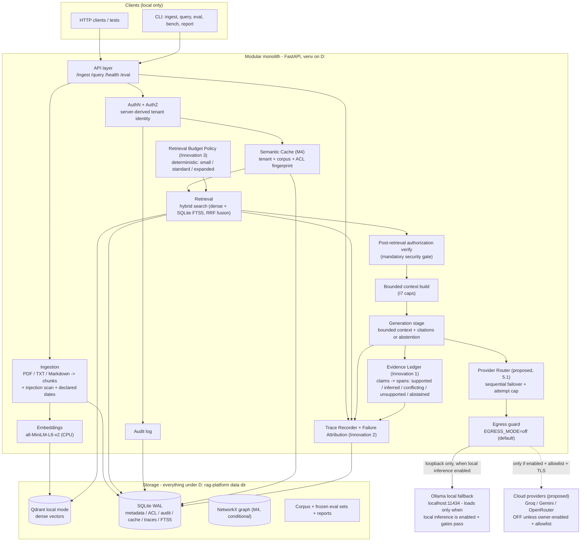
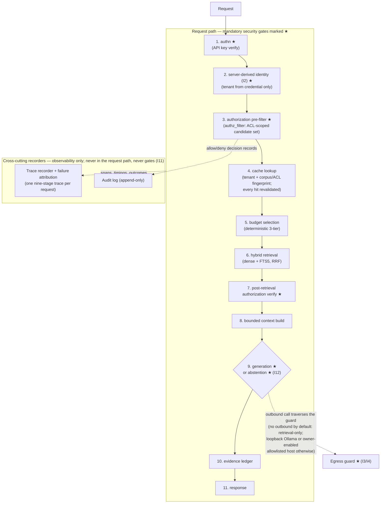

# RAG Platform — Master Plan v2 (Local-First RAG Engine with Provider-Routed Generation, Evaluation & Diagnostic Core)

**Project root:** `D:\rag-platform`
**Document:** `RAG_Platform_Master_Plan_v2.4.md` — version 2.4, 2026-10-19
**Supersedes:** `RAG_Platform_Master_Plan_v2.3.md` (v2.3 — preserved untouched; v2.4 revises the generation architecture from local-Ollama-first to **cloud-first generation with Ollama as a guarded local fallback**, while local retrieval, evidence integrity, security, and resource safety remain unchanged and binding — see `RAG_Platform_Plan_Change_Note_v2.4.md`). History: v2.3 was the final pre-implementation close-out (`RAG_Platform_Plan_Change_Note_v2.3.md`); v2.2 resolved the BG-1 sequencing and authorization/cache-ordering contradictions (`RAG_Platform_Plan_Change_Note_v2.2.md`); v2.1 applied the final storage decision (`RAG_Platform_Plan_Change_Note_v2.1.md`); v2.0 superseded v1.0 (`RAG_Platform_Plan_Diff.md`).
**Baseline check:** v2.3 and its change note are the current canonical baseline — no newer master plan exists in the repository.
**Companion documents:** `RAG_Platform_Strategy_Review.md` (build-vs-reuse evidence), `RAG_Platform_Plan_Diff.md` (v1→v2 change record), `docs\RESOURCE_BUDGET.md` (binding resource-safety policy, §5).
**Status:** Planning document revised **during** implementation, documentation-only. Phase 0 completed 2026-10-19 (commit `282cd11`, approved under D1). Phase 0.5 (BG-1a), Phase 1, and all later phases remain gated on explicit owner approval. **This v2.4 revision changed no code, scripts, tests, benchmarks, models, dependencies, credentials, or runtime configuration, and made no external calls.** Section 0 classifies exactly what exists, what was approved, what is proposed, and what still awaits approval.

**Storage policy (final decision, 2026-10-18 — non-negotiable):** D: is the project workspace and the destination for **all** project-generated data (code, docs, reports, venvs, project interpreters, dependency caches, HF/embedding caches, Qdrant/SQLite databases + WAL, temp files, logs, traces, eval datasets, Git metadata/worktrees, build outputs, fixtures). C: is **not** a project storage destination and **its free space is not a project readiness gate**. Existing C: installations (e.g., Ollama and its models) may be read/executed but are never relocated, and reading a system tool never licenses project writes to C:. Setup/storage checks are destination-aware (D:-side sufficiency), not C:-threshold-based.

**Priority order (never violated):** 1) correctness & security → 2) low resource usage → 3) reproducibility → 4) performance.

---

## 0. What This Revision Changes (v2.4 classification)

Four classes, kept strictly separate:

**1. Existing and implemented as of 2026-10-19 (unchanged by v2.4):** Phase 0 repository scaffold — git repository (commit `282cd11`), `.gitignore`, uv scaffold with pinned dependencies, `.env.example` (`EGRESS_MODE=off`), D:-pinned `scripts\env.ps1`, license + pip-audit baseline; BG-1a scripts (`scripts\bench_model.ps1`, `scripts\bench_model.py`) created and **under owner review, not yet approved to run**; resource-safety policy recorded in `docs\RESOURCE_BUDGET.md` §5 (3 GB available-RAM start gate, 2 GB emergency floor, binding hard caps, retrieval-only default). **No provider-router code, no provider configuration, no cloud credentials, and no cloud client exist. §5.1–§5.4 are specifications for future approved work, not descriptions of current behaviour.**

**2. Previously approved and preserved (no criterion, threshold, or gate relaxed by v2.4):** the storage policy; milestones M1–M4 and every acceptance gate; the phase 0–8 structure; evaluation methodology §9.1–§9.5; the BG-1a/BG-1b protocol and stop conditions; invariants I1–I13 (revised only where the change note lists, never weakened); decisions D1–D12 with their recorded outcomes (`docs\RESOURCE_BUDGET.md` §1); the retrieval-only default (generation disabled by default until a `usable-*` verdict plus explicit owner approval).

**3. Proposed by v2.4 (documentation only; nothing active):** the cloud-first provider order and provider-router requirements (§5.1); cloud privacy/egress rules (§5.2); the guarded-local-fallback framing (§5.3); formalized retrieval-only behaviour (§5.4); new constraints Z13–Z14; new invariants I14–I16; the gated provider evaluation plan §9.6; additive Phases 9–11 (§15); risks R23–R29; the reframed Appendix A.

**4. Awaiting explicit owner approval (writing a proposal down is not approval):** D13 (architecture direction), D14 (provider order), D15 (provider verification — network + terms), D16 (router implementation), D17 (provider-enabled evaluation), D18 (outbound budget numbers). Separately and already gated: Phase 0.5 (BG-1a) execution, Phase 1 start, any egress enablement, any credential creation, and any contact with an external provider.

---

## 1. Vision and Target Users

**Vision.** A small, local-first retrieval-augmented generation **engine** — not another all-in-one chat platform — whose defining properties are **verifiable evidence** (every claim traceable to authorized source spans, with honest abstention), **inspectable failures** (every weak answer attributable to the pipeline stage that broke), and **honest measurement** (a frozen, reproducible, offline evaluation harness that runs on the hardware we actually own, with results reported as measured facts or explicit `not-measured`). Retrieval, authorization, evidence assembly, and storage are always local; **generation** is provider-routed — cloud free-tier providers in a configurable order when the owner enables them, a guarded local Ollama fallback when enabled and resource-safe, and retrieval-only when no provider is enabled or all providers fail (§5.1, §5.4).

**Target users (in priority order):**
1. **This machine's owner** — a student who wants a private, zero-cost document Q&A system over personal/study material, usable while VS Code, a browser, and coursework run alongside.
2. **A reviewer/examiner** — anyone who wants to verify that the system's security, evaluation, and resource claims are real and reproducible from a clean checkout.
3. **A future reader of the code** — someone learning how permission-aware RAG, citation grounding, and RAG failure diagnosis are actually built, in inspectable Python rather than a framework's internals.

**Why this exists (from the strategy review, full evidence in `RAG_Platform_Strategy_Review.md`).** Established platforms already provide chat-over-documents: AnythingLLM (MIT, but multi-user requires Docker), RAGFlow (Apache-2.0, Docker + 50 GB, open-source permission model stated "not yet supported"), Dify (modified license, multi-tenant operation restricted, Docker Compose stack), Open WebUI (RBAC exists but with additive permission logic and two 2026 RAG-authorization CVEs), Onyx (document-level permissions are Enterprise-subscription features; PostgreSQL + OpenSearch + Redis stack). None of them ships, in zero-cost local form: (a) a runtime claim-level evidence ledger with abstention, (b) deterministic offline per-stage failure attribution, (c) a frozen-corpus evaluation harness with honest pass/fail/skipped/blocked reporting. This project spends its entire complexity budget on exactly those three gaps on top of a deliberately thin engine substrate.

---

## 2. Non-Negotiable Constraints (carried from v1; v2.4 revisions marked inline)

| # | Rule |
|---|------|
| Z1 | **No paid APIs, subscriptions, paid hosting, paid managed databases, trial credits, or expiring promotional credits** — ever, in any component or test. Cloud generation is restricted to established free tiers; any response indicating payment required is a permanent failure, never an invitation (I15). |
| Z2 | **Core platform works with zero cloud accounts and zero API keys.** No account-based service may be required for any acceptance test. M1–M4 gates pass with providers disabled (retrieval-only / local configuration). |
| Z3 | **Generation is provider-routed: cloud-first order, guarded local fallback (revised in v2.4).** Proposed order: Groq → Google Gemini API → OpenRouter → Ollama, configurable through project-local configuration. **"Cloud-first" describes the configured failover order, not the default state:** by default no cloud provider is enabled, and Ollama loads only when local inference is explicitly enabled and every resource-safety gate passes (§10.4). With nothing enabled (the default), the system runs retrieval-only. Ollama remains at `localhost:11434`. |
| Z4 | **`EGRESS_MODE=off` by default.** No documents, queries, prompts, embeddings, or user data leave the machine unless the user explicitly enables egress. **Enabling any cloud provider requires explicit owner approval, constitutes an act of enabling egress, and is valid only with the I4 allowlist active.** |
| Z5 | **Never** enable billing, use paid models, purchase credits, or silently fall back to a paid endpoint. Fallbacks must be recorded (`served_by`, reason) and traverse only the approved provider order (§5.1), ending in the guarded local fallback or in retrieval-only. *(v2.4: the former "local-only fallbacks" wording is superseded — fallbacks may traverse the documented cloud order, never a paid endpoint.)* |
| Z6 | **No new model downloads** without demonstrated need **and** explicit approval. Benchmark what exists first. |
| Z7 | **No unnecessary infrastructure:** no Docker requirement, no Redis/Neo4j/PostgreSQL/rerankers/dashboards/agents unless a milestone's measured need justifies it (Appendix C). |
| Z8 | **Never fabricate results.** Every metric is a measured number or marked `not-measured`. Reports distinguish `passed / failed / skipped / blocked / not-measured`. |
| Z9 | **All new artifacts on D:** venv, project interpreters, caches, databases, corpora, artifacts, traces, logs, reports, Git metadata/worktrees, temp files. C: is not a project storage destination and must not grow from project activity; **C: free space is not a readiness gate** — setup checks gate on D: destination sufficiency instead. Existing C: installations may be read/executed, never relocated; project dependencies are never installed globally. Docker data is never relocated; Docker is not used without approval. |
| Z10 | Cloud providers (Groq, Gemini, OpenRouter) become the **proposed primary generation path (revised in v2.4)** but remain **opt-in, off by default, never requirements, and never in any acceptance path until separately approved (D13–D17)**. Free-tier eligibility must be verified per model before activation (Phase 10); an unconfigured, unauthenticated, unavailable, or eligibility-unestablished provider is skipped cleanly and recorded. |
| Z11 | Retrieval and ingestion must keep working when Ollama is stopped **and whenever every configured generation provider is unavailable, disabled, skipped, or disallowed (retrieval-only degraded mode)**. |
| Z12 | **Original plan file is never deleted or overwritten.** `RAG_Platform_Master_Plan.md` and all planning documents live on D:. |
| Z13 *(new in v2.4)* | **No automatic provider activation or payment.** Nothing auto-enables a provider, auto-upgrades a plan, purchases credits, or retries a permanently failed provider in an uncontrolled loop. All provider configuration is project-local and owner-reviewed; every skip and failure is recorded. |
| Z14 *(new in v2.4)* | **Resource safety outranks every feature, provider, and benchmark (binding).** `docs\RESOURCE_BUDGET.md` §5 holds: the 3 GB available-RAM start gate, the 2 GB emergency floor, the binding hard caps, and the owner's requirement that the application must not intentionally continue operating above **90 % of total system RAM**. A user-space application cannot guarantee that Windows or other processes will never push the system above 90 %; it refuses work, monitors, and aborts its own operations conservatively. Cloud generation never relaxes any local gate, and no gate is ever lowered automatically. |

---

## 3. Non-Goals (explicit)

- **Not a chat platform.** No web UI beyond a minimal status page; API + CLI only.
- **Not an agent framework.** No tool use, no autonomous loops, no orchestration engine.
- **Not OCR/scanned-PDF support.** Text-based PDF, TXT, Markdown only (assumption A7; failure is a clear error, not silent degradation).
- **Not a multi-tenant SaaS.** Tenancy exists to prove isolation invariants on one machine, not to host organizations.
- **Not a graph database showcase.** Graph retrieval is a conditional, measured experiment (§7.4), not a commitment.
- **Not a benchmark leaderboard entry.** Evaluation is for regression-gating our own changes on our own corpus, with honest limitations.
- **Not GPU-dependent.** Torch is CPU-only on this machine; GPU offload, if any, belongs to Ollama and must be proven with `ollama ps`, never assumed.
- **Not a replacement for calibrated uncertainty.** The system never presents model-generated confidence as calibrated probability (calibration would itself require measurement we cannot afford).
- **Not a cloud-hosted application (new in v2.4).** The engine, corpus, databases, and diagnostics all run locally on this machine (D:). "Cloud-first" refers only to optional outbound generation calls made through the egress guard — never to hosting the platform externally.
- **Not a general LLM gateway (new in v2.4).** The provider set is frozen to the four documented providers (§5.1, Appendix A). Any other provider, model marketplace, or gateway framework (LiteLLM-class) requires a plan revision and separate approval (Appendix C).

---

## 4. Chosen Differentiators (the three core innovations)

Three innovations selected per the strategy review (scoring table §4 there). Each states: problem → why existing approaches don't sufficiently solve it (honestly classified) → design → baseline → measurable success → failure conditions → dependencies → milestone.

### 4.1 Innovation 1 — Evidence Ledger

**Problem.** RAG answers assert claims; users cannot tell which claims the retrieved documents actually support. Citation lists show *what was in context*, not *which sentence each passage justifies*. Unsupported claims (hallucinations, over-generalizations, stale facts) pass unnoticed.

**Honest classification.** *Useful integration + engineering improvement*, not novel research. Claim-level citation evaluation exists in research (ALCE: citation recall/precision via NLI, 85.1%/77.6% agreement with humans; FActScore: atomic-fact support; ALiiCE: dependency-tree atomic claims). RAGFlow ships chunk-level traceable citations. What is not found in reviewed documentation is a **runtime, zero-cost, local ledger** that classifies each answer claim as `directly_supported / inferred / conflicting / unsupported` and **abstains** when evidence is insufficient — with a deterministic evaluation path that does not require downloading an NLI model or a hosted judge.

**Design.**
1. **Claim extraction (two tiers):**
   - *Deterministic tier (primary, always on):* split the generated answer into sentences, then into atomic claims via rule-based segmentation (clause splitting on discourse markers, numeral/entity isolation). No model call. Produces `claims[]` with character offsets into the answer.
   - *Advisory tier (optional, off by default):* local Ollama model decomposes claims at `temperature=0`. Labeled **non-deterministic** in every report; used only to compare against the deterministic tier, never as a gate. *(v2.4 clarification: advisory tiers stay local-only — claim decomposition and judging are never sent to a cloud provider.)*
2. **Claim-to-evidence mapping.** Each claim is matched against the authorized context spans that were actually sent to the generator (recorded in the trace, §4.2):
   - `directly_supported`: deterministic containment — normalized claim text (numbers, dates, entities, units preserved) appears as a substring of a cited span, or ≥1 token-set Jaccard over content-word stems exceeds a frozen threshold. Deterministic and reproducible.
   - `inferred`: claim not contained verbatim but all its named entities and numerals appear in the cited span(s), with overlap above a frozen lower threshold. Deterministic heuristic — **explicitly not entailment**; documented as a proxy.
   - `conflicting`: claim's entities match a span but a key value (number/date/negation marker) differs — surfaces contradiction Candidate D's deterministic subset (§4.4).
   - `unsupported`: none of the above. The claim is flagged.
   - `not_classified`: claim contains no retrievable anchors (opinion, transition text). Never counted as supported or unsupported in metrics; reported separately.
3. **Abstention.** If the top retrieval score is below a frozen floor, or zero context spans exist, generation is **skipped** and the API returns an explicit abstention object with the reason (`no_evidence / low_score / unauthorized_only`). Abstention is a first-class response, not an error.
4. **Emission.** Every generated answer carries a `ledger` field: claims with class, cited span IDs (chunk IDs + char ranges), and the method that produced each classification (`containment | overlap | abstained`).
5. **What this tier deliberately does NOT claim.** `directly_supported` means *textually present*, not *semantically true*; `inferred` is an overlap heuristic, not logical entailment. Both limitations are printed in `docs/EVALUATION.md` and in every eval report header. No confidence probabilities are ever emitted.

**Baseline.** v1-style RAG: answer + list of retrieved chunks (citations exist, no claim mapping).

**Measurable success criteria (frozen corpus, §8).**
- Citation validity: 100% of emitted span IDs resolve to real, authorized chunks (deterministic test).
- Unsupported-claim recall on the **planted-unsupported set**: the ledger flags ≥X% of claims deliberately authored into the corpus as unanswerable-by-design (X set after M1 baseline measurement; target ≥80%, provisional).
- False-flag rate on directly-quotable claims ≤Y% (provisional ≤10%, set after baseline).
- Abstention correctness: ≥Z% of unanswerable questions produce abstention, not generation (provisional ≥90%).
- Ledger overhead: ≤10% of answer latency (deterministic tier only).

**Failure conditions (simplify or remove).** If deterministic claim segmentation mis-splits >30% of answers on the frozen set (measured against the advisory tier's manual-inspection sample), simplify to sentence-level claims. If unsupported-claim recall stays <50% after one threshold-tuning cycle, the ledger degrades to "citations + abstention only" and the project reports that honestly rather than shipping a weak classifier.

**Dependencies / milestone.** M1 trace substrate (context-span recording), M2 authorization (ledger spans must be post-verification spans), M3 implementation.

### 4.2 Innovation 2 — RAG Failure Observatory

**Problem.** When a RAG answer is weak, nobody can say *why*: did retrieval miss the evidence? rank it out of the context window? did evidence conflict? did the model ignore it? did citations lie? did Ollama time out? Existing tools score answers (Ragas/TruLens judges) or trace network spans (OTEL) — both judge-dependent or framework-embedded. A local engine should be able to explain failures **deterministically, offline, with structured traces**.

**Honest classification.** *Useful engineering improvement.* Observability exists in commercial/OTEL form; deterministic per-stage attribution with frozen failure fixtures inside a lightweight local engine was not found in reviewed documentation. Not a research claim.

**Design.**
1. **Structured JSON traces.** Every `/query` writes one trace record (SQLite table + optional JSONL export): request ID, timestamp, tenant (ID only), stages with inputs/outputs digests, timings, scores (top-k retrieval scores), `served_by`, degradation reason, cache status, and the *authorization decision set* (allowed/denied doc IDs — IDs only). *(v2.4: generation traces additionally record provider, model, attempt count, outcome, and sanitized failure category — never API keys, authorization headers, or full prompts; see §5.1.)*
2. **Stage-instrumented pipeline.** Stages: `authn → authz_filter → cache_lookup → retrieval → post_verify → context_build → generation → ledger → response`. Each stage emits start/end, outcome enum, and bounded diagnostic fields. The eleven-step request flow (§5) maps onto these nine stages: server-derived identity (I2) is recorded within `authn`, and budget selection (§4.3) within `retrieval`; trace recording and failure attribution are cross-cutting recorders, not stages. **Mandatory security gates:** `authn`, `authz_filter`, `post_verify`, pre-generation abstention (I12), egress guard (I3/I4); **advisory diagnostics (never gates, I11):** injection-quarantine flags, budget decisions, ledger `inferred` classes, attribution rules.
3. **Deterministic failure attribution rules.** A rule engine over the trace assigns exactly one primary failure class (first match wins, all matches logged):
   - `RETRIEVAL_MISS` — gold chunk (eval mode) or any chunk above score floor absent from top-k.
   - `RANKING_FAILURE` — gold chunk retrieved at rank > context cutoff.
   - `INSUFFICIENT_EVIDENCE` — all authorized chunks below score floor (may legitimately end in abstention; classified as handled vs unhandled).
   - `CONTRADICTORY_EVIDENCE` — ≥2 authorized spans disagree on a key value for the query's entities (shares detector with §4.1 conflict class).
   - `GENERATION_FAILURE` — model returned empty/off-format/timeout, or emitted claims the ledger marks unsupported above threshold.
   - `CITATION_FAILURE` — answer cites spans outside the authorized context set (security-relevant; also raises an audit event).
   - `MODEL_UNAVAILABLE` / `DEGRADED_RETRIEVAL_ONLY` — Ollama unreachable **or every configured generation provider unavailable/skipped**; pipeline fell back per Z11. *(revised in v2.4)*
   - `PROVIDER_FAILSTOP` *(new in v2.4)* — a provider returned a permanent error (invalid credentials / unsupported model / payment required) and was skipped without retry per §5.1; the sanitized category is recorded and the chain continued deterministically.
   - `CACHE_STALE_RISK` — cache hit whose corpus/ACL fingerprint does not match current state (should be impossible post-§4.3; if observed, it is a bug finding, not a silent serve).
4. **Reproducible failure fixtures.** The frozen corpus (§8) contains authored failure cases with known expected classes (planted ranking traps: near-duplicate distractors; planted contradictions; unanswerable questions; injection documents). The observatory's attribution is scored against these expected classes.
5. **Command-line reports.** `cli.py report failures --run <id>` prints per-class counts, worst queries with their traces, and a before/after comparison when two run IDs are given. JSON traces are the source of truth; the CLI is a renderer.
6. **Privacy bounds.** Traces store chunk IDs, character ranges, score distributions, and ≤200-char excerpts **only for spans the requesting tenant was authorized to see**; denied-document content is never excerpted; secrets never appear (invariant I6, I10). Trace retention is bounded and tenant-scoped.

**Baseline.** v1 logging (structured logs, no per-stage attribution, no fixtures).

**Measurable success criteria.**
- Attribution accuracy on the planted-fixture set: ≥W% exact primary-class match (provisional ≥85%, set after M1 baseline); all misattributions published in the eval report with their traces.
- Trace completeness: 100% of `/query` calls produce a trace with all nine stages (deterministic test).
- Redaction compliance: automated scan asserts no secret patterns and no denied-content excerpts in any trace (deterministic test).
- CLI before/after comparison reproduces two frozen runs byte-identically given the same inputs (determinism test).

**Failure conditions.** If attribution accuracy <60% after rule revision on one iteration, the observatory ships as **trace-recording only** (no auto-attribution), with honest reporting. Traces never justify relaxing any authorization check.

**Dependencies / milestone.** M1 instrumentation hooks + run recorder; fixtures in M1 corpus; full attribution in M3 (alongside ledger, sharing claim/contradiction detectors).

### 4.3 Innovation 3 — Adaptive Retrieval Budget (bounded, deterministic policy)

**Problem.** Fixed `top_k=8` wastes latency and context on easy lookup questions and starves multi-entity questions. On a 16 GB laptop, every unnecessary chunk costs embedding compute, prompt tokens, and generation time. Adaptation must exist **under hard resource caps** and must be removable if it doesn't measurably help.

**Honest classification.** *Engineering improvement.* Adaptive retrieval is an established research direction (Self-RAG, CRAG, Adaptive-RAG — LLM-in-the-loop variants). Those loop-based methods cost multiple LLM calls per query — unaffordable here. A **deterministic, zero-extra-LLM-call, budget-bounded policy** measured against fixed-k on our own corpus is the defensible local variant.

**Design.**
1. **Deterministic difficulty probe (no LLM call).** Query features only: token count, number of distinct named entities (regex-based), presence of comparison/multi-hop markers ("both", "compare", "difference", "relationship", quoted literals), and first-pass retrieval score statistics (top-1 score, score margin between rank-1 and rank-k).
2. **Bounded policy.** One of three budgets, chosen before generation:
   - `small`: k=4, context ≤2 chunks — high top-1 score + single entity + short query.
   - `standard`: k=8, context ≤6 chunks — default (v1 behavior).
   - `expanded`: k=14, context ≤8 chunks — multi-entity/comparison markers, or flat score margin. Caps at the hard maxima (§7.2 of v1 preserved in §10.2).
3. **At most two retrieval calls per query** (first pass, optional single re-rank pass over the same result pool — no second embedding model, no cross-encoder). Generation remains a single call. **No query-reformulation LLM calls** in v2 (documented as deferred; would break the latency/RAM budget).
4. **Router honesty — two distinct routers (revised in v2.4).** The *retrieval-budget router* (this innovation) routes retrieval budgets and cache use; the *generation provider router* (§5.1) selects generation providers. Both report `served_by` truthfully — `provider:model` for generation answers, `cache:<key-digest>` for cache hits, budget tier recorded in the trace. `/health` lists only what is actually configured and installed (v1 invariant preserved; tested by M4 gate 5).
5. **Disability switch.** `ADAPTIVE_RETRIEVAL=off` returns exactly v1 fixed-k=8 behavior; the eval harness runs both configurations and reports the delta.

**Baseline.** Fixed k=8, context ≤6 chunks (v1 default).

**Measurable success criteria (frozen corpus, both configs).**
- Quality non-inferiority: adaptive Recall@k/nDCG@10/token-F1 within a frozen margin (provisional ≤2% absolute drop) of fixed-k — measured, not assumed.
- Efficiency gain: median retrieved-chunk count and median generation latency strictly lower than fixed-k, with the per-class breakdown (easy queries should shrink; expanded queries should grow).
- Cap compliance: no query exceeds two retrieval calls / hard caps (deterministic test).
- If quality drops beyond margin: adaptation is **disabled by default** and the finding is reported (§4.3 failure condition).

**Failure conditions.** No measurable latency/context saving after one tuning cycle → remove the feature, keep fixed-k (reported honestly). Score-margin features proving noisy → freeze at three-tier coarse policy or drop to two tiers.

**Dependencies / milestone.** M1 retrieval metrics + traces; M3 policy implementation and A/B eval (M4 if M3 capacity is consumed by ledger/observatory; see §7 schedule).

### 4.4 Deterministic contradiction/freshness subset (absorbed from Candidate D)

Full contradiction/temporal engines are **rejected** (complexity, NLI dependence). Absorbed deterministic subset:
- **Document metadata timestamps** (author-declared `date:` field, file mtime recorded at ingest as `ingested_at`) stored per chunk; "newer source disagrees with older source" is *surfaced*, never auto-resolved.
- **Conflict detector:** same normalized entity set + differing numeral/date/negation in retrieved spans → `conflicting` flag in ledger + `CONTRADICTORY_EVIDENCE` class in observatory. Pure string/regex logic; frozen fixtures plant known conflicts.
- No temporal database, no graph requirement, no semantic NLI. Known dates vs inferred freshness are labeled distinctly in output (`declared_date` vs `ingested_at`).

### 4.5 Rejected candidates (record for traceability)
- **E — Permission-safe memory:** rejected. Derived conversational memory's revocation/invalidation complexity outweighs its value; the M4 semantic cache plus ordinary retrieval cover the demonstrated need. Revisit only with a new threat model and measured user value.
- **Full semantic contradiction engine (NLI-based):** rejected — requires model download (violates Z6) or hosted judge (violates Z2).
- **Counterfactual probes (from review candidate G):** deferred, not rejected — valuable but costs 2× generation per probed query; recorded in §13 as a post-v2 experiment.

## 5. Architecture

Modular monolith, one Python process, one API, one CLI — same substrate as v1, extended with an evaluation/diagnostic spine. No microservices, no containers, no servers beyond the already-installed local Ollama server. When (and only when) the owner enables a cloud provider, generation calls leave through the egress guard over HTTPS to exact allowlisted hosts (I4); the engine itself remains one local process with all state on D:.

**Component overview** — wiring of the modular monolith (who talks to whom). Security-sensitive *ordering* is normative in the request-flow diagram below and in §4.2; where this overview is ambiguous, those define the truth. The **Provider Router** node is a v2.4 *proposed* component (§5.1) — it does not exist in code yet.



*Default-state note (v2.4): in the default configuration neither Egress-guard edge carries traffic — no provider is enabled, so the generation stage returns retrieval-only. The `OLL` edge is active only when local inference is explicitly enabled and the §10.4 gates pass; the `CLOUD` edge only when the owner has enabled cloud inference under I4.*

**Pipeline (M3 end-state; canonical ordering — this list is normative and matches §4.2 exactly):** authenticate → derive tenant from credential (I2) → **authorization pre-filter** → cache lookup (tenant + corpus/ACL-fingerprint-scoped; every hit revalidated against current ACLs as defense-in-depth) → deterministic budget selection → hybrid retrieval (dense + BM25 via SQLite FTS5, reciprocal-rank fusion) → independent post-retrieval authorization verify → bounded context build → **provider-routed generation with citations or pre-generation abstention (I12) — or a retrieval-only response with the recorded reason when no provider is enabled or every provider fails (§5.1, §5.4)** → evidence ledger → response. **Trace recording and failure attribution are cross-cutting recorders** — one nine-stage trace per request (stages: `authn, authz_filter, cache_lookup, retrieval, post_verify, context_build, generation, ledger, response`; the eleven flow steps map onto these nine stages: server-derived identity (I2) is recorded within `authn`, and budget selection (§4.3) within `retrieval`); the recorder is not itself a pipeline stage. **Cache lookup never precedes the authorization pre-filter** (I1): a cache hit can never bypass current authorization or cross tenants — pre-filter scoping plus revalidation-on-hit (M4 gate 1) are both required. **Mandatory security gates:** authentication, server-derived identity (I2), authorization pre-filter, independent post-retrieval verify, pre-generation abstention (I12), egress guard (I3/I4). **Advisory diagnostics (never gates, I11):** injection-quarantine flags, adaptive-budget decisions, ledger `inferred` classifications, failure-attribution rules, and all model-based advisory tiers. Any stage may degrade to retrieval-only; every degradation is explicit and logged.

**Request flow (normative visual — renders the pipeline above exactly; the component overview shows wiring only):**



The gates marked ★ cannot be bypassed, reordered, delayed, or overridden by cache hits, budget decisions, advisory diagnostics, client flags, or the recorders (I11, I12). Trace recording and audit logging observe the flow; they never sit inside it. Budget selection (step 5) always precedes the retrieval it controls (step 6); retrieval reaches generation only through post-verification (step 7) and bounded context build (step 8).

**Design principles:**
1. **Evaluation spine, not bolt-on.** Traces (§4.2) are emitted from M1, so the eval harness and observatory consume the same records the engine produces — no parallel telemetry path to drift.
2. **Two-phase authorization** (pre-filter + independent post-verify) unchanged from v1 invariant I1; the ledger consumes only post-verified spans, making unsupported-claim detection *authorization-safe by construction*.
3. **Deterministic where it matters, advisory where it must.** Every classifier has a deterministic tier that gates behavior and an optional advisory tier (local model, temperature=0, labeled non-deterministic) that never gates anything.
4. **Every component has a kill switch** (§4.3 `ADAPTIVE_RETRIEVAL=off`, cache bypass flag, ledger minimum mode) so any innovation can be reduced to v1 behavior without code surgery.
5. **Fail honestly to retrieval-only (new in v2.4).** Every generation failure path — provider skipped, provider failed, budget exhausted, resource gate tripped — ends in an explicit retrieval-only response with a recorded reason. There is no path that fabricates an answer, retries without bound, or silently substitutes a different provider than the recorded one.

### 5.1 Generation provider router (proposed in v2.4 — NOT implemented)

> This subsection specifies requirements for a **future approved implementation**. No router code, provider configuration, or credential exists today; nothing here has been executed.

**What "cloud-first" means and does not mean.** It means the *configured failover order* prefers eligible cloud free-tier providers before local inference (D14, proposed). It does **not** mean cloud is enabled by default, that egress is on, that any provider is configured or authenticated, or that any provider is claimed to be free/available/permanently unchanged. The default state remains: no provider enabled → retrieval-only (Z3, Z4, Z10).

**Proposed provider order (D14, pending approval):** 1) **Groq** — primary candidate; 2) **Google Gemini API** — secondary candidate; 3) **OpenRouter** — optional additional fallback, only for models whose free-tier eligibility is established and documented; 4) **Ollama** — guarded local fallback (§5.3), only when local inference is explicitly enabled and resource-safe. Ordering is project-local configuration. These are proposed defaults, **not** claims that any provider is currently configured, authenticated, available, or permanently free. No other provider may be added without a plan revision (Appendix C). No model IDs, quota figures, pricing, or availability commitments are asserted — exact free-tier models are decided at provider verification (D15, Phase 10).

**Interface requirements:**
- A **provider-neutral typed interface** for generation requests and responses (request: bounded prompt context built from post-verified spans, token/char caps per I7, deadline; response: provider, model, text, latency, attempt list, outcome). Providers implement the interface; the pipeline never speaks a provider SDK dialect. Implementation uses the existing `httpx` dependency — **no new dependency, no provider SDK** (§6).
- **Explicit provider and model selection** in configuration; a request never guesses a model; unconfigured providers are absent from the attempt order.
- **Sequential failover by default.** One generation request in flight (generation concurrency stays 1); providers are attempted strictly in configured order, **never raced in parallel, never sent duplicate concurrent generation requests**.
- **Bounded timeouts and bounded retries.** Every attempt honors the §10.1 timeout caps (15 s / 60 s); transient errors may be retried at most twice within an attempt budget; permanent errors are **never** retried.
- **Request budget and provider-attempt cap.** Per query: each provider is visited at most once; total attempts are capped (proposed cap: number of enabled providers, hard maximum 4 — confirm in D18); an overall generation deadline bounds the whole chain. Exhausting the cap ends in retrieval-only with the sanitized failure category recorded. No uncontrolled retry loops.
- **Deterministic error taxonomy.** *Transient* (rate limit / 5xx / timeout / connection error / malformed response) → bounded retry or next provider. *Permanent* (invalid credentials / unsupported model / payment required) → skip provider without retry, record category, continue the order. *Skipped* (not configured / key absent / free-tier eligibility unestablished / disallowed by privacy settings) → clean skip, recorded. A response that indicates **payment required** permanently disables that provider for the run and is never acted upon by upgrading anything (Z1, Z13, I15).
- **Loop and duplicate-answer prevention.** Each provider is visited at most once per request; failover happens **before** any partial answer becomes user-visible; exactly one response object is returned — duplicate user-visible answers are structurally impossible.
- **Observability.** Record selected provider, model, latency, attempt count, outcome, and sanitized failure category (enum) in the trace (§4.2). **Never log API keys, authorization headers, or full sensitive prompts by default** (I6, I15); prompt content in traces stays within the ≤200-char excerpt bound and authorization scope (I10).
- **Honest final result.** When no provider produced an answer, the response explicitly identifies generation as unavailable with the recorded reason (§5.4). The system never presents retrieval-only output as if a model answered.

### 5.2 Privacy and network egress requirements for cloud inference (proposed in v2.4)

Cloud inference necessarily sends selected request content to an external service. Binding rules for any future enablement:

- **Egress stays disabled by default** until the owner explicitly enables cloud inference (Z4). Enabling a provider = explicit owner approval + configuration + I4 allowlist (exact host, TLS, redirect rejection) + verified free-tier eligibility.
- **Minimum necessary content only.** Only the retrieved evidence actually needed for the answer, plus bounded prompt context (I7 caps: context chunks ≤8, prompt chars ≤8000), may be transmitted. **Never the entire document collection** — no bulk "send the corpus" path exists or may be added.
- **Authorization before assembly (I1/I16).** Cloud prompts are assembled strictly after the authorization pre-filter and independent post-verification; denied spans, other tenants' content, credentials, unrelated user data, internal logs, and local file paths are never included (paths are sanitized out of prompts and traces).
- **Document-level external-processing restrictions.** A future per-document "no external processing" flag must be honored by prompt assembly (documented requirement; implementation pending approval). Provider selection respects privacy settings; a restricted document simply never leaves the machine.
- **Retrieval-only / local-only mode is documented and default** (§5.4). The application remains fully useful with egress off.
- **Provider terms are checked, not assumed.** Data-retention, training-use, and privacy terms of each provider must be verified before production use (D15, Phase 10) and recorded with dated evidence in `docs\PROVIDERS.md` (future). **No unsupported privacy guarantee is made** — sending evidence to a third party is a privacy trade-off, not a free upgrade; known caveats (e.g., Gemini's training-data-use caveat preserved in v1 Appendix A) must be re-verified at enablement.
- **No external calls are made by this planning revision** (confirmed in the v2.4 change note).

### 5.3 Ollama as a guarded local fallback (revised in v2.4: no longer the default path)

- Ollama is retained as an **optional** fallback, enabled only when local inference is explicitly enabled and **all** resource-safety gates pass (§10.4: 3 GB start gate before any load, 2 GB emergency floor, swap safeguards, runtime caps, 90 % total-RAM ceiling requirement).
- **Never automatically download a model** (Z6). **Never automatically load a model** — loading requires the explicit enablement plus gate pass; unload behaviour (`keep_alive`) stays bounded.
- Model calls remain sequential; generation concurrency = 1; all §10.1 hard caps apply unchanged.
- If Ollama is disabled, unavailable, or unsafe at any point → skip it and return retrieval-only results (Z11, §5.4). Local fallback must never undermine system responsiveness; a safety stop is recorded as `blocked`, never as a pass (§9.1).
- BG-1a (§10.3) remains the measurement source for whether the local fallback is viable at all (`usable-*` vs `too-*` verdict feeding D3); its protocol, stop conditions, and approvals are unchanged.
- **No benchmark is run and no model is loaded to validate this planning change.** The 90 % ceiling is not permission to consume 90 % RAM — existing stricter safeguards remain binding (Z14).

### 5.4 Retrieval-only behaviour (formalized in v2.4; already required by Z11)

Retrieval-only operation is a **first-class supported mode, not an error condition**. When all generation providers fail, are disabled, skipped, or are disallowed:

- Return the relevant retrieved passages with their source identifiers (chunk IDs + char ranges), preserving applicable access controls, citation, and evidence metadata.
- State clearly, in the response, that generation was unavailable and that no generated answer was produced, with the recorded reason category.
- **Never fabricate a natural-language answer and present it as model output**; never fabricate citations.
- Do not lose, weaken, or bypass the Evidence Ledger's evidence labels or abstention rules — an abstention object with its reason is the correct ledger output for a no-generation response.
- Record the degradation in the trace (`DEGRADED_RETRIEVAL_ONLY` or `PROVIDER_FAILSTOP`, §4.2) under §9.1 status semantics; degraded-mode behaviour is proven by BG-1b (§10.3) and M1 gate 2.

## 6. Technology Choices and Dependency Rationale

All v1 choices are preserved unless marked. Full alternatives analysis in `RAG_Platform_Strategy_Review.md` §2 and v1 §5.

| Concern | Choice | Change from v1 | Rationale |
|---|---|---|---|
| Language / venv | Python 3.14 (fallback: uv-managed 3.12/3.13 **on D:**), uv | none | Verified present; R7 contingency unchanged |
| Web / CLI | FastAPI + pydantic-settings; argparse CLI (+ `report`, `eval`, `bench` subcommands) | extended CLI | v1 decision holds |
| Pipeline | Hand-rolled thin modules | none | Strategy review confirmed: no LangChain/LlamaIndex-class framework (auditability, RAM, no hidden remote calls) |
| Embeddings | sentence-transformers `all-MiniLM-L6-v2` (CPU, cached copy on D:) | none | Existing cache reused (Z6) |
| Dense store | Qdrant client **local mode** (embedded, path on D:) | none | Verified persistent + full filter API (v1 §2.1) |
| **Keyword store** | **SQLite FTS5 (BM25) + RRF fusion with dense results** | **added** | Zero new services (FTS5 ships with stdlib sqlite3 — verify at Phase 0, fallback dense-only); research evidence: BM25 wins at small corpus scale (arXiv 2607.26497); established, not novel (honest classification in review §4, candidate I) |
| Metadata/ACL/cache/traces | SQLite (WAL) via stdlib `sqlite3`, versioned SQL migrations | traces + FTS5 tables added | Single source of truth; no ORM |
| **Generation providers** | **Provider-neutral typed interface over existing `httpx` (no provider SDKs); proposed order Groq → Gemini → OpenRouter → Ollama guarded local fallback (§5.1)** | **revised in v2.4** (was: Ollama only) | Cloud-first architecture proposal (D13/D14 pending) with retrieval-only default; **no new dependency** (httpx + pydantic already in the stack); provider SDKs and gateway frameworks explicitly rejected (§3, Appendix C); Z2/Z10 keep all gates provider-free |
| Local fallback model | Benchmark existing `qwen3:8b` first; installed alternatives (`qwen2.5-coder:7b`) evaluated if too heavy; **no downloads without separate approval (D3)** | relabeled (guards the fallback path since v2.4) | Z6; §5.3; BG-1a verdict feeds D3 unchanged |
| Claim decomposition | **Rule-based deterministic splitter (stdlib only)**; advisory tier = same local Ollama model at temperature=0, **local-only, never cloud** | new | Avoids downloading NLI/spaCy models; ALiiCE-style atomic claims approximated by clause rules — limitations documented, not hidden |
| Graph (M4, conditional) | NetworkX, **LLM-free construction** (regex/heuristic entity extraction + co-occurrence; LinearRAG-style) | demoted to conditional experiment | Paper evidence: LLM-based graph construction costs 177K–655K tokens (§2.3 of review) — infeasible locally; LLM-free construction is the only defensible variant here |
| Cache (M4) | SQLite + embedding similarity, keyed by tenant + corpus fingerprint + ACL fingerprint | fingerprint keys added | v1 decision evolved for I1/I2 safety |
| Judge (eval, optional) | Local Ollama at temperature=0, advisory only, **local-only** | none | Never a gate; Ragas/TruLens **not adopted** (judge-centric, extra dependency surface — review §2.2) |
| HTTP client | httpx | none | v1 decision; also carries all provider calls |
| PDF parsing | pypdf | none | v1 decision; license verified at install |
| Tests | pytest + pytest-cov; psutil for perf | + fixture-based observatory scoring; + mock-provider suite (Phase 9, proposed) | v1 decision |
| **Explicitly not added** | Docker, Redis, Neo4j, PostgreSQL, rerankers, dashboards, OCR, agent frameworks, NLI models, Ragas/TruLens/DeepEval packages, **provider SDKs, LLM gateway frameworks (LiteLLM-class)** | — | Z7, Z6; escalation only via Appendix C |

**Dependency list (setup-time only, pinned via `uv.lock`):** fastapi, uvicorn, pydantic, pydantic-settings, httpx, sentence-transformers, qdrant-client, pypdf, psutil, pytest, pytest-cov, networkx (M4 only — may be deferred from initial install). Dev-only: pip-audit. Every install runs a license review (Z1, Z9). **The proposed provider router (§5.1) adds no dependency.**

## 7. Revised Milestones and Dependencies

v1's four milestones are re-scoped: evaluation moves **into M1** (first-class, per reassessment §6); the two differentiators get their **own milestone** (M3) instead of being diluted; GraphRAG becomes a **conditional experiment inside M4** rather than a milestone commitment. Full rationale in `RAG_Platform_Plan_Diff.md`. *(v2.4: the milestone structure and gates are unchanged; cloud-provider work lands in additive, separately gated Phases 9–11 after M1 — §15 — and no gate ever requires a provider.)*

```mermaid
gantt
    title Milestone dependency order (not a schedule)
    dateFormat X
    axisFormat %s
    section Foundations
    M1 Engine + Eval Foundation : done, 1, 4
    section Security
    M2 Permission-Aware Multi-Tenancy : done, 2, 4
    section Differentiators
    M3 Evidence Ledger + Failure Observatory : done, 3, 3
    section Efficiency + Experiment
    M4 Adaptive Budget + Cache (+ conditional graph) : done, 4, 3
```



### 7.1 M1 — Baseline RAG Engine + Evaluation Foundation
**Scope:** ingestion (PDF/TXT/Markdown) with injection-pattern scan and declared-date capture; sentence-aware bounded chunking; MiniLM embeddings (CPU, copied cache on D:); Qdrant local mode (persisted on D:, filtering test-verified); **SQLite FTS5 keyword index + RRF fusion**; top-k retrieval with score floor; **provider-neutral generation stage (local Ollama adapter only at M1) with source citations and abstention path — retrieval-only is the default configuration**; FastAPI endpoints + argparse CLI; **frozen synthetic corpus + eval harness + trace recorder (stage timings, scores, served_by)**; **BG-1a** model-only benchmark (Phase 0.5, §10.3) with the **BG-1b** pipeline-unavailability proof at Phase 6 (§10.3).
**Dependencies:** Python/uv, Ollama, MiniLM cache (present); `qdrant-client`, `pypdf`, `sentence-transformers` (Phase 0 installs → D:).
**Excluded:** auth beyond a single default tenant, cache, adaptive policy, ledger, graph, **cloud providers** (multi-provider failover, provider verification, and any provider-enabled run belong to Phases 9–10, post-M1, separately gated), OCR, downloads.

**Acceptance gate (all measured; no fabricated numbers):**
1. E2E: ingest frozen corpus → `/query` returns answer with **valid citations** (every cited span ID resolves; deterministic test, 100%). *(v2.4 clarification: executed with local generation explicitly enabled under the §10.4 resource gates; a cloud provider is never required (Z2). If no generation configuration is enabled or the BG-1a verdict leaves generation disabled, this item is `blocked` with its reason per §9.1 and is resolved by D3 — never silently waived.)*
2. Ollama stopped → `/query` returns retrieved passages + `generation: unavailable` (Z11); all retrieval/lexical eval tests pass with Ollama off. With v2.4 this degraded path must equally trigger when every configured provider is unavailable or disabled (§5.4). **(BG-1b pipeline-unavailability proof, §10.3; executed at Phase 6.)**
3. Restart persistence: same corpus searchable after process restart (Qdrant dir + SQLite on D:).
4. Filtering test: payload filter returns exactly the expected set on a labeled fixture.
5. Hybrid ≥ dense-only on frozen-corpus Recall@5 (measured; if not, dense-only ships and the finding is reported — FTS5 stays as an available-but-disabled path).
6. **Eval harness runs end-to-end** producing: Recall@5/10, MRR, nDCG@10, token-F1, abstention correctness, latency p50/p95, per-stage trace timings — with dataset SHA256, lockfile hash, `served_by`, and status column (`passed/failed/skipped/blocked/not-measured`).
7. **BG-1a model benchmark report** for `qwen3:8b` (§10.3; run at Phase 0.5) with `ollama ps` evidence; model verdict recorded (`usable-cpu` / `usable-gpu(partial/full)` / `too-slow` / `too-heavy` / `blocked`-with-reason) in `docs/RESOURCE_BUDGET.md` and the dated `reports\` artifact. The BG-1b unavailability proof is verified by gate 2, not gate 7.
8. Egress suite: **zero outbound HTTP** with `EGRESS_MODE=off` across the entire test run (T-ADV-09).
9. Perf: steady-state app RAM ≤1.5 GB (provisional); generation spike leaves ≥3 GB system RAM free or budget revised with data (§10.1 rule).

### 7.2 M2 — Permission-Aware Multi-Tenancy
**Scope:** per-tenant API keys (PBKDF2-hashed, stdlib); **server-derived tenant identity**; document-level ACL; pre-retrieval filtering; **independent post-retrieval verification**; append-only audit log; injection-quarantine flags enforced at retrieval; adversarial suite (§9.3).
**Dependencies:** M1 storage/retrieval; SQLite schema extension.

**Acceptance gate:**
1. **Invariant I1 holds under test:** instrumented context assembly proves unauthorized content never enters generation context, cache response, ledger spans, or returned payload.
2. Forged-identity matrix fails closed: forged tenant header/param, tampered/expired/replayed/missing key → correct 401/403, correct audit entries, **no leakage in error bodies**.
3. Permission revocation effective on next request (no stale allow, no stale cache serve).
4. Cross-tenant retrieval: zero foreign chunks at top-k boundaries.
5. Prompt-injection corpus: injected instructions never become instructions (I8); quarantined chunks flagged and reported.
6. Audit completeness: every allow/deny produces one immutable record.
7. M1 regression suite still green.

### 7.3 M3 — Evidence Ledger + Failure Observatory (the differentiators)
**Scope:** deterministic claim segmentation; claim→span mapping (`directly_supported / inferred / conflicting / unsupported / not_classified`); abstention objects; ledger emission in API; full nine-stage trace recorder; deterministic failure-attribution rules; planted failure fixtures; CLI `report failures` with before/after comparison; advisory tiers (local model decomposition, temperature=0) **off by default**, never gating.
**Dependencies:** M1 traces + corpus fixtures; M2 post-verified spans (ledger consumes only authorized context).

**Acceptance gate:**
1. Every generated answer carries a `ledger`; every abstention carries a reason enum (deterministic test).
2. Unsupported-claim recall on planted-unsupported set ≥ provisional 80% (target re-frozen after M1 baseline); false-flag rate on directly-quotable claims ≤ provisional 10%; both published regardless of outcome.
3. Abstention correctness ≥ provisional 90% on unanswerable questions.
4. Attribution accuracy on planted failure fixtures ≥ provisional 85% exact primary-class; **all misattributions listed with traces** in the report.
5. Trace completeness 100% of `/query` calls (nine stages); redaction scan clean (no secrets, no denied-content excerpts).
6. Determinism: two runs of the same frozen inputs produce byte-identical ledger + attribution JSON (temperature=0, deterministic tier only).
7. Ledger+observatory overhead ≤25% of answer latency (provisional; measured and published).
8. M1/M2 suites green; egress suite green (ledger adds no network path).

### 7.4 M4 — Adaptive Retrieval Budget + Semantic Cache (+ conditional graph experiment)
**Scope:** deterministic three-tier retrieval budget policy with A/B eval against fixed-k; SQLite semantic cache keyed by tenant + corpus fingerprint + ACL fingerprint with revalidation-on-hit and revocation invalidation; concurrency semaphore (gen = 1) and 503 fast-fail; measured latency/RAM/hit-rate reports. **Conditional sub-experiment (D10):** LLM-free NetworkX graph (regex entity extraction + co-occurrence + bounded 2-hop expansion) evaluated on the multi-hop subset vs vector-only baseline — **only if** M1–M3 are stable and the multi-hop subset shows a measured retrieval deficit, and only with separate approval.
**Dependencies:** M1 metrics + traces; M2 identity/ACL (cache keys, graph tenancy); M3 claims (ledger informs quality delta measurement).

**Acceptance gate:**
1. Cache: authorization revalidation on every hit (revocation test); tenant isolation; invalidation on doc/ACL change; measured hit rate + p50/p95 (hit vs miss) + RAM/disk delta.
2. Cache answer-quality delta vs no-cache within frozen margin (provisional ≤2% absolute token-F1) — measured, published either way.
3. Adaptive: quality non-inferiority within frozen margin **and** strict reduction in median chunks/latency (both provisional margins re-frozen after M1 baseline); cap-compliance test (≤2 retrieval calls); **if non-inferiority fails → adaptive disabled by default, finding reported**.
4. Concurrency: N parallel `/query` → ≤1 generation in flight; excess → fast 503; laptop stays responsive (perf test).
5. **Budget-router honesty:** `/health` lists only configured providers and installed local models; Ollama down **or all configured providers unavailable** → retrieval-only with the reason recorded. *(extended in v2.4; no criterion relaxed)*
6. *(If D10 approved and attempted)* Graph: provenance-traceable edges; traversal bounds enforced under adversarial dense graph; multi-hop subset head-to-head **with honest numbers whether positive or negative**; single-hop non-regression; cross-tenant graph isolation. **A null or negative result is a fully valid outcome and will be reported as such.**
7. Full regression: M1–M3 suites green.

## 8. Security and Privacy Invariants

All v1 invariants (I1–I9) are preserved in force; I10–I13 extend them for the diagnostic components; I14–I16 are added by v2.4 for provider-routed generation. §9.3 states what each test proves and cannot prove.

| ID | Invariant |
|---|---|
| **I1** | **Authorization precedes context.** Unauthorized document content never enters generation context, cache response, ledger spans, observatory excerpts, or returned results — enforced by pre-retrieval filtering AND independent post-retrieval verification (defense in depth). *Extended in v2: ledger and trace excerpting consume only post-verified spans. **Extended in v2.4: cloud prompt assembly happens only over post-verified spans (I16).*** |
| **I2** | **Server-derived identity.** Tenant/principal come only from the credential; client-supplied identity fields are never trusted. |
| **I3** | **Zero egress by default (revised wording in v2.4).** `EGRESS_MODE=off` (default) ⇒ no request containing documents, chunks, queries, prompts, embeddings, or identifiers leaves the machine — in fact **no outbound request is made at all** beyond loopback; the local Ollama socket is contacted only when local inference is enabled. |
| **I4** | **Egress allowlist when explicitly enabled.** Opt-in requires exact-host allowlist + TLS, redirect rejection to non-allowlisted hosts, free-eligibility verification, env-only keys never logged. Paid fallback structurally impossible. *(v2.4: also enforced — provider-attempt cap and bounded timeouts (§5.1), permanent errors never retried, and no code path that upgrades a plan or purchases credits.)* |
| **I5** | **No silent substitution.** Every response records `served_by`; every fallback records its reason (429/timeout/not_configured/unavailable/degraded, plus `skipped-permanent` for provider failstop). Applies to adaptive-budget decisions and cache hits (recorded as `cache:<key-digest>`). |
| **I6** | **Secret-safe by construction.** `.env` gitignored; `.env.example` placeholders only; logs redacted; health checks report `configured: true/false`; error bodies never echo internals. *(v2.4: API keys are env-only, never logged, never traced, never echoed by /health.)* |
| **I7** | **Bounded everything.** Input length, chunk count, top-k, context, traversal, concurrency, retries, queues, cache entry size, ledger claim count, trace excerpt length — all hard-capped; unbounded growth is a bug. *(v2.4: provider attempts, per-attempt retries, and total generation deadline are hard-capped too — §5.1, §10.1.)* |
| **I8** | **Data is data.** Retrieved content (including documents containing injection attempts) is delimited and labeled untrusted; it can never issue instructions; no tool execution exists. Injection-scan flags (`quarantined`) are advisory labels surfaced to users, **never authorization decisions** — ACL alone decides access. |
| **I9** | **Integrity of state.** SQLite (WAL) + Qdrant directory are the sole local sources of truth; audit log is append-only; cache or ledger correctness never outranks I1. |
| **I10** *(new)* | **Diagnostic artifacts are authorization-scoped.** Traces and ledger records store chunk IDs, offsets, scores, and short excerpts **only for spans the requesting tenant could see at request time**; denied-document content is never excerpted into any diagnostic store; traces are queryable only through the owner tenant's context. |
| **I11** *(new)* | **Advisory tiers never gate.** Model-based classifiers (claim decomposition, local judge) run at temperature=0, are labeled non-deterministic in every artifact, and cannot change authorization, cache, or abstention behavior. If they fail or are disabled, the deterministic tier's output stands. *(v2.4: advisory tiers remain local-only and are never sent to a cloud provider.)* |
| **I12** *(new)* | **Abstention cannot be suppressed.** The abstention path (low evidence score / zero authorized spans) is decided before generation and cannot be overridden by cache, adaptive budget, or client flags. |
| **I13** *(new)* | **Ledger honesty.** The ledger never emits calibrated probabilities; `directly_supported` means textual containment (documented), `inferred` means an overlap heuristic (documented). No UI or API field may imply stronger semantics than the method actually provides. |
| **I14** *(new in v2.4)* | **Provider honesty.** Every generated answer records provider, model, attempt count, and outcome in `served_by` and the trace; no silent provider substitution, no silent model aliasing, no duplicate user-visible answers. A retrieval-only response always states that generation was unavailable — never a fabricated answer, never partial model output presented as complete. |
| **I15** *(new in v2.4)* | **Cost safety by construction.** No code path can purchase credits, enable billing, switch tiers, or upgrade a plan; a `payment required` response is a permanent provider failure, not a prompt to act. Provider attempts are capped, permanent errors are never retried, and rate limits are handled deterministically without uncontrolled loops. Credentials are env-only and never logged. |
| **I16** *(new in v2.4)* | **Prompt minimization.** Only post-verified evidence spans plus bounded prompt context (I7 caps) may ever be transmitted to a provider. Never the corpus, never credentials, never denied content, never unrelated user data, never local file paths. Authorization and document-access checks always precede cloud prompt assembly (I1); document-level external-processing restrictions are honored when implemented. |

**Threat model (documented fully in `docs/SECURITY.md` at implementation):** assets = corpus, ACLs, keys, audit log, traces, ledger, **provider credentials**; adversaries = other tenants on the instance, malicious documents (prompt injection, poisoned chunks), local malware (out of scope beyond OS defaults), network observer (loopback-only default; when a cloud provider is owner-enabled: TLS to exact allowlisted hosts, minimized prompts per I16, no secrets on the wire from our side). Cloud privacy risks (provider retention, training-use terms, provider-side logging) are documented in Appendix A/§5.2, must be re-verified before enablement (D15), and stay dormant while egress is off. **No privacy guarantee beyond our own boundaries is claimed.**

## 9. Evaluation Methodology (first-class, per reassessment §6)

### 9.1 Principles
1. **Deterministic, local, offline primary path** — no network, no hosted judge, no API keys in any gate (Z2, Z10). Provider-enabled runs (§9.6) are outside every gate, run in a separately labeled configuration, and are never a prerequisite for a gate or a substitute for a gate run.
2. **Frozen datasets** with SHA256 manifest; edits create a new dataset ID (never overwrite).
3. **Baseline-vs-new comparison for every innovation** — no feature ships without its fixed/simple baseline having been measured on the same frozen set (I3 policy vs fixed-k; ledger vs plain citations; attribution vs planted labels; cache vs no-cache; provider chain vs retrieval-only — with retrieval metrics themselves provider-independent).
4. **Honest statuses:** every metric row = `value | measured-at | model | served_by | status` where status ∈ `passed/failed/skipped/blocked/not-measured`. Fabrication forbidden (Z8).
5. **Status semantics (frozen; applies identically to every metric row, test result, benchmark verdict, gate item, and Definition-of-Done item):** `passed` = executed and met its frozen criterion; `failed` = executed and missed its frozen criterion (a defect signal); `skipped` = deliberately not executed this run, with the reason recorded (never counts as a pass); `blocked` = could not execute because a prerequisite was unavailable or a safety stop / user abort fired — the reason and missing prerequisite are recorded, it is **never** reported as `passed`, **never** auto-counted as `failed`, and it must be re-run or explicitly waived (with the waiver reason recorded) before the owning gate can be approved; `not-measured` = no data collected in this configuration, never inferred from another run or configuration. A safety stop, unavailable prerequisite, or user-requested abort is therefore always `blocked` — not a successful test and not a product defect.
6. **Known-metric limitations printed in every report header** (§9.4).

### 9.2 Datasets (locally authored, frozen; D7)
- **Corpus:** ~20–40 synthetic documents (~50–150 KB each; TXT/MD/PDF mix) across several topics, authored during implementation, containing deliberate difficulty structures:
  - near-duplicate distractor passages (ranking traps),
  - planted contradictions (same entity, conflicting values, with `declared_date` metadata — feeds §4.1 conflict class and §4.4),
  - unanswerable-by-design questions (evidence absent from corpus — feeds abstention),
  - planted unsupported-claim targets (questions whose gold answer spans *do not* contain a tempting-but-wrong figure — feeds unsupported-claim recall),
  - prompt-injection documents (feeds I8 tests),
  - multi-hop chains (two-hop entity bridges — feeds M4 subset).
- **Question sets (frozen JSONL):** `q → gold chunk IDs / gold answer span / type / expected-outcome`. Type ∈ {single-hop, multi-hop, unanswerable, conflict-aware, injection-adjacent}. Expected-outcome ∈ {answer, abstain, flag-conflict}. Sizes: ~80–120 for M1 gates; multi-hop subset (~40) added at M1 so M4 comparison is possible without regenerating data.
- If the user later supplies real documents, they form an **additional** frozen set with its own ID — never a replacement.
- **Fixture authorship is documented and the author–evaluator risk disclosed (R19):** every document and question set records author, creation date, and the difficulty structure it exercises. The same person authors corpus and gold labels; mitigations are frozen hashed splits, published item lists (reviewer-auditable), and the ban on external-comparison claims.
- **Freeze before tuning:** corpus, question sets, gold labels/answer keys, and the dev/test split are SHA256-frozen *before the first tuning run*; ground truth is never regenerated from system output.
- **Dev/test separation:** thresholds tune on `dev` only; `test` is evaluated once per candidate configuration, the harness refuses to tune on test labels, and each report records the running count of test-split evaluations (surfacing overfitting-by-repetition). The approach stays local, zero-cost, and proportionate — no external grading services, no downloaded judge models.

### 9.3 What the security tests prove and cannot prove
| Test proves | Test cannot prove |
|---|---|
| The **implemented enforcement paths** reject the enumerated forged/revoked/cross-tenant cases in the tested configurations | Absence of unknown bypasses, side channels, or logic errors outside the enumerated matrix |
| Zero outbound sockets in the egress-instrumented test process during the suite **and** the eval run (socket instrumentation makes any non-loopback `connect()` fail the test) | That a dependency's future update adds no network call (mitigated by re-running the suite each change; not a proof); traffic from other processes (OS services, Ollama's own loopback calls) or from code paths the suite never executes; **offline env flags (`HF_HUB_OFFLINE` etc., §12) suppress download attempts by design but are not themselves proof of zero traffic — the socket instrumentation is** |
| Trace/ledger redaction rules hold on the tested corpus | Semantic privacy of content the tenant was *authorized* to see (inherent) |
| Deterministic classifiers behave per specification on the frozen corpus | Behavior on out-of-distribution text (out of scope; documented) |
| *(v2.4)* That in a **provider-enabled** run only exact allowlisted hosts were contacted, prompt bodies contained only post-verified bounded content (I16), and no paid/billing endpoint is reachable by construction (I15) | Anything about provider-side retention, logging, or training use — those are contractual terms to verify at enablement (D15), not properties our tests can prove |

*Egress-gate runs (M1 gate 8, T-ADV-09) always execute with `EGRESS_MODE=off`. Provider-enabled runs (§9.6) use the I4 allowlist in a separately labeled configuration and never substitute for a gate run.*

### 9.4 Metrics and their honest limitations
| Class | Metrics | Determinism | Limitation printed in reports |
|---|---|---|---|
| Retrieval | Recall@k (5,10), MRR, nDCG@10 | Fully deterministic | Measure overlap with gold IDs — not semantic usefulness |
| Answer lexical | Token-F1 vs gold spans | Deterministic | Lexical overlap ≠ factual faithfulness; paraphrases score low |
| Grounding | Citation validity (span resolves + authorized), citation coverage (claims with ≥1 citation) | Deterministic | Coverage ≠ correctness; a cited span can be irrelevant (motivates ledger) |
| Ledger | Unsupported-claim recall/precision on planted set; abstention correctness; conflict detection recall | Deterministic (containment/regex tier) | Containment-based `directly_supported` misses paraphrase support (false "unsupported" possible); `inferred` is an overlap proxy, **not entailment** |
| Robustness | Unanswerable refusal rate + false-refusal rate | Deterministic gold | Gold authored by the same author as corpus (self-consistency risk — mitigated by frozen splits + published items) |
| Observatory | Attribution accuracy vs planted classes; trace completeness; redaction-scan clean | Deterministic | Fixtures are authored failure modes; real-world failures may fall outside the taxonomy (unknown-unknowns reported as `unattributed`) |
| Systems | Latency p50/p95, RAM/VRAM peak (psutil), tok/s, cache hit rate, retrieval-call counts, `served_by` distribution | Measured | Single-machine results; no cross-machine generalization |
| Advisory (optional) | Local-judge correctness/faithfulness on a small slice | **Non-deterministic** (temperature=0 helps, does not guarantee) | Never a gate; run-to-run variance reported if executed; may be marked `skipped` for time |
| M4 graph (if approved) | Multi-hop subset Recall/nDCG hybrid vs vector-only; single-hop non-regression | Deterministic | Synthetic multi-hop chains may favor graph traversal by construction — labeled in report |
| **Provider (new in v2.4, §9.6 — gated)** | Per-provider answer token-F1, citation validity/coverage, ledger metrics, latency p50/p95, attempt counts, failure/skip categories | Measured (network; gated) | **Reported separately per provider/model and never merged with retrieval metrics**; free-tier quotas, models, and latency drift over time — dated evidence only; provider results never generalize to retrieval quality |

### 9.5 Reporting
- `reports/eval_<dataset>_<config>_<timestamp>.md` + JSON: dataset hash, lockfile hash, model + `served_by`, per-metric values with statuses, failure-attribution summary, resource table.
- Dev/test split frozen (SHA256) before any threshold tuning, ground truth never regenerated from system output; thresholds tuned on dev, evaluated once on test, with the test-split evaluation count reported (§9.2).
- No comparative claims about external systems without their measured numbers; no external benchmark presented as ours (v1 Appendix B preserved).

### 9.6 Gated cloud-provider evaluation (proposed in v2.4 — future; requires D15, D16, D17; nothing executed)

A future evaluation comparing the revised architecture against the existing baseline on the **same frozen corpus (§9.2) with reproducible settings**. It is a plan, not a result: **every metric in this subsection starts as `not-measured`**, and existing §7 thresholds plus previously approved criteria remain authoritative. Required coverage:

- **Retrieval quality independent of the LLM provider.** Recall@k, MRR, nDCG@10, token-F1 are computed from retrieval records with generation mocked or disabled — measured once per corpus/config, never per provider. A provider change therefore *structurally cannot* disguise a retrieval regression: retrieval and provider metrics live in separate tables and separate report sections.
- **Answer correctness and citation/evidence quality, per provider.** Token-F1, citation validity/coverage, ledger unsupported-claim recall, abstention correctness — reported separately for each provider/model configuration.
- **Abstention when evidence is insufficient.** Unanswerable questions must abstain under every provider; abstention correctness per provider, using the same frozen criteria as §7.
- **Provider failures, rate limits, timeouts, and fallback correctness.** Deterministic injected failures against the mock harness (429 rate limit, timeout, connection error, malformed response, invalid credentials, unsupported model, provider down): assert sequential order honored, permanent errors never retried, attempt cap respected, clean skips recorded, retrieval-only returned with a sanitized category, and exactly one user-visible result (no duplicate answers).
- **Latency and bounded retry counts.** Per-provider latency p50/p95 and attempt-count distributions under the §10.1/§5.1 caps; exceeding a cap is `failed`, not "fast".
- **Privacy and egress policy enforcement.** Outbound capture asserts: only exact allowlisted hosts contacted; prompt bodies contain only post-verified evidence + bounded context; no credentials, denied content, unrelated data, or local file paths (I16); egress-off configuration still produces zero outbound sockets (regression of T-ADV-09).
- **Retrieval-only behaviour.** With all providers unavailable/disabled/disallowed, responses carry passages + source IDs + an explicit generation-unavailable statement (§5.4); no fabricated answers; ledger/abstention rules intact.
- **Resource use and system responsiveness.** Local-fallback runs must still pass every §10.4 gate (3 GB start gate, 2 GB emergency floor, swap safeguards, runtime cap, 90 % ceiling requirement); provider-enabled runs must not raise local RAM/VRAM above the steady-state baseline. System responsiveness is never traded for a passing number (Z14).
- **Cost safety and prevention of unintended paid requests.** Structural tests prove no code path reaches a paid endpoint, purchases credits, or upgrades a plan (I15); attempt caps prevent runaway request loops; no API key is ever required for any non-provider test (Z2).

Runs occur only after D15–D17 approval, with the exact free-tier models decided at verification (no model IDs are invented here), and are always labeled distinctly from gate runs.

## 10. Resource Budget and Safe Benchmark Protocol

### 10.1 Budgets — provisional until measured (estimates carried from v1 §6.1, unchanged in force)
| Component | RAM (est.) | VRAM (est.) | Disk (D:) | Notes |
|---|---|---|---|---|
| FastAPI + uvicorn | 150–300 MB | 0 | — | 1 worker |
| venv (torch CPU + transformers + qdrant-client + app) | — | — | ~3–4 GB | uv cache on D: |
| MiniLM embeddings (lazy) | 300–700 MB | 0 | 87 MB cache copy | CPU only |
| Qdrant local mode | 50–300 MB | 0 | ~1.5 KB/chunk | in-process |
| SQLite (WAL: metadata/ACL/audit/cache/traces/FTS5) | 10–80 MB | 0 | MB-scale | traces bounded by retention cap |
| Ollama idle | 200–400 MB | 0 | — | models 9.23 GB stay on C: (existing; Z9 covers *new* artifacts) |
| `qwen3:8b` loaded (CPU path) | +5–6.5 GB | 0 | — | mmap caveat; unload via `keep_alive` |
| `qwen3:8b` loaded (partial GPU) | ~0.5–1 GB host | up to ~5.5 GB | — | proven only via `ollama ps` |
| Ledger + traces + budget policy | +20–80 MB | 0 | MB-scale | deterministic tiers only |
| **Cloud provider call (if owner-enabled — new row, v2.4)** | ~0 local model RAM | 0 | — | network-only; prompt content bounded by I16; never required by any gate |
| **Steady state total** | **~0.8–1.5 GB** | 0 | — | must hold with browser + VS Code open |
| **CPU-generation worst case** | **~7–9 GB** | 0–5.5 GB | — | ≥3 GB system free-RAM floor enforced |

Operational bounds (hard caps carried from v1 §6.2): chunk ~1000/150 chars; top_k default 8 max 20 (adaptive tiers 4/8/14); context chunks ≤8; prompt chars ≤8000; Ollama timeouts 15 s/60 s; retries ≤2; generation concurrency 1; graph depth ≤2 / ≤50 nodes (if D10); ledger claims per answer ≤40 (I7); trace excerpt ≤200 chars. **Outbound generation caps (v2.4, proposed — D18):** providers attempted sequentially and at most once per query; total provider attempts per query ≤ number of enabled providers, hard maximum 4; transient errors retried ≤2 within an attempt; permanent errors never retried; the whole chain is bounded by a total generation deadline (within the 60 s cap). No duplicate concurrent generation requests.

### 10.2 Disk strategy (unchanged from v1 §6.3)
All new artifacts under `D:\rag-platform\`; `env.ps1` sets `UV_CACHE_DIR`/`HF_HOME`/`TMP` project-locally (no system env changes); MiniLM cache copied C:→D: (D2 — a read from C:, all writes land on D:); existing Ollama models stay on C: untouched (D4 withdrawn — model stores are never relocated); Docker untouched and unused. **Setup checks are destination-aware:** before creating project artifacts, assert D: is writable with sufficient free space for the planned operation (fail loud with the observed value); record a D: (and informational C:) free-space snapshot in the setup report. **No C: free-space minimum exists.** If a specific existing system tool unavoidably needs C: space for an operation, that limitation is disclosed and the operation stops for approval (Z9). §12 lists the concrete redirected operational paths and the destination-aware resolved-path assertions that enforce this before any project artifact is created.

### 10.3 Safe benchmark protocol BG-1 — split: BG-1a (Phase 0.5, model-only) and BG-1b (Phase 6, pipeline-unavailability proof)

*(v2.4 note: unchanged protocol. Under the revised architecture BG-1a primarily feeds the **guarded local fallback** (§5.3) and D3; its data remains required regardless of provider decisions, because the fallback must never be assumed resource-safe.)*

**Goal:** decide whether `qwen3:8b` is usable for generation on this laptop — measured, not assumed. **No benchmarks during planning; both parts run only after D1 approval.** BG-1 is one protocol with two dependency footprints: steps 1–4 and 6–8 need only Ollama (existing C: install, read/execute-only per Z9) and the Phase 0 environment; step 5 needs the retrieval pipeline and therefore runs later.

**BG-1a — model-only baseline (Phase 0.5: immediately after Phase 0, before Phase 1).** No application code is required.
1. **Pre-checks:** record idle RAM/VRAM (psutil + `nvidia-smi` if available); confirm Ollama API reachable; confirm model present (`ollama list`; verifies assumption A1 about aliases via digest comparison).
2. **Load test:** request a 32-token generation at `num_ctx=2048`, `keep_alive=0`. Record time-to-first-token, tok/s, host RAM delta, VRAM delta (`ollama ps` output captured verbatim as evidence for A2/A3).
3. **Sustained test:** one 512-token generation at `num_ctx=4096`. Record same counters + peak values.
4. **Unload check:** `keep_alive=0` confirmed; RAM/VRAM return to within 300 MB of idle (or the failure is recorded).
6. **Stop conditions (abort immediately, unload, record):** free system RAM < 2 GB at any sample; any swap activity detected; user-reported system sluggishness (manual override always honored); benchmark runtime > 15 minutes. *(v2.4: the start gate of `docs\RESOURCE_BUDGET.md` §5 applies first — idle available RAM < 3 GB ⇒ the run refuses and records `blocked`; and the application must not intentionally continue operating above 90 % total system RAM — Z14.)*
7. **Verdict (one of, with evidence):** `usable-cpu`, `usable-gpu(partial/full)` (only with `ollama ps` proof), `too-slow` (tok/s below the `too-slow` floor — **provisional recommendation 4 tok/s, unapproved; requires the owner's D12 confirmation before BG-1a runs**), `too-heavy` (RAM floor breached), or `blocked` (a stop condition tripped — a safety abort, **not** a model verdict; status semantics §9.1). A `too-*` verdict triggers decision D3 (options: stay retrieval-only, accept slower generation, or user-approved smaller-model download to D:).
8. **No other model is downloaded or benchmarked in BG-1** (Z6). `qwen2.5-coder:7b` may be benchmarked only if `qwen3:8b` verdicts `too-heavy`/`too-slow` and only as a same-session fallback check (it is already on disk).

- *Proves:* the generation-model verdict (feeds D3) and the measured RAM/VRAM/latency/tok-s budgets, with `ollama ps` evidence for assumptions A2/A3.
- *Evidence stored:* dated benchmark report (Markdown + JSON) under `reports\` (gitignored, on D:) plus the verdict and measured numbers recorded in `docs/RESOURCE_BUDGET.md` (committed). **No result exists until the protocol actually runs; nothing here is pre-filled.**
- *Depends on / blocks:* depends on Phase 0 only (venv + psutil on D:) **and the D12 threshold decision recorded before the run**; its verdict is recorded **before** Phase 6 builds generation defaults (`num_ctx`, timeouts), so D3 and Phase 6 never rest on an unvalidated model assumption.

**BG-1b — pipeline-unavailability proof (Phase 6; satisfies M1 gate 2).**
5. **Unavailability test:** point the pipeline at a misconfigured Ollama port → `/query` returns retrieval-only (retrieved passages + `generation: unavailable`) within the configured timeout, with the degradation reason recorded (Z11, I5). *(v2.4: the same degraded response must also trigger when all configured providers are skipped/unavailable per §5.1 caps.)*

- *Proves:* degraded mode works end-to-end through the real pipeline (not a mock).
- *Evidence stored:* the Phase 6 integration-test result (passed/failed status recorded in the M1 gate report; the test runs with Ollama unreachable and loads no model).
- *Depends on:* Phases 2–6 (storage, embeddings, retrieval, generation client). Because no model is loaded, BG-1b has no RAM risk and needs no stop conditions; it is a pipeline test, not a model benchmark.

### 10.4 Resource-safety supremacy and start gate (owner policy, recorded in v2.4; binding)

The owner's overriding requirement: **system resource safety takes priority over all features and benchmarks** — the goal is a useful, measurable RAG engine that runs comfortably on this laptop, never maximum features at the cost of responsiveness. Concretely, binding from `docs\RESOURCE_BUDGET.md` §5 (2026-10-19) and restated here so the plan and the policy agree:

- **Start gate:** before any model load or benchmark, idle available RAM must be ≥ 3 GB. Below that, the operation **refuses** and records `blocked` — it never proceeds "to see what happens".
- **Emergency floor:** available RAM < 2 GB at any sample, any swap activity, or user-reported sluggishness ⇒ abort immediately, unload, record (BG-1a stop conditions unchanged).
- **Thresholds are never lowered automatically**, and no feature (including cloud generation) is grounds to relax them. A safety stop is always `blocked` (§9.1), never a pass and never auto-`failed`.
- **90 % total-RAM ceiling:** the application must not intentionally continue operating above 90 % of total system RAM. A user-space application cannot guarantee that Windows or other processes will never push the system over 90 %; therefore the application refuses work, monitors, and aborts its own operations conservatively — it does not "aim for" 90 % consumption. Existing stricter safeguards (3 GB / 2 GB) remain binding and are **not** relaxed by the 90 % figure.
- **Cloud generation does not change any of this:** it reduces local model pressure only when it is explicitly enabled and verified; while local inference runs, every gate above applies exactly as before.
- *Open documentation item:* the 90 % ceiling requirement is recorded here in v2.4; it should be mirrored into `docs\RESOURCE_BUDGET.md` §5 at the next owner-authorized documentation update (that file was not edited by this planning revision).

## 11. Directory Structure

```
D:\rag-platform\
├── README.md                     # honest status + quickstart
├── RAG_Platform_Master_Plan.md       # v1 plan (HISTORICAL — never modified)
├── RAG_Platform_Master_Plan_v2.md       # v2.0 plan (HISTORICAL — never modified)
├── RAG_Platform_Master_Plan_v2.1.md     # v2.1 plan (HISTORICAL — storage decision)
├── RAG_Platform_Master_Plan_v2.2.md     # v2.2 plan (HISTORICAL — consistency pass)
├── RAG_Platform_Master_Plan_v2.3.md     # v2.3 plan (HISTORICAL — final pre-implementation close-out)
├── RAG_Platform_Master_Plan_v2.4.md     # this document (v2.4, cloud-first generation architecture)
├── RAG_Platform_Strategy_Review.md  # build-vs-reuse evidence
├── RAG_Platform_Plan_Diff.md        # change record
├── pyproject.toml / uv.lock
├── .env.example                  # EGRESS_MODE=off, OLLAMA_BASE_URL, PORT placeholders only (provider key placeholders added only if/when D16 approves implementation; no values)
├── .gitignore                    # .env, data/, *.db, corpora, models, caches, traces, reports
├── src\rag_platform\
│   ├── config.py                 # validated settings; egress/allowlist; kill switches; provider settings (future, D16)
│   ├── main.py  api\  cli.py     # ingest | query | eval | bench | report
│   ├── ingestion\                # loaders, chunker, injection scan, declared-date capture
│   ├── embeddings\               # MiniLM wrapper (lazy, CPU)
│   ├── vectorstore\              # Qdrant-local adapter (interface allows promotion)
│   ├── retrieval\                # hybrid dense+FTS5, RRF, score floor, post-verify
│   ├── budget\                   # deterministic retrieval-budget policy (Innovation 3) + kill switch
│   ├── generation\               # provider-neutral client interface (§5.1) + local Ollama adapter; provider router module added only at Phase 9 (gated D16); citations + abstention path
│   ├── ledger\                   # claim splitter, support classifier, conflict detector
│   ├── observatory\              # trace recorder, failure attribution rules, report renderer
│   ├── auth\                     # API keys, tenant derivation, ACL
│   ├── cache\                    # M4 semantic cache (fingerprint keys)
│   ├── graph\                    # M4 conditional LLM-free NetworkX experiment
│   ├── db\                       # sqlite3, schema.sql, versioned migrations
│   ├── eval\                     # datasets, metrics, harness, report writer
│   └── observability\            # (v1 name preserved) shared trace/log helpers, if split out
├── tests\                       # unit/adversarial/integration/perf/eval + egress suite
├── scripts\                    # setup.ps1, env.ps1, bench_model.ps1/py (BG-1a), safe helpers
├── docs\                       # SETUP_WINDOWS.md, EVALUATION.md, SECURITY.md, RESOURCE_BUDGET.md (binding §5 policy), PROVIDERS.md (future — created only at Phase 10, gated D15)
├── data\                       # logs\ tmp\ sqlite\ qdrant\ (gitignored)
├── reports\                    # dated artifacts (gitignored)
└── corpora\                    # frozen datasets + SHA manifests (committed)
```

## 12. Verification Plan (commands to run; none executed during planning)

| Check | Command (PowerShell, from `D:\rag-platform`) | Type | Earliest phase |
|---|---|---|---|
| FTS5 available in bundled sqlite3 | `uv run python -c 'import sqlite3; c=sqlite3.connect(":memory:"); c.execute("CREATE VIRTUAL TABLE t USING fts5(x)"); print("FTS5 OK; sqlite", sqlite3.sqlite_version)'` | static (no project code, no network) | 0 |
| Ollama reachable, models listed (read-only; C: read/execute per Z9) | `ollama list` then `Invoke-RestMethod http://localhost:11434/api/tags` | static | 0 (BG-1a pre-check) |
| Redirected paths resolve under D: | `. .\scripts\env.ps1; @($env:UV_CACHE_DIR, $env:HF_HOME, $env:TEMP, $env:TMP) | ForEach-Object { if (-not $_.StartsWith('D:\rag-platform')) { throw "NOT ON D: -> $_" } }; 'paths OK'` | static config assertion (also run by setup.ps1) | 0 |
| Egress default off in config | `. .\scripts\env.ps1; $env:EGRESS_MODE` (expect `off`; `/health` echoes it once the server exists) | static now; runtime echo later | 0 / 1 |
| Qdrant local persistence + payload filter honored | `uv run python -c 'from qdrant_client import QdrantClient, models; p=r"data\tmp\qdrant_selfcheck"; c=Qd` [command continues as in v2.3 — verbatim, unchanged] | requires Phase 0 dependencies installed (`uv sync`); no project code, no network | 0 (post-sync) → gates 3–4 |
| Zero outbound with `EGRESS_MODE=off` | `uv run pytest tests\egress\ -q` — socket instrumentation fails the suite on any non-loopback `connect()` | requires implementation (Phase 1 config rejection; full run by Phase 6) | 1 / 6 |
| **Provider router inert when disabled (new, v2.4)** | `uv run pytest tests\providers\ -q` — mock-provider fixtures: with no provider configured the router performs **zero** network I/O; failover order, attempt caps, permanent-error skip, and single-result assertions all run offline | requires implementation (Phase 9, gated D16) | 9 |
| **Allowlist + no-paid structural check (new, v2.4)** | provider-enabled test run (gated): only exact allowlisted hosts contacted; payment-required responses disable the provider and no upgrade path exists | requires implementation + enablement (Phases 9–10, gated D15/D16) | 9–10 |

Static checks (FTS5, Ollama reachability, path/config assertions) run at Phase 0 before project code exists; the Qdrant check needs only the installed dependency, not the application; the egress suite is an implementation-level test; the two provider rows are proposed implementation-level checks. **No command in this table has been executed during planning, and none was executed by the v2.4 revision.**
- No Docker invocation anywhere; no WSL usage.

## 13. Risks, Trade-offs, and Fallbacks

v1 risks R1–R14 carry unchanged (model fit R1, no-GPU-offload R2, RAM pressure R3, Qdrant-local limits R4, SQLite concurrency R5, C: overflow R6 — *mitigation updated v2.1: all project writes pinned to D: and setup gates on D: sufficiency, not a C: free-space minimum*; Python 3.14 compat R7, PDF parsing R8, model quality R9, **free-tier drift R10 — dormant in v2.3, activated as a live risk by the v2.4 proposal (mitigation below and in R24)**, dependency vulns R11, eval overfitting R12, scope creep R13, Windows quirks R14). Risks R15–R22 carry unchanged from v2.3. New risks (v2.4):

| ID | Risk | L | I | Mitigation / fallback |
|---|---|---|---|---|
| R23 | Evidence transmitted to a cloud provider exceeds what the owner intends (over-broad prompts, denied spans, corpus-scale leakage) | L | **H** | I16 prompt minimization; authorization + post-verify strictly before prompt assembly (I1); context/char caps (I7); outbound-content tests in §9.6; egress off by default (Z4); document-level external-processing flag (§5.2) |
| R24 | Free-tier drift: quotas, model IDs, terms, or availability change after verification (extends dormant R10) | **H** | M | Dated verification record in `docs\PROVIDERS.md` at Phase 10; clean skip on any provider error class; failover to next provider; retrieval-only continuity (§5.4); re-verify before each provider-enabled eval; provider results always dated |
| R25 | Credential leakage (API keys in logs, traces, repo, error bodies) | L | **H** | Env-only keys, `.env` gitignored, placeholders-only `.env.example` (I6); redaction tests; `/health` reports `configured: true/false` only; keys never traced (§5.1); rotation documented at enablement |
| R26 | Cost runaway or unintended paid usage | L | **H** | Z1/Z13/I15 structural: no billing/purchase code paths; payment-required ⇒ permanent skip; attempt caps (§10.1); free-tier eligibility verified before activation; structural no-paid test (§9.6) |
| R27 | Provider behavioral drift (silent model updates change answer/citation quality) | M | M | Per-provider frozen-eval runs (§9.6) after any model change; provider+model recorded in `served_by` (I14); provider metrics separated from retrieval metrics so drift cannot hide a retrieval regression |
| R28 | Egress-bypass defect: a code path sends content with `EGRESS_MODE=off` | L | **H** | Single choke point (egress guard, I3/I4); socket instrumentation in every gate run (T-ADV-09); deny-by-default allowlist; mock-first provider tests (Phase 9); zero-egress suite remains a M1 gate regardless of provider work |
| R29 | Provider latency/availability variance degrades perceived reliability | M | M | Bounded timeouts + sequential failover (§5.1); honest failure categories; retrieval-only fallback always available; latency reported per provider (§9.6), never as a single blended "system" number |

## 14. Decisions — Recorded Status and v2.4 Items Requiring Approval

**Recorded outcomes (all recorded 2026-10-19 in `docs\RESOURCE_BUDGET.md` §1 by the owner; v2.3 table preserved below with statuses):**

| ID | Decision | Recommendation (as in v2.3) | Status |
|---|---|---|---|
| **D1** | Approve v2 direction + implementation start (Phases 0–8 → M1) | Approve | **Approved 2026-10-19** (Phase 0 executed; later phases remain individually gated) |
| **D2** | Copy MiniLM cache C: → D:; project-local `HF_HOME` (no system env changes) | Approve | **Approved 2026-10-19** |
| **D3** | Post-BG-1a model verdict: if `qwen3:8b` is too slow/heavy → options = retrieval-only / accept slowness / **separate approval** for a small Apache-2.0 model download to D: | Defer to BG-1a data | **Deferred** — awaits BG-1a verdict; now feeds the guarded local fallback (§5.3) |
| **D4** | ~~Optional: relocate `OLLAMA_MODELS` (9.2 GB) C: → D: (system env change)~~ **Withdrawn (final storage decision 2026-10-18):** existing installations and model stores are never relocated; Ollama models remain on C: and are read-only use for the project | No action — closed | **Closed/withdrawn** |
| **D5** | Confirm SQLite (WAL + FTS5) for all M1–M4 storage | Approve | **Approved 2026-10-19** |
| **D6** | Confirm M2 auth: PBKDF2-hashed API keys, server-derived tenants, stdlib-only | Approve | **Approved 2026-10-19** |
| **D7** | Confirm eval corpus: locally authored synthetic set with planted difficulty structures (no downloads) | Approve | **Approved 2026-10-19** |
| **D8** | Git: `git init` at Phase 0 | Approve | **Approved 2026-10-19** (done; single local repo, no remote) |
| **D9** | Advisory tiers (ledger decomposition, local judge): **off by default**, advisory-only forever | Approve | **Approved 2026-10-19** |
| **D10** | Conditional M4 graph experiment (LLM-free NetworkX): attempt only if multi-hop deficit measured + separate approval; a negative result is publishable | Decide at M3 exit | **Deferred** (M3 exit) |
| **D11** | Provisional quality/latency margins (§4, §7: 80% recall, 10% false-flag, 90% abstention, 85% attribution, ≤2% F1 delta) — re-freeze after M1 baseline, before M3 tuning | Approve as provisional | **Approved 2026-10-19** (as provisional) |
| **D12** | BG-1a `too-slow` floor: confirm or replace the **provisional recommendation of 4 tok/s** — approval required **before Phase 0.5 (BG-1a) runs** (§10.3 step 7) | Recommendation: confirm 4 tok/s as the provisional floor; record the decision in `docs\RESOURCE_BUDGET.md`; measured tok/s is reported regardless of the chosen floor | **Confirmed: 4 tok/s floor (2026-10-19)** |

**Decisions introduced by v2.4 — ALL PENDING; none is approved by being listed here:**

| ID | Decision | Recommendation |
|---|---|---|
| **D13** | Approve the **cloud-first generation architecture direction** (§5.1–§5.4) as the target architecture — approval of direction only; it enables no code, no egress, and no provider contact by itself | Approve as architecture direction; keep all enablement separately gated |
| **D14** | Confirm the **proposed provider order** Groq → Gemini → OpenRouter → Ollama (configurable project-locally; ordering may be revised after verification evidence) | Confirm as proposed default; verification (D15) may recommend reordering with evidence |
| **D15** | Approve **provider verification** (Phase 10): dated check of each candidate's model IDs, free-tier eligibility/limits, terms, and data-retention/training-use clauses → `docs\PROVIDERS.md`; requires temporary, scoped network use and explicit egress enablement for verification only | Approve only after D13/D14; verification precedes any enablement |
| **D16** | Approve **implementation of the provider router** (Phase 9: typed interface, sequential failover, caps, error taxonomy, offline mock-provider tests) — code change, requires its own review | Approve when ready to implement; mock-tested offline before any live provider |
| **D17** | Approve a **provider-enabled evaluation run** (§9.6), after D15 verification and D16 implementation | Decide at Phase 11 with §9.6 plan in hand |
| **D18** | Confirm the **outbound attempt/timeout budget numbers** proposed in §10.1 (attempts ≤ enabled providers, hard max 4; retries ≤2 transient; total deadline ≤60 s) | Confirm or tighten; never loosen beyond existing caps |

## 15. Implementation Sequence (revised; started after D1 — v2.4 changes marked)

| Phase | Tasks | Produces |
|---|---|---|
| 0 | `git init` (D8) + `.gitignore`; uv scaffold, pinned deps, license + pip-audit baseline; **destination-aware D:-space check + resolved-path assertions (`UV_CACHE_DIR`/`HF_HOME`/`TMP`/`TEMP`/logs/reports resolve under D:; no C: gate)**; FTS5 detection (R20); Python 3.14 compat check (R7) | Repo, lockfile, `.env.example` — **completed 2026-10-19 (commit `282cd11`) under approved D1** |
| 0.5 | **BG-1a** model-only benchmark (§10.3 steps 1–4, 6–8; Ollama + psutil only; stop conditions + start gate in force) → verdict feeds **D3** and Phase 6 generation defaults | Model verdict + measured budgets in `docs/RESOURCE_BUDGET.md` + dated report under `reports\` — **awaiting owner approval to run; not yet executed** |
| 1 | Config (egress off, kill switches, startup-rejection tests), redacted logging, `/health` skeleton | I3/I4/I6 from commit 1 |
| 2 | SQLite schema + migrations (incl. FTS5 + trace tables); Qdrant-local adapter + persistence/filter tests | Verified storage on D: |
| 3 | Embeddings wrapper; MiniLM cache copy (D2) | Zero-network embed path |
| 4 | Ingestion: loaders, chunker, **injection scan, declared-date capture** | Corpus on D: |
| 5 | Hybrid retrieval (dense + FTS5 + RRF) + post-verify stub + score floor | Retrieval tests green |
| 6 | Generation: **provider-neutral client interface** (§5.1 types; local Ollama adapter only at M1), bounded context, citations, **abstention path**; **no provider enabled by default → retrieval-only**; egress tests; **BG-1b pipeline-unavailability proof (§10.3 step 5)** | Z11 + I3 proof |
| 7 | API + CLI (incl. `report` skeleton) | M1 surface |
| 8 | **Frozen corpus with all planted structures** + eval harness + trace recorder | Eval report → **Gate M1** |
| M2 | §7.2 sequence → **Gate M2** |
| M3 | §7.3 sequence (ledger → attribution → fixtures scoring → advisory tiers last) → **Gate M3** |
| M4 | §7.4 sequence (budget policy A/B → cache → concurrency → conditional graph if D10) → **Gate M4** → final honest status report |
| **9** *(new, v2.4 — additive, gated D16)* | Provider router core: typed interface, sequential failover, attempt/timeout caps, permanent-error taxonomy, single-result guarantee, trace fields (provider/model/attempts/outcome), **offline mock-provider test suite** | Router implemented and proven inert when disabled; retrieval-only default unchanged |
| **10** *(new, v2.4 — additive, gated D15 + scoped egress approval)* | Provider verification + enablement: dated per-provider evidence (model IDs, free tiers, terms, retention/training caveats) → `docs\PROVIDERS.md`; project-local keys (`.env`, gitignored); I4 exact-host allowlist; one minimal cost-safe smoke call per enabled provider | Verified, documented provider configuration — or clean `blocked` record if verification is denied |
| **11** *(new, v2.4 — additive, gated D17)* | Provider-enabled evaluation per §9.6, reported separately from retrieval metrics and from gate runs | Dated provider comparison report (or `not-measured` if not approved) |

**Sequence notes (v2.4):** phases 9–11 are strictly **additive** — no existing task was moved, no milestone boundary changed, no gate relaxed, and with D13–D18 unapproved the sequence executes identically to v2.3 (retrieval-only default; local generation only when separately enabled). The four-month/four-milestone strategy is unchanged. Phase 0.5 remains ordered before Phase 1 exactly as in v2.3.

## 16. Definition of Done

The project is done when **all** of the following hold, with evidence:
1. **Gates M1–M4** each pass per §7, or their unmet items are published as `failed/blocked/not-measured` with reasons — no gate is silently downgraded; a `blocked` item is re-run or explicitly waived (waiver reason recorded) per the status semantics in §9.1, and never treated as a pass.
2. A reviewer can, from a clean checkout on this machine: run `scripts\setup.ps1`, run the full test suite, run the eval harness, and reproduce the published metrics **byte-identically** (deterministic tiers) from documented commands (SETUP_WINDOWS.md accurate).
3. Zero-cost claims verified: the full suite and eval run with **no API keys set and no outbound traffic** (egress instrumentation evidence attached to the M1 report). This must hold in the default configuration; any §9.6 provider run is separately labeled and never substitutes for this evidence.
4. Security invariants I1–I16 each map to at least one passing test, and §9.3's "cannot prove" limits are documented in `docs/SECURITY.md`.
5. Every innovation is reported **with its baseline and its honest result** — including negative results (adaptive disabled, ledger degraded, graph experiment unfavorable, provider unavailable) if that is what the measurements show.
6. Resource claims in `docs/RESOURCE_BUDGET.md` are **measured values** with methodology, replacing all provisional estimates — and the §10.4 gates were enforced, not merely documented (no run proceeded below the start gate; no abort was reported as a pass).
7. Z1–Z14 hold throughout; the v1 plan file and all planning documents remain intact on D:; **no project activity wrote to C:** (evidence: D:-primary free-space and C:-non-growth snapshots recorded at Phase 0 and in the final report — a storage-policy verification, not a setup gate; C: free space never gates project readiness).
8. *(new in v2.4)* **Cloud is optional everywhere:** no gate, test, or DoD item requires a provider, a key, or egress; with providers disabled the system passes identically to the v2.3 plan; if any provider evaluation ran, its results are reported separately (§9.6) and cost-safety tests prove no code path reaches a paid endpoint (I15).

---

## Appendix A — Cloud Generation Providers (proposed primary path since v2.4; OFF BY DEFAULT, unverified)

v2.4 promotes Appendix A from dormant documentation to the **proposed primary generation path** (§5.1). Nothing here is configured, authenticated, contacted, or approved:

- **Proposed order (D14, pending):** Groq (primary candidate) → Google Gemini API (secondary candidate) → OpenRouter (optional additional fallback — only models whose free-tier eligibility is established and documented) → Ollama (guarded local fallback, §5.3). The order is project-local configuration; skipping any provider that is not configured, unauthenticated, unavailable, or eligibility-unestablished is **clean and recorded** (Z13).
- **No claims:** none of these providers is claimed to be currently configured, authenticated, available, permanently free, faster, cheaper, or more private than local inference. No model IDs, quota figures, pricing guarantees, or availability commitments are asserted in v2.4 — exact free-tier models are decided at provider verification (D15, Phase 10). The dated Oct-2026 caveats preserved verbatim in v1 Appendix A (Groq free-plan per-model RPM/RPD; Gemini free-tier training-data-use caveat and billing-kill caveat; OpenRouter rotating `:free` lineup; GitHub Models retired 2026-07-30 — verified dead) remain the only previously verified statements and must be re-verified at enablement. The rejected-for-cost providers list is unchanged (paid providers stay rejected under Z1).
- **Verification before any enablement (D15 → Phase 10):** per-provider model IDs, free-tier eligibility and limits, terms of service, and data-retention/training-use clauses are re-verified and recorded with dated evidence in `docs\PROVIDERS.md`. Provider data-retention, training-use, and privacy terms must be checked before production use — **no privacy guarantee is made here** (§5.2).
- **Enablement rule:** explicit owner instruction + I4 exact-host allowlist + TLS + redirect rejection + env-only keys + free-eligibility verification (I4, Z4, Z13). Nothing is enabled by default; nothing in this appendix runs in any M1–M4 acceptance path (Z2, Z10).

## Appendix B — Honest Reporting Rules (unchanged from v1)
Every number measured-here (with date/model/dataset hash/`served_by`) or labeled `estimate`/`not-measured`; statuses reported as-is; lexical metrics never presented as faithfulness proof; "free" claims cite dated evidence; no external benchmark presented as ours.

## Appendix C — Infrastructure Escalation Criteria (unchanged in force; extended)
PostgreSQL / Redis / Neo4j / native Qdrant server / reranker / dashboard remain **never-by-default**, each with its measured-justification precondition (v1 Appendix C). **Addendum for v2:** NLI models (for research-grade support classification) are escalation candidates too — require separate download approval (Z6) and a written accuracy justification against the existing deterministic tiers; agent frameworks and hosted observability (LangSmith-class) are permanently out of scope under Z1/Z2/Z7. **Addendum for v2.4:** providers beyond the four documented (Groq / Gemini / OpenRouter / Ollama), gateway frameworks (LiteLLM-class), paid tiers of any kind, and any change to the provider order or enablement rules require a plan revision and separate owner approval (Z1, Z7, Z10, Z13).

