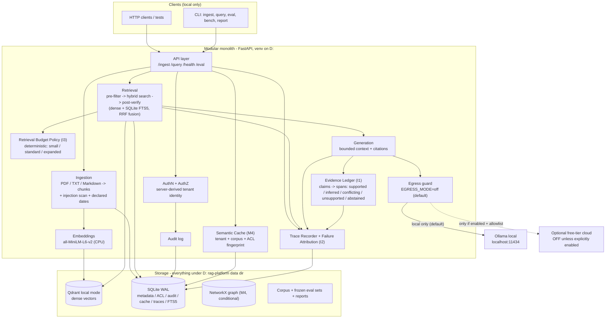

# RAG Platform — Master Plan v2 (Local-First RAG Engine with Evaluation & Diagnostic Core)

**Project root:** `D:\rag-platform`
**Document:** `RAG_Platform_Master_Plan_v2.md` — version 2.0, 2026-10-18
**Supersedes:** `RAG_Platform_Master_Plan.md` (v1.0 — preserved untouched for history; see `RAG_Platform_Plan_Diff.md` for the change record)
**Companion documents:** `RAG_Platform_Strategy_Review.md` (build-vs-reuse evidence), `RAG_Platform_Plan_Diff.md` (what changed and why)
**Status:** Planning deliverable. **Implementation has NOT started.** No code, Git, packages, models, services, or system changes exist. Work begins only after explicit approval of the unresolved decisions in §14.

**Priority order (never violated):** 1) correctness & security → 2) low resource usage → 3) reproducibility → 4) performance.

---

## 1. Vision and Target Users

**Vision.** A small, local-first retrieval-augmented generation **engine** — not another all-in-one chat platform — whose defining properties are **verifiable evidence** (every claim traceable to authorized source spans, with honest abstention), **inspectable failures** (every weak answer attributable to the pipeline stage that broke), and **honest measurement** (a frozen, reproducible, offline evaluation harness that runs on the hardware we actually own, with results reported as measured facts or explicit `not-measured`).

**Target users (in priority order):**
1. **This machine's owner** — a student who wants a private, zero-cost document Q&A system over personal/study material, usable while VS Code, a browser, and coursework run alongside.
2. **A reviewer/examiner** — anyone who wants to verify that the system's security, evaluation, and resource claims are real and reproducible from a clean checkout.
3. **A future reader of the code** — someone learning how permission-aware RAG, citation grounding, and RAG failure diagnosis are actually built, in inspectable Python rather than a framework's internals.

**Why this exists (from the strategy review, full evidence in `RAG_Platform_Strategy_Review.md`).** Established platforms already provide chat-over-documents: AnythingLLM (MIT, but multi-user requires Docker), RAGFlow (Apache-2.0, Docker + 50 GB, open-source permission model stated "not yet supported"), Dify (modified license, multi-tenant operation restricted, Docker Compose stack), Open WebUI (RBAC exists but with additive permission logic and two 2026 RAG-authorization CVEs), Onyx (document-level permissions are Enterprise-subscription features; PostgreSQL + OpenSearch + Redis stack). None of them ships, in zero-cost local form: (a) a runtime claim-level evidence ledger with abstention, (b) deterministic offline per-stage failure attribution, (c) a frozen-corpus evaluation harness with honest pass/fail/skipped/blocked reporting. This project spends its entire complexity budget on exactly those three gaps on top of a deliberately thin engine substrate.

---

## 2. Non-Negotiable Constraints (carried from v1, unchanged in force)

| # | Rule |
|---|------|
| Z1 | **No paid APIs, subscriptions, paid hosting, paid managed databases, trial credits, or expiring promotional credits** — ever, in any component or test. |
| Z2 | **Core platform works with zero cloud accounts and zero API keys.** No account-based service may be required for any acceptance test. |
| Z3 | **Local inference is the default:** Ollama on `localhost:11434`, reusing models already installed. |
| Z4 | **`EGRESS_MODE=off` by default.** No documents, queries, prompts, embeddings, or user data leave the machine unless the user explicitly enables egress. |
| Z5 | **Never** enable billing, use paid models, or silently fall back to a paid endpoint. Fallbacks must be recorded (`served_by`, reason) and are local-only. |
| Z6 | **No new model downloads** without demonstrated need **and** explicit approval. Benchmark what exists first. |
| Z7 | **No unnecessary infrastructure:** no Docker requirement, no Redis/Neo4j/PostgreSQL/rerankers/dashboards/agents unless a milestone's measured need justifies it (Appendix C). |
| Z8 | **Never fabricate results.** Every metric is a measured number or marked `not-measured`. Reports distinguish `passed / failed / skipped / blocked / not-measured`. |
| Z9 | **All new artifacts on D:** venv, caches, databases, corpora, artifacts, traces. C: must not grow. Docker data is never relocated; Docker is not used without approval. |
| Z10 | Cloud providers (Groq, Gemini, OpenRouter) are **documentation-only, opt-in, optional** (Appendix A) — never requirements, never enabled by default, never in any acceptance path. |
| Z11 | Retrieval and ingestion must keep working when Ollama is stopped (**retrieval-only degraded mode**). |
| Z12 | **Original plan file is never deleted or overwritten.** `RAG_Platform_Master_Plan.md` and all planning documents live on D:. |

---

## 3. Non-Goals (explicit)

- **Not a chat platform.** No web UI beyond a minimal status page; API + CLI only.
- **Not an agent framework.** No tool use, no autonomous loops, no orchestration engine.
- **Not OCR/scanned-PDF support.** Text-based PDF, TXT, Markdown only (assumption A7; failure is a clear error, not silent degradation).
- **Not a multi-tenant SaaS.** Tenancy exists to prove isolation invariants on one machine, not to host organizations.
- **Not a graph database showcase.** Graph retrieval is a conditional, measured experiment (§7.4), not a commitment.
- **Not a benchmark leaderboard entry.** Evaluation is for regression-gating our own changes on our own corpus, with honest limitations.
- **Not GPU-dependent.** Torch is CPU-only on this machine; GPU offload, if any, belongs to Ollama and must be proven with `ollama ps`, never assumed.
- **Not a replacement for calibrated uncertainty.** The system never presents model-generated confidence as calibrated probability (calibration would itself require measurement we cannot afford).

---

## 4. Chosen Differentiators (the three core innovations)

Three innovations selected per the strategy review (scoring table §4 there). Each states: problem → why existing approaches don't sufficiently solve it (honestly classified) → design → baseline → measurable success → failure conditions → dependencies → milestone.

### 4.1 Innovation 1 — Evidence Ledger

**Problem.** RAG answers assert claims; users cannot tell which claims the retrieved documents actually support. Citation lists show *what was in context*, not *which sentence each passage justifies*. Unsupported claims (hallucinations, over-generalizations, stale facts) pass unnoticed.

**Honest classification.** *Useful integration + engineering improvement*, not novel research. Claim-level citation evaluation exists in research (ALCE: citation recall/precision via NLI, 85.1%/77.6% agreement with humans; FActScore: atomic-fact support; ALiiCE: dependency-tree atomic claims). RAGFlow ships chunk-level traceable citations. What is not found in reviewed documentation is a **runtime, zero-cost, local ledger** that classifies each answer claim as `directly_supported / inferred / conflicting / unsupported` and **abstains** when evidence is insufficient — with a deterministic evaluation path that does not require downloading an NLI model or a hosted judge.

**Design.**
1. **Claim extraction (two tiers):**
   - *Deterministic tier (primary, always on):* split the generated answer into sentences, then into atomic claims via rule-based segmentation (clause splitting on discourse markers, numeral/entity isolation). No model call. Produces `claims[]` with character offsets into the answer.
   - *Advisory tier (optional, off by default):* local Ollama model decomposes claims at `temperature=0`. Labeled **non-deterministic** in every report; used only to compare against the deterministic tier, never as a gate.
2. **Claim-to-evidence mapping.** Each claim is matched against the authorized context spans that were actually sent to the generator (recorded in the trace, §4.2):
   - `directly_supported`: deterministic containment — normalized claim text (numbers, dates, entities, units preserved) appears as a substring of a cited span, or ≥1 token-set Jaccard over content-word stems exceeds a frozen threshold. Deterministic and reproducible.
   - `inferred`: claim not contained verbatim but all its named entities and numerals appear in the cited span(s), with overlap above a frozen lower threshold. Deterministic heuristic — **explicitly not entailment**; documented as a proxy.
   - `conflicting`: claim's entities match a span but a key value (number/date/negation marker) differs — surfaces contradiction Candidate D's deterministic subset (§4.4).
   - `unsupported`: none of the above. The claim is flagged.
   - `not_classified`: claim contains no retrievable anchors (opinion, transition text). Never counted as supported or unsupported in metrics; reported separately.
3. **Abstention.** If the top retrieval score is below a frozen floor, or zero context spans exist, generation is **skipped** and the API returns an explicit abstention object with the reason (`no_evidence / low_score / unauthorized_only`). Abstention is a first-class response, not an error.
4. **Emission.** Every generated answer carries a `ledger` field: claims with class, cited span IDs (chunk IDs + char ranges), and the method that produced each classification (`containment | overlap | abstained`).
5. **What this tier deliberately does NOT claim.** `directly_supported` means *textually present*, not *semantically true*; `inferred` is an overlap heuristic, not logical entailment. Both limitations are printed in `docs/EVALUATION.md` and in every eval report header. No confidence probabilities are ever emitted.

**Baseline.** v1-style RAG: answer + list of retrieved chunks (citations exist, no claim mapping).

**Measurable success criteria (frozen corpus, §8).**
- Citation validity: 100% of emitted span IDs resolve to real, authorized chunks (deterministic test).
- Unsupported-claim recall on the **planted-unsupported set**: the ledger flags ≥X% of claims deliberately authored into the corpus as unanswerable-by-design (X set after M1 baseline measurement; target ≥80%, provisional).
- False-flag rate on directly-quotable claims ≤Y% (provisional ≤10%, set after baseline).
- Abstention correctness: ≥Z% of unanswerable questions produce abstention, not generation (provisional ≥90%).
- Ledger overhead: ≤10% of answer latency (deterministic tier only).

**Failure conditions (simplify or remove).** If deterministic claim segmentation mis-splits >30% of answers on the frozen set (measured against the advisory tier's manual-inspection sample), simplify to sentence-level claims. If unsupported-claim recall stays <50% after one threshold-tuning cycle, the ledger degrades to "citations + abstention only" and the project reports that honestly rather than shipping a weak classifier.

**Dependencies / milestone.** M1 trace substrate (context-span recording), M2 authorization (ledger spans must be post-verification spans), M3 implementation.

### 4.2 Innovation 2 — RAG Failure Observatory

**Problem.** When a RAG answer is weak, nobody can say *why*: did retrieval miss the evidence? rank it out of the context window? did evidence conflict? did the model ignore it? did citations lie? did Ollama time out? Existing tools score answers (Ragas/TruLens judges) or trace network spans (OTEL) — both judge-dependent or framework-embedded. A local engine should be able to explain failures **deterministically, offline, with structured traces**.

**Honest classification.** *Useful engineering improvement.* Observability exists in commercial/OTEL form; deterministic per-stage attribution with frozen failure fixtures inside a lightweight local engine was not found in reviewed documentation. Not a research claim.

**Design.**
1. **Structured JSON traces.** Every `/query` writes one trace record (SQLite table + optional JSONL export): request ID, timestamp, tenant (ID only), stages with inputs/outputs digests, timings, scores (top-k retrieval scores), `served_by`, degradation reason, cache status, and the *authorization decision set* (allowed/denied doc IDs — IDs only).
2. **Stage-instrumented pipeline.** Stages: `authn → authz_filter → cache_lookup → retrieval → post_verify → context_build → generation → ledger → response`. Each stage emits start/end, outcome enum, and bounded diagnostic fields.
3. **Deterministic failure attribution rules.** A rule engine over the trace assigns exactly one primary failure class (first match wins, all matches logged):
   - `RETRIEVAL_MISS` — gold chunk (eval mode) or any chunk above score floor absent from top-k.
   - `RANKING_FAILURE` — gold chunk retrieved at rank > context cutoff.
   - `INSUFFICIENT_EVIDENCE` — all authorized chunks below score floor (may legitimately end in abstention; classified as handled vs unhandled).
   - `CONTRADICTORY_EVIDENCE` — ≥2 authorized spans disagree on a key value for the query's entities (shares detector with §4.1 conflict class).
   - `GENERATION_FAILURE` — model returned empty/off-format/timeout, or emitted claims the ledger marks unsupported above threshold.
   - `CITATION_FAILURE` — answer cites spans outside the authorized context set (security-relevant; also raises an audit event).
   - `MODEL_UNAVAILABLE` / `DEGRADED_RETRIEVAL_ONLY` — Ollama unreachable; pipeline fell back per Z11.
   - `CACHE_STALE_RISK` — cache hit whose corpus/ACL fingerprint does not match current state (should be impossible post-§4.3; if observed, it is a bug finding, not a silent serve).
4. **Reproducible failure fixtures.** The frozen corpus (§8) contains authored failure cases with known expected classes (planted ranking traps: near-duplicate distractors; planted contradictions; unanswerable questions; injection documents). The observatory's attribution is scored against these expected classes.
5. **Command-line reports.** `cli.py report failures --run <id>` prints per-class counts, worst queries with their traces, and a before/after comparison when two run IDs are given. JSON traces are the source of truth; the CLI is a renderer.
6. **Privacy bounds.** Traces store chunk IDs, character ranges, score distributions, and ≤200-char excerpts **only for spans the requesting tenant was authorized to see**; denied-document content is never excerpted; secrets never appear (invariant I6, I10). Trace retention is bounded and tenant-scoped.

**Baseline.** v1 logging (structured logs, no per-stage attribution, no fixtures).

**Measurable success criteria.**
- Attribution accuracy on the planted-fixture set: ≥W% exact primary-class match (provisional ≥85%, set after M1 baseline); all misattributions published in the eval report with their traces.
- Trace completeness: 100% of `/query` calls produce a trace with all nine stages (deterministic test).
- Redaction compliance: automated scan asserts no secret patterns and no denied-content excerpts in any trace (deterministic test).
- CLI before/after comparison reproduces two frozen runs byte-identically given the same inputs (determinism test).

**Failure conditions.** If attribution accuracy <60% after rule revision on one iteration, the observatory ships as **trace-recording only** (no auto-attribution), with honest reporting. Traces never justify relaxing any authorization check.

**Dependencies / milestone.** M1 instrumentation hooks + run recorder; fixtures in M1 corpus; full attribution in M3 (alongside ledger, sharing claim/contradiction detectors).

### 4.3 Innovation 3 — Adaptive Retrieval Budget (bounded, deterministic policy)

**Problem.** Fixed `top_k=8` wastes latency and context on easy lookup questions and starves multi-entity questions. On a 16 GB laptop, every unnecessary chunk costs embedding compute, prompt tokens, and generation time. Adaptation must exist **under hard resource caps** and must be removable if it doesn't measurably help.

**Honest classification.** *Engineering improvement.* Adaptive retrieval is an established research direction (Self-RAG, CRAG, Adaptive-RAG — LLM-in-the-loop variants). Those loop-based methods cost multiple LLM calls per query — unaffordable here. A **deterministic, zero-extra-LLM-call, budget-bounded policy** measured against fixed-k on our own corpus is the defensible local variant.

**Design.**
1. **Deterministic difficulty probe (no LLM call).** Query features only: token count, number of distinct named entities (regex-based), presence of comparison/multi-hop markers ("both", "compare", "difference", "relationship", quoted literals), and first-pass retrieval score statistics (top-1 score, score margin between rank-1 and rank-k).
2. **Bounded policy.** One of three budgets, chosen before generation:
   - `small`: k=4, context ≤2 chunks — high top-1 score + single entity + short query.
   - `standard`: k=8, context ≤6 chunks — default (v1 behavior).
   - `expanded`: k=14, context ≤8 chunks — multi-entity/comparison markers, or flat score margin. Caps at the hard maxima (§7.2 of v1 preserved in §10.2).
3. **At most two retrieval calls per query** (first pass, optional single re-rank pass over the same result pool — no second embedding model, no cross-encoder). Generation remains a single call. **No query-reformulation LLM calls** in v2 (documented as deferred; would break the latency/RAM budget).
4. **Router honesty.** Only one generation model exists (`qwen3:8b` or its measured replacement); the "router" routes **retrieval budgets and cache use**, and reports `served_by` truthfully. `/health` lists only what is actually installed (v1 invariant preserved).
5. **Disability switch.** `ADAPTIVE_RETRIEVAL=off` returns exactly v1 fixed-k=8 behavior; the eval harness runs both configurations and reports the delta.

**Baseline.** Fixed k=8, context ≤6 chunks (v1 default).

**Measurable success criteria (frozen corpus, both configs).**
- Quality non-inferiority: adaptive Recall@k/nDCG@10/token-F1 within a frozen margin (provisional ≤2% absolute drop) of fixed-k — measured, not assumed.
- Efficiency gain: median retrieved-chunk count and median generation latency strictly lower than fixed-k, with the per-class breakdown (easy queries should shrink; expanded queries should grow).
- Cap compliance: no query exceeds two retrieval calls / hard caps (deterministic test).
- If quality drops beyond margin: adaptation is **disabled by default** and the finding is reported (§4.3 failure condition).

**Failure conditions.** No measurable latency/context saving after one tuning cycle → remove the feature, keep fixed-k (reported honestly). Score-margin features proving noisy → freeze at three-tier coarse policy or drop to two tiers.

**Dependencies / milestone.** M1 retrieval metrics + traces; M3 policy implementation and A/B eval (M4 if M3 capacity is consumed by ledger/observatory; see §7 schedule).

### 4.4 Deterministic contradiction/freshness subset (absorbed from Candidate D)

Full contradiction/temporal engines are **rejected** (complexity, NLI dependence). Absorbed deterministic subset:
- **Document metadata timestamps** (author-declared `date:` field, file mtime recorded at ingest as `ingested_at`) stored per chunk; "newer source disagrees with older source" is *surfaced*, never auto-resolved.
- **Conflict detector:** same normalized entity set + differing numeral/date/negation in retrieved spans → `conflicting` flag in ledger + `CONTRADICTORY_EVIDENCE` class in observatory. Pure string/regex logic; frozen fixtures plant known conflicts.
- No temporal database, no graph requirement, no semantic NLI. Known dates vs inferred freshness are labeled distinctly in output (`declared_date` vs `ingested_at`).

### 4.5 Rejected candidates (record for traceability)
- **E — Permission-safe memory:** rejected. Derived conversational memory's revocation/invalidation complexity outweighs its value; the M4 semantic cache plus ordinary retrieval cover the demonstrated need. Revisit only with a new threat model and measured user value.
- **Full semantic contradiction engine (NLI-based):** rejected — requires model download (violates Z6) or hosted judge (violates Z2).
- **Counterfactual probes (from review candidate G):** deferred, not rejected — valuable but costs 2× generation per probed query; recorded in §13 as a post-v2 experiment.

## 5. Architecture

Modular monolith, one Python process, one API, one CLI — same substrate as v1, extended with an evaluation/diagnostic spine. No microservices, no containers, no servers beyond Ollama (already running).



**Pipeline (M3 end-state):** authenticate → derive tenant from credential → cache lookup (fingerprint-checked) → authorization pre-filter → deterministic budget selection → hybrid retrieval (dense + BM25 via SQLite FTS5, reciprocal-rank fusion) → independent post-retrieval authorization verify → bounded context build → local generation with citations → evidence ledger → trace record + failure attribution → response. Any stage may degrade to retrieval-only; every degradation is explicit and logged.

**Design principles:**
1. **Evaluation spine, not bolt-on.** Traces (§4.2) are emitted from M1, so the eval harness and observatory consume the same records the engine produces — no parallel telemetry path to drift.
2. **Two-phase authorization** (pre-filter + independent post-verify) unchanged from v1 invariant I1; the ledger consumes only post-verified spans, making unsupported-claim detection *authorization-safe by construction*.
3. **Deterministic where it matters, advisory where it must.** Every classifier has a deterministic tier that gates behavior and an optional advisory tier (local model, temperature=0, labeled non-deterministic) that never gates anything.
4. **Every component has a kill switch** (§4.3 `ADAPTIVE_RETRIEVAL=off`, cache bypass flag, ledger minimum mode) so any innovation can be reduced to v1 behavior without code surgery.

## 6. Technology Choices and Dependency Rationale

All v1 choices are preserved unless marked. Full alternatives analysis in `RAG_Platform_Strategy_Review.md` §2 and v1 §5.

| Concern | Choice | Change from v1 | Rationale |
|---|---|---|---|
| Language / venv | Python 3.14 (fallback: uv-managed 3.12/3.13 **on D:**), uv | none | Verified present; R7 contingency unchanged |
| Web / CLI | FastAPI + pydantic-settings; argparse CLI (+ `report`, `eval`, `bench` subcommands) | extended CLI | v1 decision holds |
| Pipeline | Hand-rolled thin modules | none | Strategy review confirmed: no LangChain/LlamaIndex-class framework (auditability, RAM, no hidden remote calls) |
| Embeddings | sentence-transformers `all-MiniLM-L6-v2` (CPU, cached copy on D:) | none | Existing cache reused (Z6) |
| Dense store | Qdrant client **local mode** (embedded, path on D:) | none | Verified persistent + full filter API (v1 §2.1) |
| **Keyword store** | **SQLite FTS5 (BM25) + RRF fusion with dense results** | **added** | Zero new services (FTS5 ships with stdlib sqlite3 — verify at Phase 0, fallback dense-only); research evidence: BM25 wins at small corpus scale (arXiv 2607.26497); established, not novel (honest classification in review §4, candidate I) |
| Metadata/ACL/cache/traces | SQLite (WAL) via stdlib `sqlite3`, versioned SQL migrations | traces + FTS5 tables added | Single source of truth; no ORM |
| LLM runtime | Ollama (installed, running) | none | Z3 |
| Generation model | Benchmark existing `qwen3:8b` first; installed alternatives (`qwen2.5-coder:7b`) evaluated if too heavy; **no downloads without separate approval (D3)** | none | Z6 |
| Claim decomposition | **Rule-based deterministic splitter (stdlib only)**; advisory tier = same Ollama model at temperature=0 | new | Avoids downloading NLI/spaCy models; ALiiCE-style atomic claims approximated by clause rules — limitations documented, not hidden |
| Graph (M4, conditional) | NetworkX, **LLM-free construction** (regex/heuristic entity extraction + co-occurrence; LinearRAG-style) | demoted to conditional experiment | Paper evidence: LLM-based graph construction costs 177K–655K tokens (§2.3 of review) — infeasible locally; LLM-free construction is the only defensible variant here |
| Cache (M4) | SQLite + embedding similarity, keyed by tenant + corpus fingerprint + ACL fingerprint | fingerprint keys added | v1 decision evolved for I1/I2 safety |
| Judge (eval, optional) | Local Ollama at temperature=0, advisory only | none | Never a gate; Ragas/TruLens **not adopted** (judge-centric, extra dependency surface — review §2.2) |
| HTTP client | httpx | none | v1 decision |
| PDF parsing | pypdf | none | v1 decision; license verified at install |
| Tests | pytest + pytest-cov; psutil for perf | + fixture-based observatory scoring | v1 decision |
| **Explicitly not added** | Docker, Redis, Neo4j, PostgreSQL, rerankers, dashboards, OCR, agent frameworks, NLI models, Ragas/TruLens/DeepEval packages | — | Z7, Z6; escalation only via Appendix C |

**Dependency list (setup-time only, pinned via `uv.lock`):** fastapi, uvicorn, pydantic, pydantic-settings, httpx, sentence-transformers, qdrant-client, pypdf, psutil, pytest, pytest-cov, networkx (M4 only — may be deferred from initial install). Dev-only: pip-audit. Every install runs a license review (Z1, Z9).

## 7. Revised Milestones and Dependencies

v1's four milestones are re-scoped: evaluation moves **into M1** (first-class, per reassessment §6); the two differentiators get their **own milestone** (M3) instead of being diluted; GraphRAG becomes a **conditional experiment inside M4** rather than a milestone commitment. Full rationale in `RAG_Platform_Plan_Diff.md`.

```mermaid
gantt
    title Milestone dependency order (not a schedule)
    dateFormat X
    axisFormat %s
    section Foundations
    M1 Engine + Eval Foundation : done, 1, 4
    section Security
    M2 Permission-Aware Multi-Tenancy : done, 2, 4
    section Differentiators
    M3 Evidence Ledger + Failure Observatory : done, 3, 3
    section Efficiency + Experiment
    M4 Adaptive Budget + Cache (+ conditional graph) : done, 4, 3
```



### 7.1 M1 — Baseline RAG Engine + Evaluation Foundation
**Scope:** ingestion (PDF/TXT/Markdown) with injection-pattern scan and declared-date capture; sentence-aware bounded chunking; MiniLM embeddings (CPU, copied cache on D:); Qdrant local mode (persisted on D:, filtering test-verified); **SQLite FTS5 keyword index + RRF fusion**; top-k retrieval with score floor; Ollama generation with source citations and **abstention path**; retrieval-only degraded mode; FastAPI endpoints + argparse CLI; **frozen synthetic corpus + eval harness + trace recorder (stage timings, scores, served_by)**; **safe model benchmark BG-1** (§10.3).
**Dependencies:** Python/uv, Ollama, MiniLM cache (present); `qdrant-client`, `pypdf`, `sentence-transformers` (Phase 0 installs → D:).
**Excluded:** auth beyond a single default tenant, cache, adaptive policy, ledger, graph, cloud, OCR, downloads.

**Acceptance gate (all measured; no fabricated numbers):**
1. E2E: ingest frozen corpus → `/query` returns answer with **valid citations** (every cited span ID resolves; deterministic test, 100%).
2. Ollama stopped → `/query` returns retrieved passages + `generation: unavailable` (Z11); all retrieval/lexical eval tests pass with Ollama off.
3. Restart persistence: same corpus searchable after process restart (Qdrant dir + SQLite on D:).
4. Filtering test: payload filter returns exactly the expected set on a labeled fixture.
5. Hybrid ≥ dense-only on frozen-corpus Recall@5 (measured; if not, dense-only ships and the finding is reported — FTS5 stays as an available-but-disabled path).
6. **Eval harness runs end-to-end** producing: Recall@5/10, MRR, nDCG@10, token-F1, abstention correctness, latency p50/p95, per-stage trace timings — with dataset SHA256, lockfile hash, `served_by`, and status column (`passed/failed/skipped/blocked/not-measured`).
7. **BG-1 benchmark report** for `qwen3:8b` (§10.3) with `ollama ps` evidence; model verdict recorded (usable / too slow / too heavy).
8. Egress suite: **zero outbound HTTP** with `EGRESS_MODE=off` across the entire test run (T-ADV-09).
9. Perf: steady-state app RAM ≤1.5 GB (provisional); generation spike leaves ≥3 GB system RAM free or budget revised with data (§10.1 rule).

### 7.2 M2 — Permission-Aware Multi-Tenancy
**Scope:** per-tenant API keys (PBKDF2-hashed, stdlib); **server-derived tenant identity**; document-level ACL; pre-retrieval filtering; **independent post-retrieval verification**; append-only audit log; injection-quarantine flags enforced at retrieval; adversarial suite (§9.3).
**Dependencies:** M1 storage/retrieval; SQLite schema extension.

**Acceptance gate:**
1. **Invariant I1 holds under test:** instrumented context assembly proves unauthorized content never enters generation context, cache response, ledger spans, or returned payload.
2. Forged-identity matrix fails closed: forged tenant header/param, tampered/expired/replayed/missing key → correct 401/403, correct audit entries, **no leakage in error bodies**.
3. Permission revocation effective on next request (no stale allow, no stale cache serve).
4. Cross-tenant retrieval: zero foreign chunks at top-k boundaries.
5. Prompt-injection corpus: injected instructions never become instructions (I8); quarantined chunks flagged and reported.
6. Audit completeness: every allow/deny produces one immutable record.
7. M1 regression suite still green.

### 7.3 M3 — Evidence Ledger + Failure Observatory (the differentiators)
**Scope:** deterministic claim segmentation; claim→span mapping (`directly_supported / inferred / conflicting / unsupported / not_classified`); abstention objects; ledger emission in API; full nine-stage trace recorder; deterministic failure-attribution rules; planted failure fixtures; CLI `report failures` with before/after comparison; advisory tiers (local model decomposition, temperature=0) **off by default**, never gating.
**Dependencies:** M1 traces + corpus fixtures; M2 post-verified spans (ledger consumes only authorized context).

**Acceptance gate:**
1. Every generated answer carries a `ledger`; every abstention carries a reason enum (deterministic test).
2. Unsupported-claim recall on planted-unsupported set ≥ provisional 80% (target re-frozen after M1 baseline); false-flag rate on directly-quotable claims ≤ provisional 10%; both published regardless of outcome.
3. Abstention correctness ≥ provisional 90% on unanswerable questions.
4. Attribution accuracy on planted failure fixtures ≥ provisional 85% exact primary-class; **all misattributions listed with traces** in the report.
5. Trace completeness 100% of `/query` calls (nine stages); redaction scan clean (no secrets, no denied-content excerpts).
6. Determinism: two runs of the same frozen inputs produce byte-identical ledger + attribution JSON (temperature=0, deterministic tier only).
7. Ledger+observatory overhead ≤25% of answer latency (provisional; measured and published).
8. M1/M2 suites green; egress suite green (ledger adds no network path).

### 7.4 M4 — Adaptive Retrieval Budget + Semantic Cache (+ conditional graph experiment)
**Scope:** deterministic three-tier retrieval budget policy with A/B eval against fixed-k; SQLite semantic cache keyed by tenant + corpus fingerprint + ACL fingerprint with revalidation-on-hit and revocation invalidation; concurrency semaphore (gen = 1) and 503 fast-fail; measured latency/RAM/hit-rate reports. **Conditional sub-experiment (D10):** LLM-free NetworkX graph (regex entity extraction + co-occurrence + bounded 2-hop expansion) evaluated on the multi-hop subset vs vector-only baseline — **only if** M1–M3 are stable and the multi-hop subset shows a measured retrieval deficit, and only with separate approval.
**Dependencies:** M1 metrics + traces; M2 identity/ACL (cache keys, graph tenancy); M3 claims (ledger informs quality delta measurement).

**Acceptance gate:**
1. Cache: authorization revalidation on every hit (revocation test); tenant isolation; invalidation on doc/ACL change; measured hit rate + p50/p95 (hit vs miss) + RAM/disk delta.
2. Cache answer-quality delta vs no-cache within frozen margin (provisional ≤2% absolute token-F1) — measured, published either way.
3. Adaptive: quality non-inferiority within frozen margin **and** strict reduction in median chunks/latency (both provisional margins re-frozen after M1 baseline); cap-compliance test (≤2 retrieval calls); **if non-inferiority fails → adaptive disabled by default, finding reported**.
4. Concurrency: N parallel `/query` → ≤1 generation in flight; excess → fast 503; laptop stays responsive (perf test).
5. Router honesty: `/health` lists only installed models; Ollama down → retrieval-only with reason recorded.
6. *(If D10 approved and attempted)* Graph: provenance-traceable edges; traversal bounds enforced under adversarial dense graph; multi-hop subset head-to-head **with honest numbers whether positive or negative**; single-hop non-regression; cross-tenant graph isolation. **A null or negative result is a fully valid outcome and will be reported as such.**
7. Full regression: M1–M3 suites green.

## 8. Security and Privacy Invariants

All v1 invariants (I1–I9) are preserved verbatim in force; I10–I13 extend them for the new components. §9.3 states what each test proves and cannot prove.

| ID | Invariant |
|---|---|
| **I1** | **Authorization precedes context.** Unauthorized document content never enters generation context, cache response, ledger spans, observatory excerpts, or returned results — enforced by pre-retrieval filtering AND independent post-retrieval verification (defense in depth). *Extended in v2: ledger and trace excerpting consume only post-verified spans.* |
| **I2** | **Server-derived identity.** Tenant/principal come only from the credential; client-supplied identity fields are never trusted. |
| **I3** | **Zero egress by default.** `EGRESS_MODE=off` (default) ⇒ no request containing documents, chunks, queries, prompts, embeddings, or identifiers leaves the machine. Only the local Ollama socket is contacted. |
| **I4** | **Egress allowlist when explicitly enabled.** Opt-in requires exact-host allowlist + TLS, redirect rejection to non-allowlisted hosts, free-eligibility verification, env-only keys never logged. Paid fallback structurally impossible. |
| **I5** | **No silent substitution.** Every response records `served_by`; every fallback records its reason (429/timeout/not_configured/unavailable/degraded). Applies to adaptive-budget decisions and cache hits (recorded as `cache:<key-digest>`). |
| **I6** | **Secret-safe by construction.** `.env` gitignored; `.env.example` placeholders only; logs redacted; health checks report `configured: true/false`; error bodies never echo internals. |
| **I7** | **Bounded everything.** Input length, chunk count, top-k, context, traversal, concurrency, retries, queues, cache entry size, ledger claim count, trace excerpt length — all hard-capped; unbounded growth is a bug. |
| **I8** | **Data is data.** Retrieved content (including documents containing injection attempts) is delimited and labeled untrusted; it can never issue instructions; no tool execution exists. Injection-scan flags (`quarantined`) are advisory labels surfaced to users, **never authorization decisions** — ACL alone decides access. |
| **I9** | **Integrity of state.** SQLite (WAL) + Qdrant directory are the sole local sources of truth; audit log is append-only; cache or ledger correctness never outranks I1. |
| **I10** *(new)* | **Diagnostic artifacts are authorization-scoped.** Traces and ledger records store chunk IDs, offsets, scores, and short excerpts **only for spans the requesting tenant could see at request time**; denied-document content is never excerpted into any diagnostic store; traces are queryable only through the owner tenant's context. |
| **I11** *(new)* | **Advisory tiers never gate.** Model-based classifiers (claim decomposition, local judge) run at temperature=0, are labeled non-deterministic in every artifact, and cannot change authorization, cache, or abstention behavior. If they fail or are disabled, the deterministic tier's output stands. |
| **I12** *(new)* | **Abstention cannot be suppressed.** The abstention path (low evidence score / zero authorized spans) is decided before generation and cannot be overridden by cache, adaptive budget, or client flags. |
| **I13** *(new)* | **Ledger honesty.** The ledger never emits calibrated probabilities; `directly_supported` means textual containment (documented), `inferred` means an overlap heuristic (documented). No UI or API field may imply stronger semantics than the method actually provides. |

**Threat model (documented fully in `docs/SECURITY.md` at implementation):** assets = corpus, ACLs, keys, audit log, traces, ledger; adversaries = other tenants on the instance, malicious documents (prompt injection, poisoned chunks), local malware (out of scope beyond OS defaults), network observer (mitigated by loopback-only + egress guard). Free-tier cloud privacy risks remain documented in Appendix A and stay dormant while egress is off.

## 9. Evaluation Methodology (first-class, per reassessment §6)

### 9.1 Principles
1. **Deterministic, local, offline primary path** — no network, no hosted judge, no API keys in any gate (Z2, Z10).
2. **Frozen datasets** with SHA256 manifest; edits create a new dataset ID (never overwrite).
3. **Baseline-vs-new comparison for every innovation** — no feature ships without its fixed/simple baseline having been measured on the same frozen set (I3 policy vs fixed-k; ledger vs plain citations; attribution vs planted labels; cache vs no-cache).
4. **Honest statuses:** every metric row = `value | measured-at | model | served_by | status` where status ∈ `passed/failed/skipped/blocked/not-measured`. Fabrication forbidden (Z8).
5. **Known-metric limitations printed in every report header** (§9.4).

### 9.2 Datasets (locally authored, frozen; D7)
- **Corpus:** ~20–40 synthetic documents (~50–150 KB each; TXT/MD/PDF mix) across several topics, authored during implementation, containing deliberate difficulty structures:
  - near-duplicate distractor passages (ranking traps),
  - planted contradictions (same entity, conflicting values, with `declared_date` metadata — feeds §4.1 conflict class and §4.4),
  - unanswerable-by-design questions (evidence absent from corpus — feeds abstention),
  - planted unsupported-claim targets (questions whose gold answer spans *do not* contain a tempting-but-wrong figure — feeds unsupported-claim recall),
  - prompt-injection documents (feeds I8 tests),
  - multi-hop chains (two-hop entity bridges — feeds M4 subset).
- **Question sets (frozen JSONL):** `q → gold chunk IDs / gold answer span / type / expected-outcome`. Type ∈ {single-hop, multi-hop, unanswerable, conflict-aware, injection-adjacent}. Expected-outcome ∈ {answer, abstain, flag-conflict}. Sizes: ~80–120 for M1 gates; multi-hop subset (~40) added at M1 so M4 comparison is possible without regenerating data.
- If the user later supplies real documents, they form an **additional** frozen set with its own ID — never a replacement.

### 9.3 What the security tests prove and cannot prove
| Test proves | Test cannot prove |
|---|---|
| The **implemented enforcement paths** reject the enumerated forged/revoked/cross-tenant cases in the tested configurations | Absence of unknown bypasses, side channels, or logic errors outside the enumerated matrix |
| Zero outbound sockets in the egress-instrumented test process during the suite | That a dependency's future update adds no network call (mitigated by re-running the suite each change; not a proof) |
| Trace/ledger redaction rules hold on the tested corpus | Semantic privacy of content the tenant was *authorized* to see (inherent) |
| Deterministic classifiers behave per specification on the frozen corpus | Behavior on out-of-distribution text (out of scope; documented) |

### 9.4 Metrics and their honest limitations
| Class | Metrics | Determinism | Limitation printed in reports |
|---|---|---|---|
| Retrieval | Recall@k (5,10), MRR, nDCG@10 | Fully deterministic | Measure overlap with gold IDs — not semantic usefulness |
| Answer lexical | Token-F1 vs gold spans | Deterministic | Lexical overlap ≠ factual faithfulness; paraphrases score low |
| Grounding | Citation validity (span resolves + authorized), citation coverage (claims with ≥1 citation) | Deterministic | Coverage ≠ correctness; a cited span can be irrelevant (motivates ledger) |
| Ledger | Unsupported-claim recall/precision on planted set; abstention correctness; conflict detection recall | Deterministic (containment/regex tier) | Containment-based `directly_supported` misses paraphrase support (false "unsupported" possible); `inferred` is an overlap proxy, **not entailment** |
| Robustness | Unanswerable refusal rate + false-refusal rate | Deterministic gold | Gold authored by the same author as corpus (self-consistency risk — mitigated by frozen splits + published items) |
| Observatory | Attribution accuracy vs planted classes; trace completeness; redaction-scan clean | Deterministic | Fixtures are authored failure modes; real-world failures may fall outside the taxonomy (unknown-unknowns reported as `unattributed`) |
| Systems | Latency p50/p95, RAM/VRAM peak (psutil), tok/s, cache hit rate, retrieval-call counts, `served_by` distribution | Measured | Single-machine results; no cross-machine generalization |
| Advisory (optional) | Local-judge correctness/faithfulness on a small slice | **Non-deterministic** (temperature=0 helps, does not guarantee) | Never a gate; run-to-run variance reported if executed; may be marked `skipped` for time |
| M4 graph (if approved) | Multi-hop subset Recall/nDCG hybrid vs vector-only; single-hop non-regression | Deterministic | Synthetic multi-hop chains may favor graph traversal by construction — labeled in report |

### 9.5 Reporting
- `reports/eval_<dataset>_<config>_<timestamp>.md` + JSON: dataset hash, lockfile hash, model + `served_by`, per-metric values with statuses, failure-attribution summary, resource table.
- Dev/test split frozen before any threshold tuning; thresholds tuned on dev, evaluated once on test.
- No comparative claims about external systems without their measured numbers; no external benchmark presented as ours (v1 Appendix B preserved).

## 10. Resource Budget and Safe Benchmark Protocol

### 10.1 Budgets — provisional until measured (estimates carried from v1 §6.1, unchanged in force)
| Component | RAM (est.) | VRAM (est.) | Disk (D:) | Notes |
|---|---|---|---|---|
| FastAPI + uvicorn | 150–300 MB | 0 | — | 1 worker |
| venv (torch CPU + transformers + qdrant-client + app) | — | — | ~3–4 GB | uv cache on D: |
| MiniLM embeddings (lazy) | 300–700 MB | 0 | 87 MB cache copy | CPU only |
| Qdrant local mode | 50–300 MB | 0 | ~1.5 KB/chunk | in-process |
| SQLite (WAL: metadata/ACL/audit/cache/traces/FTS5) | 10–80 MB | 0 | MB-scale | traces bounded by retention cap |
| Ollama idle | 200–400 MB | 0 | — | models 9.23 GB stay on C: (existing; Z9 covers *new* artifacts) |
| `qwen3:8b` loaded (CPU path) | +5–6.5 GB | 0 | — | mmap caveat; unload via `keep_alive` |
| `qwen3:8b` loaded (partial GPU) | ~0.5–1 GB host | up to ~5.5 GB | — | proven only via `ollama ps` |
| Ledger + traces + budget policy | +20–80 MB | 0 | MB-scale | deterministic tiers only |
| **Steady state total** | **~0.8–1.5 GB** | 0 | — | must hold with browser + VS Code open |
| **CPU-generation worst case** | **~7–9 GB** | 0–5.5 GB | — | ≥3 GB system free-RAM floor enforced |

Operational bounds (hard caps carried from v1 §6.2): chunk ~1000/150 chars; top_k default 8 max 20 (adaptive tiers 4/8/14); context chunks ≤8; prompt chars ≤8000; Ollama timeouts 15 s/60 s; retries ≤2; generation concurrency 1; graph depth ≤2 / ≤50 nodes (if D10); ledger claims per answer ≤40 (I7); trace excerpt ≤200 chars.

### 10.2 Disk strategy (unchanged from v1 §6.3)
All new artifacts under `D:\rag-platform\`; `env.ps1` sets `UV_CACHE_DIR`/`HF_HOME`/`TMP` project-locally (no system env changes); MiniLM cache copied C:→D: (D2); `OLLAMA_MODELS` untouched on C: unless D4 approved; Docker untouched and unused; setup script asserts C: free space and fails loud.

### 10.3 Safe benchmark protocol BG-1 (run once at M1 start; no benchmarks during planning)
**Goal:** decide whether `qwen3:8b` is usable for generation on this laptop — measured, not assumed.
1. **Pre-checks:** record idle RAM/VRAM (psutil + `nvidia-smi` if available); confirm Ollama API reachable; confirm model present (`ollama list`; verifies assumption A1 about aliases via digest comparison).
2. **Load test:** request a 32-token generation at `num_ctx=2048`, `keep_alive=0`. Record time-to-first-token, tok/s, host RAM delta, VRAM delta (`ollama ps` output captured verbatim as evidence for A2/A3).
3. **Sustained test:** one 512-token generation at `num_ctx=4096`. Record same counters + peak values.
4. **Unload check:** `keep_alive=0` confirmed; RAM/VRAM return to within 300 MB of idle (or the failure is recorded).
5. **Unavailability test:** stop contacting Ollama (misconfigured port) → pipeline returns retrieval-only within timeout (Z11 proof for M1 gate 2).
6. **Stop conditions (abort immediately, unload, record):** free system RAM < 2 GB at any sample; any swap activity detected; user-reported system sluggishness (manual override always honored); benchmark runtime > 15 minutes.
7. **Verdict (one of, with evidence):** `usable-cpu`, `usable-gpu(partial/full)` (only with `ollama ps` proof), `too-slow` (tok/s below a published floor the user sets, provisional 4 tok/s), `too-heavy` (RAM floor breached). A `too-*` verdict triggers decision D3 (options: stay retrieval-only, accept slower generation, or user-approved smaller-model download to D:).
8. **No other model is downloaded or benchmarked in BG-1** (Z6). `qwen2.5-coder:7b` may be benchmarked only if `qwen3:8b` verdicts `too-heavy`/`too-slow` and only as a same-session fallback check (it is already on disk).

## 11. Directory Structure

```
D:\rag-platform\
├── README.md                     # honest status + quickstart
├── RAG_Platform_Master_Plan.md       # v1 plan (HISTORICAL — never modified)
├── RAG_Platform_Master_Plan_v2.md   # this document
├── RAG_Platform_Strategy_Review.md  # build-vs-reuse evidence
├── RAG_Platform_Plan_Diff.md        # change record
├── pyproject.toml / uv.lock
├── .env.example                  # EGRESS_MODE=off, OLLAMA_BASE_URL, PORT placeholders only
├── .gitignore                    # .env, data/, *.db, corpora, models, caches, traces, reports
├── src\rag_platform\
│   ├── config.py                 # validated settings; egress/allowlist; kill switches
│   ├── main.py  api\  cli.py     # ingest | query | eval | bench | report
│   ├── ingestion\                # loaders, chunker, injection scan, declared-date capture
│   ├── embeddings\               # MiniLM wrapper (lazy, CPU)
│   ├── vectorstore\              # Qdrant-local adapter (interface allows promotion)
│   ├── retrieval\                # hybrid dense+FTS5, RRF, score floor, post-verify
│   ├── budget\                   # deterministic retrieval-budget policy (I3) + kill switch
│   ├── generation\               # Ollama client, bounded context, citations, abstention path
│   ├── ledger\                   # claim splitter, support classifier, conflict detector
│   ├── observatory\              # trace recorder, failure attribution rules, report renderer
│   ├── auth\                     # API keys, tenant derivation, ACL
│   ├── cache\                    # M4 semantic cache (fingerprint keys)
│   ├── graph\                    # M4 conditional LLM-free NetworkX experiment
│   ├── db\                       # sqlite3, schema.sql, versioned migrations
│   ├── eval\                     # datasets, metrics, harness, report writer
│   └── observability\            # logging (redacted), health, resource snapshots
├── tests\  unit\ integration\ adversarial\ egress\ perf\ fixtures\  # fixtures = planted failure cases
├── datasets\                     # frozen corpus + question sets + SHA256 manifest
├── scripts\                      # env.ps1, setup.ps1, run.ps1, bench_model.ps1 (BG-1), run_eval.ps1
├── docs\                         # SETUP_WINDOWS, ARCHITECTURE, SECURITY, EVALUATION, RESOURCE_BUDGET, CLOUD_OPTIONAL
├── reports\                      # generated eval/attribution reports (gitignored)
└── data\                         # GITIGNORED, all on D: — qdrant\ sqlite\ cache\ corpus\ graph\ traces\ artifacts\
```

## 12. Windows Setup Strategy

- **PowerShell-first docs** (`docs/SETUP_WINDOWS.md`): copy-paste blocks for `uv sync`, dot-sourcing `scripts\env.ps1` (project-local `UV_CACHE_DIR`/`HF_HOME`/`TMP` → D:; **no system env changes**), `ollama list` / `ollama serve` checks, `uvicorn` launch, `pytest`, `run_eval.ps1`, `report` CLI examples, and troubleshooting (port busy, model not found, encoding).
- `pathlib` everywhere; explicit UTF-8 on all file I/O; datasets written as UTF-8 JSONL with BOM-free encoding.
- Single uvicorn worker; port from `.env`; `/health` shows component readiness (embedding, qdrant, sqlite, ollama reachable, egress mode, adaptive on/off, cache on/off) with **no secrets**.
- `setup.ps1` asserts: C: free space ≥ 5 GB (fail loud), D: writable, Ollama reachable (warn-only), Python 3.14 import compatibility (R7 contingency: `uv python install 3.12` with `UV_PYTHON_INSTALL_DIR` on D:).
- No Docker invocation anywhere; no WSL usage.

## 13. Risks, Trade-offs, and Fallbacks

v1 risks R1–R14 carry unchanged (model fit R1, no-GPU-offload R2, RAM pressure R3, Qdrant-local limits R4, SQLite concurrency R5, C: overflow R6, Python 3.14 compat R7, PDF parsing R8, model quality R9, free-tier drift R10 [dormant], dependency vulns R11, eval overfitting R12, scope creep R13, Windows quirks R14). New risks:

| ID | Risk | L | I | Mitigation / fallback |
|---|---|---|---|---|
| R15 | Deterministic claim splitter mis-segments answers (too coarse/fine) | M | M | Advisory-tier comparison sample in M3; degrade to sentence-level claims (§4.1 failure condition) |
| R16 | Containment-based support too weak (paraphrases flagged unsupported) | **H** | M | Expected and documented (I13, §9.4); `inferred` tier absorbs overlap cases; thresholds tuned on dev split; recall reported honestly; ledger can ship citations+abstention-only |
| R17 | Attribution rules brittle on unseen failure shapes | M | M | `unattributed` class always available; accuracy gate is provisional; trace-only mode fallback (§4.2 failure condition) |
| R18 | Adaptive policy adds complexity without measurable gain | M | L | Kill criteria built into M4 gate 3; `ADAPTIVE_RETRIEVAL=off` restores v1 behavior exactly |
| R19 | Synthetic corpus flatters our own heuristics (author bias) | **H** | M | Frozen dev/test split; difficulty structures documented; real-doc set available later as additional frozen set; no external-comparison claims |
| R20 | FTS5 absent from bundled sqlite3 | L | L | Detect at Phase 0; dense-only fallback; feature flag (no dependency added) |
| R21 | Trace volume grows unbounded | L | M | Retention cap + size-based pruning job (bounded); traces gitignored |
| R22 | Advisory tiers tempt gate-dependency creep | L | H | I11 enforced by test: advisory outputs provably cannot reach authorization/cache/abstention paths |

## 14. Unresolved Decisions Requiring Approval

| ID | Decision | Recommendation |
|---|---|---|
| **D1** | Approve v2 direction + implementation start (Phases 0–8 → M1) | Approve |
| **D2** | Copy MiniLM cache C: → D:; project-local `HF_HOME` (no system env changes) | Approve |
| **D3** | Post-BG-1 model verdict: if `qwen3:8b` is too slow/heavy → options = retrieval-only / accept slowness / **separate approval** for a small Apache-2.0 model download to D: | Defer to BG-1 data |
| **D4** | Optional: relocate `OLLAMA_MODELS` (9.2 GB) C: → D: (system env change) | Optional; not blocking |
| **D5** | Confirm SQLite (WAL + FTS5) for all M1–M4 storage | Approve |
| **D6** | Confirm M2 auth: PBKDF2-hashed API keys, server-derived tenants, stdlib-only | Approve |
| **D7** | Confirm eval corpus: locally authored synthetic set with planted difficulty structures (no downloads) | Approve |
| **D8** | Git: `git init` at Phase 0 | Approve |
| **D9** | Advisory tiers (ledger decomposition, local judge): **off by default**, advisory-only forever | Approve |
| **D10** | Conditional M4 graph experiment (LLM-free NetworkX): attempt only if multi-hop deficit measured + separate approval; a negative result is publishable | Decide at M3 exit |
| **D11** | Provisional quality/latency margins (§4, §7: 80% recall, 10% false-flag, 90% abstention, 85% attribution, ≤2% F1 delta) — re-freeze after M1 baseline, before M3 tuning | Approve as provisional |

## 15. Implementation Sequence (revised; starts only after D1)

| Phase | Tasks | Produces |
|---|---|---|
| 0 | `git init` (D8) + `.gitignore`; uv scaffold, pinned deps, license + pip-audit baseline; C:-space assert; FTS5 detection (R20); Python 3.14 compat check (R7) | Repo, lockfile, `.env.example` |
| 1 | Config (egress off, kill switches, startup-rejection tests), redacted logging, `/health` skeleton | I3/I4/I6 from commit 1 |
| 2 | SQLite schema + migrations (incl. FTS5 + trace tables); Qdrant-local adapter + persistence/filter tests | Verified storage on D: |
| 3 | Embeddings wrapper; MiniLM cache copy (D2) | Zero-network embed path |
| 4 | Ingestion: loaders, chunker, **injection scan, declared-date capture** | Corpus on D: |
| 5 | Hybrid retrieval (dense + FTS5 + RRF) + post-verify stub + score floor | Retrieval tests green |
| 6 | Generation: Ollama client, bounded context, citations, **abstention path**; egress tests | Z11 + I3 proof |
| 7 | API + CLI (incl. `report` skeleton) | M1 surface |
| 8 | **Frozen corpus with all planted structures** + eval harness + trace recorder; **BG-1** (§10.3) → feeds D3 | Eval report + measured budgets → **Gate M1** |
| M2 | §7.2 sequence → **Gate M2** |
| M3 | §7.3 sequence (ledger → attribution → fixtures scoring → advisory tiers last) → **Gate M3** |
| M4 | §7.4 sequence (budget policy A/B → cache → concurrency → conditional graph if D10) → **Gate M4** → final honest status report |

## 16. Definition of Done

The project is done when **all** of the following hold, with evidence:
1. **Gates M1–M4** each pass per §7, or their unmet items are published as `failed/blocked/not-measured` with reasons — no gate is silently downgraded.
2. A reviewer can, from a clean checkout on this machine: run `scripts\setup.ps1`, run the full test suite, run the eval harness, and reproduce the published metrics **byte-identically** (deterministic tiers) from documented commands (SETUP_WINDOWS.md accurate).
3. Zero-cost claims verified: the full suite and eval run with **no API keys set and no outbound traffic** (egress instrumentation evidence attached to the M1 report).
4. Security invariants I1–I13 each map to at least one passing test, and §9.3's "cannot prove" limits are documented in `docs/SECURITY.md`.
5. Every innovation is reported **with its baseline and its honest result** — including negative results (adaptive disabled, ledger degraded, graph experiment unfavorable) if that is what the measurements show.
6. Resource claims in `docs/RESOURCE_BUDGET.md` are **measured values** with methodology, replacing all provisional estimates.
7. Z1–Z12 hold throughout; the v1 plan file and all planning documents remain intact on D:; C: did not grow from project activity (evidence: free-space deltas recorded at Phase 0 and final report).

---

## Appendix A — Optional Cloud Free-Tier Integrations (unchanged from v1; OFF BY DEFAULT)
Documentation only; nothing enabled or contacted in any acceptance path. Verified Oct-2026 limits and privacy caveats (Groq free plan per-model RPM/RPD; Gemini free tier with training-data-use caveat and billing-kill caveat; OpenRouter `:free` rotating lineup; GitHub Models retired 2026-07-30 — verified dead) are preserved verbatim in v1 Appendix A. Enablement requires explicit user instruction + design review under I4. Rejected-for-cost providers list unchanged.

## Appendix B — Honest Reporting Rules (unchanged from v1)
Every number measured-here (with date/model/dataset hash/`served_by`) or labeled `estimate`/`not-measured`; statuses reported as-is; lexical metrics never presented as faithfulness proof; "free" claims cite dated evidence; no external benchmark presented as ours.

## Appendix C — Infrastructure Escalation Criteria (unchanged in force; extended)
PostgreSQL / Redis / Neo4j / native Qdrant server / reranker / dashboard remain **never-by-default**, each with its measured-justification precondition (v1 Appendix C). **Addendum for v2:** NLI models (for research-grade support classification) are escalation candidates too — require separate download approval (Z6) and a written accuracy justification against the existing deterministic tiers; agent frameworks and hosted observability (LangSmith-class) are permanently out of scope under Z1/Z2/Z7.


