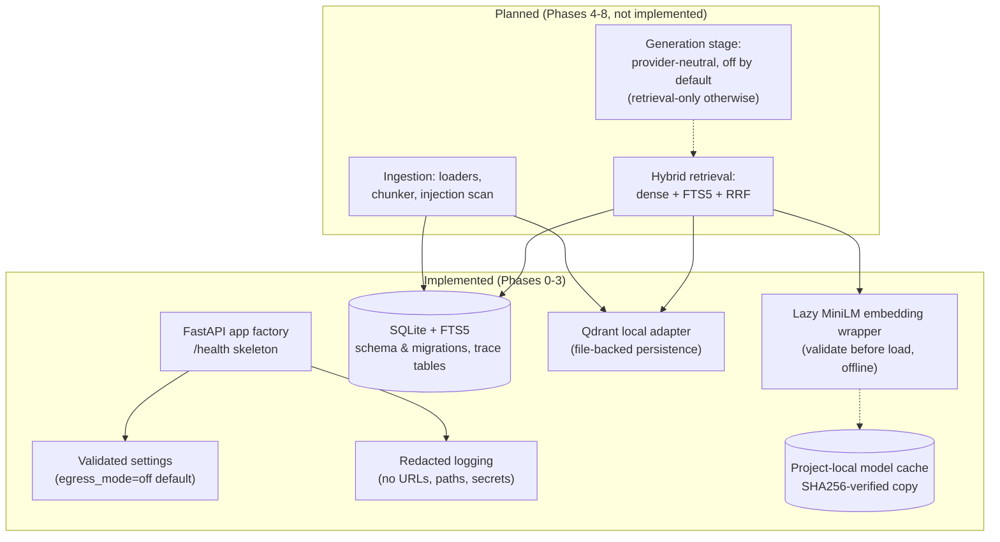

# RAG Platform

A resource-aware, local-first retrieval-augmented generation (RAG) platform with hybrid
retrieval, controlled generation, and explicit safety boundaries. The project is developed
against a canonical plan — **`RAG_Platform_Master_Plan_v2.4.md`** — and is currently
through **Phase 3** of its implementation sequence: the storage and embedding foundations
exist; the retrieval pipeline, generation stage, and evaluation harness do not yet.

## 1. Problem statement and goals

Retrieval-augmented generation is easy to demo and hard to trust. Typical
implementations silently depend on cloud services, unbounded resource usage, and
unverifiable answers. This project targets the opposite:

- **Run honestly on constrained hardware.** The development machine is a 15 GB RAM
  Windows laptop; system resource safety outranks features and benchmarks
  (`docs/RESOURCE_BUDGET.md`, plan §10.4).
- **Prove, don't claim.** Every metric is measured here, dated, and labeled; every
  status is `passed / failed / blocked / skipped / not-measured` — never silently
  downgraded (plan §9.1, Appendix B).
- **Cost-free by construction.** No API key is required for any gate or test; the
  default configuration performs no outbound network traffic at all.
- **Local core, optional cloud.** Ingestion, retrieval, authorization, evidence
  assembly, and storage are local and stay functional when every LLM provider is
  unavailable; cloud generation is a proposal that is *off by default* (plan v2.4
  Appendix A, decisions D13–D18 — all pending).

## 2. Core design principles

| Principle | What it means in practice |
|---|---|
| **Local-first** | All data, databases, caches, and models live under the project directory on the `D:` drive. No service dependency is required to run tests or gates. |
| **Modular** | Source is split into independent modules (`config`, `db`, `vectorstore`, `embeddings`, future `ingestion`/`retrieval`/`generation`), each with its own tests. |
| **Resource-aware** | Hard budgets with start gates and abort floors: 3 GB start gate, 2 GB emergency floor, binding caps (plan §10.1/§10.2). The owner's 90 %-total-RAM ceiling is documented policy; it is *not* enforced by application code — the application refuses/monitors/aborts only its own operations (plan §10.4). |
| **Deterministic** | Offline, deterministic tests; frozen evaluation datasets; no retries-as-magic — failures surface as typed, recorded outcomes. |
| **Security-conscious** | `EGRESS_MODE=off` by default, path containment (everything resolves under the project root), startup-rejection of invalid configuration, redacted logging that never echoes URLs, paths, keys, or prompts. |

## 3. Architecture overview

What exists in code today (Phases 0–3) versus what the plan schedules next:



Notes on the current wiring, stated honestly:

- `/health` reports configuration facts only — mode labels and booleans, never
  configuration values (invariant I6).
- `db`, `vectorstore`, and `embeddings` are standalone, fully tested modules.
  **No pipeline connects them yet** — there is no ingestion, no retrieval endpoint,
  and no generation code in the repository.
- The embedding wrapper loads `sentence-transformers/all-MiniLM-L6-v2` strictly from
  the project-local cache (`local_files_only=True`); it has **not** been executed
  against a real model on this machine yet (see §9).

## 4. Current implementation status

| Phase | Scope | Status |
|---|---|---|
| **0** | Repository foundation: `git init`, pinned dependencies (uv), `.gitignore`, destination-aware disk checks, FTS5 detection, `.env.example` | **Complete** — commit `282cd11` |
| **1** | Validated configuration (egress off, kill switches, startup rejection), redacted logging, `/health` skeleton | **Complete** — commit `7cee270` |
| **2** | SQLite migrations + FTS5 schema + trace tables; Qdrant-local adapter with persistence/filter tests | **Complete** — commit `c27af5e` |
| **3** | Provider-neutral, lazy MiniLM embedding wrapper; hash-verified local model-cache copy (decision D2) | **Complete** — commit `9acb0d3` |
| 0.5 | BG-1a model benchmark (feeds generation decisions) | **Not completed** — recorded attempts aborted at the resource stop conditions and classified as incident evidence, not valid results; a compliant run awaits owner approval |
| 4+ | Ingestion, retrieval, generation, API/CLI, evaluation, gates M1–M4 | **Not started** |

The four implementation commits are linear and unrewritten (Phase 0 → 3).

## 5. Repository structure

```
.
├── src/rag_platform/
│   ├── config.py            # pydantic-settings; validated at startup; project-root path containment
│   ├── logging_setup.py     # redacted logging (never logs secrets, URLs, paths, prompts)
│   ├── main.py              # FastAPI app factory; /health only (docs/openapi disabled)
│   ├── db/                  # SQLite opener (WAL, containment), migrations, schema.sql (FTS5 + traces)
│   ├── vectorstore/         # Qdrant local (file-backed) adapter: add/search/filter/remove
│   └── embeddings/          # lazy MiniLM wrapper + cache copy/verify utilities (Phase 3)
├── tests/                   # hermetic tests: config, health, logging, db, vectorstore, embeddings
│   └── egress/              # no-outbound assertions (expands at Phase 6)
├── scripts/
│   ├── env.ps1              # process-scoped env: all caches/temp on D:, HF offline flags, EGRESS_MODE=off
│   ├── setup.ps1            # environment checks → dated report under reports\
│   ├── check_fts5.py        # FTS5 availability probe
│   └── bench_model.*        # owner benchmark scripts for the gated BG-1a protocol (not run here)
├── docs/RESOURCE_BUDGET.md  # binding resource-safety policy (§5)
├── data/                    # ALL operational data (SQLite, Qdrant, logs, traces, temp) — gitignored
├── reports/                 # generated reports — gitignored, never published
├── .cache/                  # uv + Hugging Face caches (model copy lives here) — gitignored
├── pyproject.toml           # pinned dependencies; CPU-only torch index; pytest config
├── uv.lock                  # locked dependency graph
├── .env.example             # placeholder-only template; real .env is gitignored and absent
└── RAG_Platform_Master_Plan_v2.4.md   # canonical plan (+ change note; superseded versions preserved)
```

## 6. Technology stack

Based on the actual, pinned dependencies (`pyproject.toml`, `uv.lock`):

| Layer | Choice |
|---|---|
| Language / runtime | Python **3.14** (`requires-python = ">=3.14"`; documented fallback to uv-managed 3.12/3.13, plan R7) |
| Environment & locks | **uv** (project-local cache/interpreter dirs on `D:`) |
| API | **FastAPI** + **uvicorn** (OpenAPI/docs endpoints disabled) |
| Configuration | **pydantic** / **pydantic-settings** (validated, startup-rejecting) |
| HTTP client | **httpx** (future provider-neutral generation interface — no provider SDKs) |
| Embeddings | **sentence-transformers** with **torch (CPU-only wheels)** — CUDA wheels deliberately excluded |
| Vector store | **qdrant-client** in local/file-backed mode (no server) |
| Document store | **SQLite** (stdlib) with **FTS5** full-text search + trace tables |
| Documents | **pypdf** (planned Phase 4 loaders) |
| System monitoring | **psutil** (resource gates) |
| Testing / audit | **pytest**, **pytest-cov**, **pip-audit** |

Explicitly *not* added (plan §6): provider SDKs, LiteLLM-class gateways, agent
frameworks, hosted observability, `networkx` (deferred to a conditional M4 experiment).

## 7. Setup and development

Prerequisites: Windows with a `D:` drive, [uv](https://docs.astral.sh/uv/), and
PowerShell. All commands run from the project root.

```powershell
# 1. Process-scoped environment: caches/temp under D:\rag-platform,
#    Hugging Face offline flags, EGRESS_MODE=off (no global changes)
. .\scripts\env.ps1

# 2. Sync pinned dependencies (CPU-only torch index)
uv sync

# 3. Environment checks → dated report under reports\
.\scripts\setup.ps1
```

- Tests do not require a `.env` file. To run one locally, copy `.env.example` to
  `.env` (gitignored, never committed) — the template contains placeholders only and
  keeps outbound network disabled by default.
- To start the API later (documented for discoverability; not exercised by tests):

  ```powershell
  $env:PYTHONPATH = "src"
  python -m uvicorn --factory rag_platform.main:create_app
  ```

## 8. Testing

```powershell
.venv\Scripts\python.exe -m pytest        # from the project root
```

Tests are hermetic by construction: configuration environment is scrubbed per test,
fixtures stay under the project root (`data\tmp`, gitignored), and no test performs
network access, loads a model, or contacts any service.

**Historical results (recorded during the corresponding implementation sessions,
2026-10-19 — prior evidence, not a fresh run):**

- Phase 1 suite: **47 passed**, 1 upstream `StarletteDeprecationWarning`
  (fastapi/testclient — not project code).
- Phase 2: **33 passed**; full suite at that time (Phases 1+2): **80 passed**.
- Phase 3 targeted wrapper/cache tests: **26 passed, 0 failed** in 0.52 s.

**No tests were executed during this publication.** The figures above are cited from
the recorded implementation reports under `reports\` (gitignored, local-only); they
were not re-run, and the full suite has not been re-run since the Phase 3 commit.

## 9. Resource-safety, path containment, and network constraints

- **Egress is off by default and cloud providers are not activated.**
  `EGRESS_MODE=off` is the code default *and* the `env.ps1` default; there is no
  provider configuration, no key, and no generation code path in the repository.
  Enabling any provider is explicit, gated owner action (plan v2.4 §5.1, D13–D18 —
  all pending). The default system is retrieval-*oriented* and becomes
  retrieval-only by design once retrieval exists.
- **Path containment.** Settings and storage helpers resolve every path under the
  project root and refuse paths that escape it; `setup.ps1` asserts that
  `UV_CACHE_DIR`, `UV_PYTHON_INSTALL_DIR`, `HF_HOME`, `TMP`/`TEMP`, logs, and
  reports all resolve under `D:\rag-platform`. There is deliberately **no C:
  free-space gate**; the project never writes outside its directory.
- **Resource gates.** 3 GB start gate, 2 GB emergency floor, and binding memory/time
  budgets are documented in `docs/RESOURCE_BUDGET.md`. The 90 %-total-RAM ceiling is
  an owner policy target, not a code-enforced limit — a user-space application can
  only refuse work and monitor its own operations (plan §10.4).
- **Repository hygiene.** `.env`, `data/`, `reports/`, `.cache/` (including the
  copied model weights), virtual environments, and compiled artifacts are gitignored
  and were never staged. Repository content was scanned for credentials before
  publication: none found.

## 10. Roadmap (plan v2.4 §15)

- **Phase 0.5 — BG-1a model benchmark:** not completed. Attempts recorded on
  2026-10-19 aborted at the resource stop conditions (start gate / emergency RAM
  floor) and are classified as incident evidence — **not valid benchmark results**,
  with no throughput data; a compliant run awaits owner approval.
- **Phase 4** — Ingestion: loaders, chunker, injection scan, declared-date capture.
- **Phase 5** — Hybrid retrieval: dense + FTS5 + RRF, post-verify stub, score floor.
- **Phase 6** — Generation: provider-neutral client interface (local Ollama adapter
  only at M1), bounded context, citations, abstention path; **no provider enabled by
  default → retrieval-only**; socket-instrumented egress proof.
- **Phase 7** — API + CLI (incl. `report` skeleton).
- **Phase 8** — Frozen corpus with planted structures + eval harness + trace
  recorder → **Gate M1**, then milestones **M2** (evidence ledger), **M3**
  (attribution/scoring), **M4** (budget policy/optimization).
- **Phases 9–11** *(proposed, strictly additive, gated D15–D17)* — provider router
  core, provider verification & enablement, provider-enabled evaluation.

Decisions **D13–D18** (cloud-first architecture direction, provider order, provider
verification, router implementation, provider evaluation, outbound budget numbers)
are all **pending**; with them unapproved, execution is identical to the v2.3
retrieval-only sequence.

## 11. Current limitations and unverified behavior

- **This is not a working RAG pipeline.** There is no ingestion, retrieval,
  generation, CLI, or evaluation yet — only the `/health` skeleton and the
  tested building blocks above.
- **Model inference has never been run.** The Phase 3 cache copy is verified by
  file hashes, and the expected embedding dimension (384) is derived from the local
  model snapshot's `config.json` — **loading the model and producing embeddings on
  this machine is unverified** and intentionally deferred.
- **Test results are historical.** See §8; no fresh suite run accompanies this
  publication.
- **BG-1a benchmark: no valid result.** The recorded attempts aborted at resource
  stop conditions; no benchmark, throughput, latency, or quality numbers are
  claimed anywhere in this repository.
- **Cloud providers: not integrated, not verified, not activated.** The provider
  order in the plan is a proposal only; no model IDs, quotas, or pricing are asserted.
- **The 90 % RAM ceiling is not code-enforced** (documented in §9 above).
- **Windows/`D:`-specific.** Scripts and path assertions assume this layout.
