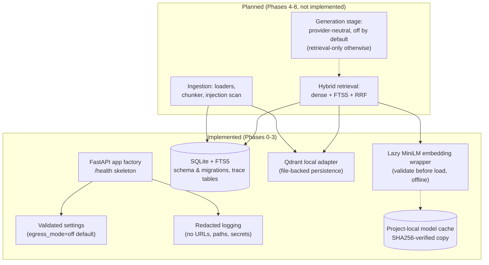

# RAG Platform

A resource-aware, local-first retrieval-augmented generation (RAG) platform with hybrid
retrieval, controlled generation, and explicit safety boundaries. The project is developed
against a canonical plan — **`RAG_Platform_Master_Plan_v2.4.md`** — and is currently
through **Phase 7** of its implementation sequence (Phases 0–7 implemented and verified;
Phases 4–7 live as uncommitted working-tree work): configuration, storage, embeddings,
ingestion, hybrid retrieval, generation, and the API/CLI surfaces exist; the evaluation
harness, model inference, and provider enablement do not.

## 1. Problem statement and goals

Retrieval-augmented generation is easy to demo and hard to trust. Typical
implementations silently depend on cloud services, unbounded resource usage, and
unverifiable answers. This project targets the opposite:

- **Run honestly on constrained hardware.** The development machine is a 15 GB RAM
  Windows laptop; system resource safety outranks features and benchmarks
  (`docs/RESOURCE_BUDGET.md`, plan §10.4).
- **Prove, don't claim.** Every metric is measured here, dated, and labeled; every
  status is `passed / failed / blocked / skipped / not-measured` — never silently
  downgraded (plan §9.1, Appendix B).
- **Cost-free by construction.** No API key is required for any gate or test; the
  default configuration performs no outbound network traffic at all.
- **Local core, optional cloud.** Ingestion, retrieval, authorization, evidence
  assembly, and storage are local and stay functional when every LLM provider is
  unavailable; cloud generation is a proposal that is *off by default* (plan v2.4
  Appendix A, decisions D13–D18 — all pending).

## 2. Core design principles

| Principle | What it means in practice |
|---|---|
| **Local-first** | All data, databases, caches, and models live under the project directory on the `D:` drive. No service dependency is required to run tests or gates. |
| **Modular** | Source is split into independent modules (`config`, `db`, `vectorstore`, `embeddings`, future `ingestion`/`retrieval`/`generation`), each with its own tests. |
| **Resource-aware** | Hard budgets with start gates and abort floors: 3 GB start gate, 2 GB emergency floor, binding caps (plan §10.1/§10.2). The owner's 90 %-total-RAM ceiling is documented policy; it is *not* enforced by application code — the application refuses/monitors/aborts only its own operations (plan §10.4). |
| **Deterministic** | Offline, deterministic tests; frozen evaluation datasets; no retries-as-magic — failures surface as typed, recorded outcomes. |
| **Security-conscious** | `EGRESS_MODE=off` by default, path containment (everything resolves under the project root), startup-rejection of invalid configuration, redacted logging that never echoes URLs, paths, keys, or prompts. |

## 3. Architecture overview

What exists in code today (Phases 0–3) versus what the plan schedules next:



Notes on the current wiring, stated honestly:

- `/health` reports configuration facts only — mode labels and booleans, never
  configuration values (invariant I6).
- `db`, `vectorstore`, and `embeddings` are standalone, fully tested modules.
  **No pipeline connects them yet** — there is no ingestion, no retrieval endpoint,
  and no generation code in the repository.
- The embedding wrapper loads `sentence-transformers/all-MiniLM-L6-v2` strictly from
  the project-local cache (`local_files_only=True`); it has **not** been executed
  against a real model on this machine yet (see §9).

## 4. Current implementation status

| Phase | Scope | Status |
|---|---|---|
| **0** | Repository foundation: `git init`, pinned dependencies (uv), `.gitignore`, destination-aware disk checks, FTS5 detection, `.env.example` | **Complete** — commit `282cd11` |
| **1** | Validated configuration (egress off, kill switches, startup rejection), redacted logging, `/health` skeleton | **Complete** — commit `7cee270` |
| **2** | SQLite migrations + FTS5 schema + trace tables; Qdrant-local adapter with persistence/filter tests | **Complete** — commit `c27af5e` |
| **3** | Provider-neutral, lazy MiniLM embedding wrapper; hash-verified local model-cache copy (decision D2) | **Complete** — commit `9acb0d3` |
| 0.5 | BG-1a model benchmark (feeds generation decisions) | **Not completed** — recorded attempts aborted at the resource stop conditions and classified as incident evidence, not valid results; a compliant run awaits owner approval |
| **4** | Ingestion: loaders, bounded chunker, injection scan, declared-date capture | **Complete** — uncommitted working tree, 2026-10-20 |
| **5** | Hybrid retrieval: FTS5 + dense + RRF fusion, post-verify stub, score floor | **Complete** — uncommitted working tree, 2026-10-20 |
| **6** | Generation: provider-neutral contracts, bounded context, citations, abstention; inert Ollama adapter; BG-1b proof | **Complete** — uncommitted working tree, 2026-10-20 |
| **7** | API (`POST /query`) + argparse CLI incl. `report` skeleton + boundary tracing | **Complete** — uncommitted working tree, 2026-10-20 |
| **8** | Frozen corpus + eval harness + trace recorder → Gate M1, then M2–M4 | **Complete** — uncommitted working tree, 2026-10-21; Gate M1 evidence checklist recorded with blocked items (see §13) |

The four implementation commits are linear and unrewritten (Phase 0 → 3);
Phases 4–8 are implemented but deliberately left **unstaged and uncommitted** —
commits are the owner's decision.

## 5. Repository structure

```
.
├── src/rag_platform/
│   ├── config.py            # pydantic-settings; validated at startup; project-root path containment
│   ├── logging_setup.py     # redacted logging (never logs secrets, URLs, paths, prompts)
│   ├── main.py              # FastAPI app factory; /health + /query (docs/openapi disabled)
│   ├── api.py               # /query schemas + shared run_query orchestration (Phase 7)
│   ├── cli.py               # argparse CLI: query, report skeleton, exit codes (Phase 7)
│   ├── tracing.py           # best-effort boundary trace over the Phase 2 trace tables
│   ├── db/                  # SQLite opener (WAL, containment), migrations, schema.sql (FTS5 + traces)
│   ├── vectorstore/         # Qdrant local (file-backed) adapter: add/search/filter/remove
│   ├── eval/                # frozen-dataset loader, metrics, harness, report writer (Phase 8)
│   ├── observability.py     # frozen stage-outcome vocabulary + observer seam (Phase 8)
│   └── embeddings/          # lazy MiniLM wrapper + cache copy/verify utilities (Phase 3)
├── tests/                   # hermetic tests: config, health, logging, db, vectorstore, embeddings
│   └── egress/              # no-outbound assertions (expands at Phase 6)
├── scripts/
│   ├── env.ps1              # process-scoped env: all caches/temp on D:, HF offline flags, EGRESS_MODE=off
│   ├── setup.ps1            # environment checks → dated report under reports\
│   ├── check_fts5.py        # FTS5 availability probe
│   └── bench_model.*        # owner benchmark scripts for the gated BG-1a protocol (not run here)
├── corpora/                  # frozen locally-authored eval datasets — gitignored, UNCOMMITTED pending owner exception (change note §12)
├── docs/RESOURCE_BUDGET.md  # binding resource-safety policy (§5)
├── docs/EVALUATION.md        # Phase 8 evaluation harness reference (added 2026-10-21)
├── data/                    # ALL operational data (SQLite, Qdrant, logs, traces, temp) — gitignored
├── reports/                 # generated reports — gitignored, never published
├── .cache/                  # uv + Hugging Face caches (model copy lives here) — gitignored
├── pyproject.toml           # pinned dependencies; CPU-only torch index; pytest config
├── uv.lock                  # locked dependency graph
├── .env.example             # placeholder-only template; real .env is gitignored and absent
└── RAG_Platform_Master_Plan_v2.4.md   # canonical plan (+ change note; superseded versions preserved)
```

## 6. Technology stack

Based on the actual, pinned dependencies (`pyproject.toml`, `uv.lock`):

| Layer | Choice |
|---|---|
| Language / runtime | Python **3.14** (`requires-python = ">=3.14"`; documented fallback to uv-managed 3.12/3.13, plan R7) |
| Environment & locks | **uv** (project-local cache/interpreter dirs on `D:`) |
| API | **FastAPI** + **uvicorn** (OpenAPI/docs endpoints disabled) |
| Configuration | **pydantic** / **pydantic-settings** (validated, startup-rejecting) |
| HTTP client | **httpx** (future provider-neutral generation interface — no provider SDKs) |
| Embeddings | **sentence-transformers** with **torch (CPU-only wheels)** — CUDA wheels deliberately excluded |
| Vector store | **qdrant-client** in local/file-backed mode (no server) |
| Document store | **SQLite** (stdlib) with **FTS5** full-text search + trace tables |
| Documents | **pypdf** (planned Phase 4 loaders) |
| System monitoring | **psutil** (resource gates) |
| Testing / audit | **pytest**, **pytest-cov**, **pip-audit** |

Explicitly *not* added (plan §6): provider SDKs, LiteLLM-class gateways, agent
frameworks, hosted observability, `networkx` (deferred to a conditional M4 experiment).

## 7. Setup and development

Prerequisites: Windows with a `D:` drive, [uv](https://docs.astral.sh/uv/), and
PowerShell. All commands run from the project root.

```powershell
# 1. Process-scoped environment: caches/temp under D:\rag-platform,
#    Hugging Face offline flags, EGRESS_MODE=off (no global changes)
. .\scripts\env.ps1

# 2. Sync pinned dependencies (CPU-only torch index)
uv sync

# 3. Environment checks → dated report under reports\
.\scripts\setup.ps1
```

- Tests do not require a `.env` file. To run one locally, copy `.env.example` to
  `.env` (gitignored, never committed) — the template contains placeholders only and
  keeps outbound network disabled by default.
- To start the API later (documented for discoverability; not exercised by tests):

  ```powershell
  $env:PYTHONPATH = "src"
  python -m uvicorn --factory rag_platform.main:create_app
  ```

## 8. Testing

```powershell
.venv\Scripts\python.exe -m pytest        # from the project root
```

Tests are hermetic by construction: configuration environment is scrubbed per test,
fixtures stay under the project root (`data\tmp`, gitignored), and no test performs
network access, loads a model, or contacts any service.

**Historical results (recorded during the corresponding implementation sessions,
2026-10-19 — prior evidence, not a fresh run):**

- Phase 1 suite: **47 passed**, 1 upstream `StarletteDeprecationWarning`
  (fastapi/testclient — not project code).
- Phase 2: **33 passed**; full suite at that time (Phases 1+2): **80 passed**.
- Phase 3 targeted wrapper/cache tests: **26 passed, 0 failed** in 0.52 s.

**Fresh run accompanying the Phase 7 update (2026-10-20, actual):** full suite
**522 passed, 0 failed, 0 skipped**, 1 upstream `StarletteDeprecationWarning`,
25.42 s (`.venv` Python from the project root); Phase 7 targeted run
(API + CLI + health + egress): **58 passed**. The historical figures above
remain as originally recorded.

**Fresh run accompanying the Phase 8 update (2026-10-21, actual):** full suite
**641 passed, 0 failed, 1 skipped**, 1 upstream `StarletteDeprecationWarning`,
30.88 s; peak working set of the test process **139.4 MB** (`GetProcessMemoryInfo` measurement). The 1 skip is the Windows symlink-privilege
fixture check (`tests/eval/test_dataset.py`); the warning is the same
pre-existing upstream deprecation. Phase 8 targeted runs: `pytest tests\eval`
**106 passed, 1 skipped** (2.28 s); `pytest tests\egress tests\test_observer_trace.py`
**18 passed** (7.67 s). Baseline 522 + 1 lexical tie-break test + 118 new
Phase 8 tests = 641.

**Superseded by the `dataset_id` security-fix run (2026-10-23, actual):** full
suite **702 passed, 0 failed, 1 skipped**, 1 upstream
`StarletteDeprecationWarning`, 31.92 s; security regression tests
(`tests\eval\test_dataset_id_security.py`) **55 passed**; `pytest tests\eval`
**167 passed, 1 skipped**; adjacent CLI/egress/health trio **29 passed,
1 warning**. Record chain, each superseding the last because changed code
invalidated it: 641 (Phase 8, pre-fix) → 696 → **702**; the 641 figure above
remains as originally recorded for the pre-fix tree. Details:
`reports\security_fix_dataset_id_20261021.md`.

## 9. Resource-safety, path containment, and network constraints

- **Egress is off by default and cloud providers are not activated.**
  `EGRESS_MODE=off` is the code default *and* the `env.ps1` default; there is no
  provider configuration, no key, and no generation code path in the repository.
  Enabling any provider is explicit, gated owner action (plan v2.4 §5.1, D13–D18 —
  all pending). The default system is retrieval-*oriented* and becomes
  retrieval-only by design once retrieval exists.
- **Path containment.** Settings and storage helpers resolve every path under the
  project root and refuse paths that escape it; `setup.ps1` asserts that
  `UV_CACHE_DIR`, `UV_PYTHON_INSTALL_DIR`, `HF_HOME`, `TMP`/`TEMP`, logs, and
  reports all resolve under `D:\rag-platform`. There is deliberately **no C:
  free-space gate**; the project never writes outside its directory.
- **Resource gates.** 3 GB start gate, 2 GB emergency floor, and binding memory/time
  budgets are documented in `docs/RESOURCE_BUDGET.md`. The 90 %-total-RAM ceiling is
  an owner policy target, not a code-enforced limit — a user-space application can
  only refuse work and monitor its own operations (plan §10.4).
- **Repository hygiene.** `.env`, `data/`, `reports/`, `.cache/` (including the
  copied model weights), virtual environments, and compiled artifacts are gitignored
  and were never staged. Repository content was scanned for credentials before
  publication: none found.

## 10. Roadmap (plan v2.4 §15)

- **Phase 0.5 — BG-1a model benchmark:** not completed. Attempts recorded on
  2026-10-19 aborted at the resource stop conditions (start gate / emergency RAM
  floor) and are classified as incident evidence — **not valid benchmark results**,
  with no throughput data; a compliant run awaits owner approval.
- **Phase 4** — Ingestion: loaders, chunker, injection scan, declared-date capture.
- **Phase 5** — Hybrid retrieval: dense + FTS5 + RRF, post-verify stub, score floor.
- **Phase 6** — Generation: provider-neutral client interface (local Ollama adapter
  only at M1), bounded context, citations, abstention path; **no provider enabled by
  default → retrieval-only**; socket-instrumented egress proof.
- **Phase 7** — API + CLI (incl. `report` skeleton).
- **Phase 8** — Frozen corpus with planted structures + eval harness + trace
  recorder → **Gate M1**, then milestones **M2** (evidence ledger), **M3**
  (attribution/scoring), **M4** (budget policy/optimization).
  *Implemented 2026-10-21 (uncommitted): corpus + harness + CLI `eval`/`ingest`
  + Gate M1 evidence checklist — Gate M1 is **not** passed (blocked criteria
  recorded; see §13.6).*
- **Phases 9–11** *(proposed, strictly additive, gated D15–D17)* — provider router
  core, provider verification & enablement, provider-enabled evaluation.

Decisions **D13–D18** (cloud-first architecture direction, provider order, provider
verification, router implementation, provider evaluation, outbound budget numbers)
are all **pending**; with them unapproved, execution is identical to the v2.3
retrieval-only sequence.

## 11. Current limitations and unverified behavior

- **The query pipeline works end to end (retrieval-only by default); the general
  ingestion surface is still library-level** — there is no `/ingest` endpoint
  (the only CLI entry point is the manifest-confined `ingest` subcommand for
  frozen eval datasets, §13.2), and the API/CLI retrieval leg remains
  **lexical-only** (see §12.5). The evaluation harness exists (§13), but
  **Gate M1 is not passed** — its evidence checklist records blocked criteria
  (generation-enabled run, score floor, BG-1a verdict, memory spike), and
  M2–M4 do not exist.
- **Model inference has never been run.** The Phase 3 cache copy is verified by
  file hashes, and the expected embedding dimension (384) is derived from the local
  model snapshot's `config.json` — **loading the model and producing embeddings on
  this machine is unverified** and intentionally deferred.
- **Test results.** §8 records the historical figures, the fresh full-suite run
  of 2026-10-20 (522 passed), the Phase 8 run of 2026-10-21 (641 passed,
  1 skipped — superseded by the security-fix run), and the current
  authoritative full-suite record of 2026-10-23 (**702 passed, 1 skipped**,
  1 warning); no benchmark or model-inference result exists anywhere.
  Intermediate commits in the 2026-10-23 publication are not independently
  test-verified — only the final tree carries the 702 record (see change
  note §13).
- **BG-1a benchmark: no valid result.** The recorded attempts aborted at resource
  stop conditions; no benchmark, throughput, latency, or quality numbers are
  claimed anywhere in this repository.
- **Cloud providers: not integrated, not verified, not activated.** The provider
  order in the plan is a proposal only; no model IDs, quotas, or pricing are asserted.
- **The 90 % RAM ceiling is not code-enforced** (documented in §9 above).
- **Windows/`D:`-specific.** Scripts and path assertions assume this layout.

## 12. Phase 7 — API and CLI (added 2026-10-20)

Phase 7 exposes the existing Phase 5 retrieval and Phase 6 generation
orchestration. Both surfaces call the **same** orchestration function
(`rag_platform.api.run_query`); neither re-implements retrieval, abstention,
or citation logic, and neither ever fabricates an answer.

### 12.1 API endpoint contract

Start (documented for discoverability; tests never start a server):

```powershell
$env:PYTHONPATH = "src"
python -m uvicorn --factory rag_platform.main:create_app
```

- **`GET /health`** — unchanged Phase 1 contract: configuration facts only
  (mode labels and booleans). It opens no database, probes no provider,
  constructs no client, and loads no model.
- **`POST /query`** — request body `{"query": "<string>"}`: required,
  `1 .. retrieval_query_max_chars` characters (default cap 512), unknown
  fields rejected, raw body bounded at 16 KiB before parsing. Success is
  **HTTP 200** with the canonical Phase 6 response shape —
  `request_id`, `retrieval`, `passages`, `generation`, `abstention`,
  `citations` — preserving retrieval-only, abstention, provider-unavailable,
  and invalid-citation outcomes exactly as the pipeline produced them. The
  server-generated `request_id` is echoed in the `X-Request-ID` header.

Errors use one sanitized envelope, `{"error": {"category", "detail"}}`, with
constant detail strings — raw prompts, retrieved content, filesystem paths,
exception messages, and tracebacks are never echoed (unexpected errors log
the exception *class* name only):

| Status | Category | Meaning |
|---|---|---|
| 404 / 405 | *(Starlette default)* | unknown route / wrong method (no app data) |
| 413 | `request_too_large` | body over the 16 KiB bound, rejected before parsing |
| 422 | `invalid_request` | malformed JSON, empty/missing/wrong-typed/extra field, or query over the retrieval cap (input never echoed) |
| 503 | `storage_unavailable` | SQLite open/migration/query failure |
| 500 | `internal_error` | unexpected failure (class name logged only) |

A generation-**unavailable** result (provider disabled, unconfigured,
unreachable, or serving invalid citations) is **not** an HTTP error: it is a
valid, truthful **HTTP 200 retrieval-only response** with
`generation.failure_category` set.

### 12.2 CLI invocation

```powershell
.venv\Scripts\python.exe -m rag_platform.cli --help
.venv\Scripts\python.exe -m rag_platform.cli query "walrus habitat"
.venv\Scripts\python.exe -m rag_platform.cli query --json "walrus habitat"
.venv\Scripts\python.exe -m rag_platform.cli report runs --limit 5
.venv\Scripts\python.exe -m rag_platform.cli report failures --run <request_id>
# optional global flag: --db <path>  (default: <data_dir>\sqlite\rag.db)
```

- `query` default output is a **bounded summary**: outcome labels, abstention
  reason, answer text when one exists, citation and passage provenance —
  **no passage-content dump**. `--json` prints the full canonical response
  for piping.
- Exit codes: **0** = a canonical response completed (answered, abstained, or
  retrieval-only — degradation is a truthful outcome, not a crash);
  **2** = invalid input (usage error, empty/whitespace/over-cap query, unknown
  run id, bad `--limit`); **3** = unrecoverable (storage unavailable or
  internal error — safe message only, never a traceback or path).
- `report` is the Phase 7 **skeleton**: it renders recorded trace rows as
  JSON. Per-class failure attribution, worst-query ranking, and before/after
  comparison arrive with the Phase 8/M3 recorder and are not faked here.

### 12.3 Tracing behavior and limitations

Each **completed** query (API or CLI) writes one `traces` row plus three
`trace_stages` rows (`retrieval`, `generation`, `response`) into the existing
Phase 2 tables — **no schema change and no migration**. Rows carry safe
structured metadata only: request id, UTC timestamp, `served_by`
(provider:model label or `retrieval_only`), sanitized `degradation_reason`,
stage outcomes, durations, bounded score summaries, SHA-256 digests, and
attempt counts. Never stored: queries, prompts, retrieved text, excerpts
(always NULL pre-M2), filesystem paths, API keys, or exception details.
`trace_authz` stays empty until M2 authorization exists, and `cache_status`
is honestly `not_implemented` until M4.

**Failure policy:** trace persistence is *best-effort and non-blocking*. If
the write fails, the failure is logged (exception class name only) and the
response is returned unchanged — a trace failure never fabricates success and
never converts a valid retrieval-only response into an error (tested).
Durable recording is only what the SQLite transaction commits; rejected
(4xx) and storage-failed requests are not traced, and full nine-stage trace
completeness belongs to the Phase 8 recorder.

### 12.4 Running the offline tests

```powershell
& ".\.venv\Scripts\python.exe" -m pytest -q                                    # full suite
& ".\.venv\Scripts\python.exe" -m pytest tests\test_api_query.py tests\test_cli.py tests\egress -q
```

All Phase 7 tests are deterministic and offline: FastAPI's in-process ASGI
test client, temporary SQLite databases under `data\tmp\` (on `D:`), fake
clients, and dead loopback ports only — no server process, no model load, no
provider contact, no dependency install, no subprocess.

### 12.5 Known Phase 7 limitations

- **Lexical-only retrieval at this surface:** the API/CLI retriever runs
  SQLite FTS5 with `embedder=None, store=None`. The dense leg (MiniLM +
  Qdrant) stays gated behind the BG-1a/D3 verdict; the Phase 7 modules never
  import `sentence_transformers` or `qdrant_client` (asserted by test), and
  no model is loaded by `/health`, `/query`, or the CLI.
- **No authentication or tenancy** (M2 owns it); the API is a single-user,
  local surface. No rate limiting, concurrency hardening, or deployment
  hardening is claimed.
- **No `/ingest` endpoint** — the API has no ingestion surface (see §11); the
  only ingestion entry point is the manifest-confined `ingest` CLI subcommand
  for frozen eval datasets (§13.2).
- **Chunked bodies without a `Content-Length` header** are bounded by
  parse-time detection (query cap), not pre-parse rejection — detection, not
  prevention, as documented for other bounded readers in this project.
- **The 90 % RAM ceiling is an owner policy, not a code-enforced gate** (§9).

## 13. Phase 8 — Evaluation harness (added 2026-10-21)

Phase 8 adds a frozen, reproducible, fully offline evaluation workflow:
`src\rag_platform\eval\` (dataset loader/validator, stdlib-only metrics, the
harness that reuses the shared `run_query`, and the JSON+Markdown report
writer), the frozen corpus builder (`scripts\build_frozen_corpus.py`), the
CLI `eval`/`ingest` commands, and the observer seam in `observability.py` /
`api.py` that lets the harness record real stage timings. Full reference:
**`docs\EVALUATION.md`**.

### 13.1 Frozen corpus (`corpora\synthetic_v1`)

24 locally-authored documents (10 TXT / 8 MD / 6 PDF, 63–85 KB each) and 114
frozen questions — dev **70** / test **44**, 40 multi-hop, all five question
types in both splits — with a SHA-256 manifest (`rag-platform-eval-manifest/1`)
verified in full before any run (per-file hash + size, path confinement, split
and label rules; any failure aborts). Gold spans/chunk IDs were produced with
the production chunker. The corpus is read-only at runtime and **uncommitted**:
`.gitignore` ignores `corpora/` despite its own "frozen eval datasets ARE
committed" comment — the conflict and the minimal proposed exception are
recorded in the change note §12 for the owner (`.gitignore` unchanged,
nothing staged).

### 13.2 CLI

```powershell
$env:PYTHONPATH = "src"
.venv\Scripts\python.exe -m rag_platform.cli eval  --dataset corpora\synthetic_v1 --split dev
.venv\Scripts\python.exe -m rag_platform.cli eval  --dataset corpora\synthetic_v1 --split dev --tuning
.venv\Scripts\python.exe -m rag_platform.cli ingest --dataset corpora\synthetic_v1
```

- `eval` always runs **generation-disabled** — there is no flag that enables
  it (argparse destinations are exactly `dataset, split, tuning, top_k, out`),
  and `EvalConfigError` refuses a run if settings ever enable generation.
- `--tuning` refuses the test split *before the file is read*; every report
  records `prior_test_split_evaluations` (dataset-wide count; resets if
  `data\eval_runs\` is deleted).
- `ingest` ingests only manifest-listed files after full verification
  (fail-closed); ambient files are ignored, question labels never reach the
  index.
- Exit codes: **0** clean; **2** invalid input (incl. tuning+test, bad top-k,
  paths outside the project, `EvalConfigError`); **3** integrity failure or
  unexpected internal error (exception class name only — never a traceback);
  **4** completed with per-query typed errors (report still written, errors
  stay in the denominators).

### 13.3 Metrics and status semantics

Recall@5/10, precision@5/10, MRR, nDCG@10 (binary, gold-chunk overlap,
macro-averaged over answerable questions with errors scored 0 — errors never
leave the denominator), abstention correctness (evidence-level only;
`generation_unavailable` counts **incorrect**), false-refusal rate,
retrieval-only rate, citation validity, latency p50/p95 (nearest-rank), and
token-F1 only where actual answers exist. Unmeasured metrics carry
`value=None, status=not_measured` — never 0 or 100 % by substitution. Metric
rows are `measured | not_measured`; gate items use the plan §9.1 vocabulary
(`passed/failed/skipped/blocked/not-measured`). **M1 defines no numeric
thresholds — a measured value is evidence, not a pass.**

### 13.4 Reports and trace linkage

Reports land under `reports\` (gitignored) as
`eval_<dataset>_<split>_<UTCstamp>_<runhex>.json` + `.md` and are never
overwritten; the **deterministic** section (digests, config, distributions,
non-latency metrics, ID-only records) is byte-identical across runs on the
same inputs, with run identity/timings isolated in **volatile**. Per-question
request IDs are deterministic (`eval:<dataset>:<split>:<qid>`) and link each
report row to its `traces`/`trace_stages` rows in the per-run database under
`data\eval_runs\`. The default path (no observer) keeps the Phase 7 trace
byte-identically; the harness's observer adds measured retrieval timing and
the `context_build` row (a raising observer is contained). No raw queries,
answers, passages, paths, or exception messages appear in traces or reports.

### 13.5 Observed dev results (2026-10-21) and findings

`reports\eval_synthetic_v1_dev_20261021T075202Z_dc9ab460.{json,md}` — 70
questions, 0 errors: recall@10 **0.9754**, MRR **0.9145**, nDCG@10 **0.8938**,
recall@5 0.8934, precision@5 0.2492, abstention correctness **0.0**,
false-refusal 0.0, retrieval-only 1.0, latency p50 11.23 ms / p95 15.28 ms,
token-F1 + citation validity `not_measured`. Values are byte-identical to an
earlier independent dev run (deterministic). Findings, recorded honestly:
(1) with the default OR-join lexical retriever, `no_candidates` is unreachable
for grammatical questions (`{ok: 70}`); (2) with no approved score floor and
generation disabled, abstain-labeled questions answer `generation_unavailable`
→ abstention correctness 0.0 — correct refusal needs the gated floor/D3
verdict; the plan's ~90 % abstention target is an **M3 (D11)** target, not an
M1 criterion.

### 13.6 Gate M1 status and known Phase 8 limitations

Evidence checklist: `reports\gate_m1_evidence_checklist_20261021.md`.
**Criterion 6 (eval harness end-to-end) is `passed`**; criteria 1, 5, 7 and
the gate-9 memory spike are `blocked` with recorded reasons (generation-enabled
run, score floor, BG-1a verdict, spike measurement — all pending owner
decisions); no gate is claimed fully passed while blocked items remain.
Also: no external-system comparison exists anywhere (R19 — same author writes
corpus and gold; mitigations are frozen hashed splits + published items); the
prior-test counter resets on `data\eval_runs\` deletion; benchmark and
model-inference results remain absent; Phase 9+ is untouched and gated.
