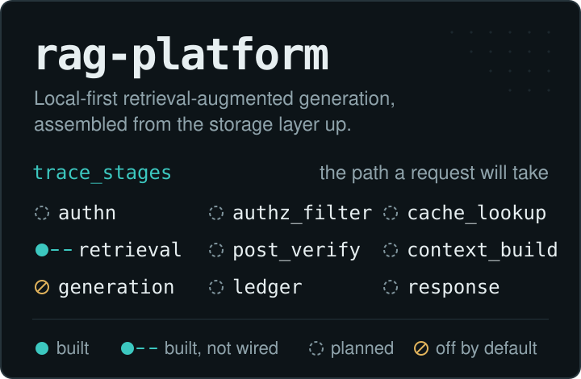
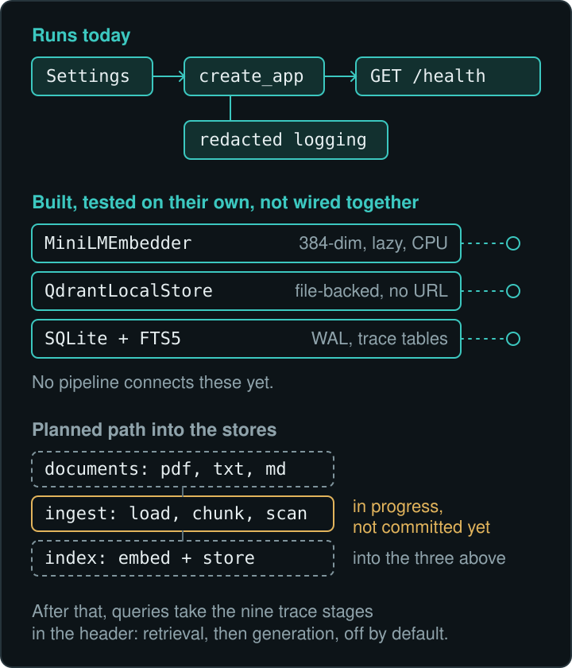

<h1 align="center">
  
</h1>

**rag-platform** is a local-first retrieval-augmented generation engine for one Windows laptop with 15 GB of RAM.
Its data, caches, virtual environment and databases stay inside the project directory, and it sends nothing over the
network by default. It is built in order, from the storage layer up, against a written plan, and it reports what it
has not done as plainly as what it has. The header lists the nine stages every request will pass through, from
`authn` to `response`. The retrieval leg (ingest, store, retrieve) now runs end to end; the answer stages that follow
`generate` do not — generation is off by default, so a query retrieves and abstains rather than writing text.

> [!NOTE]
> **Where it stands:** all eight phases are committed (Phases 4–8 published 2026-10-23 in three commits, merged with
> this README redesign, then hardened by the `question_id` integrity follow-up). The lexical retrieval pipeline runs
> end to end through the API and CLI; generation is off by default, so nothing writes text. Last full suite:
> **800 passed, 1 skipped, 1 warning**. Gate M1 is **not** passed (5 passed / 4 blocked).

[Architecture](#architecture) | [Status](#status-board) | [Inside the code](#inside-the-code) |
[Run it](#run-it) | [Limits](#known-limits) | [Plan v2.4](RAG_Platform_Master_Plan_v2.4.md) |
[Resource budget](docs/RESOURCE_BUDGET.md)

## Architecture

<p align="center">
  
</p>

The drawing above is a phase-0–3 snapshot and now lags the code; the wiring it left open has since landed:

1. **Runs today.** `create_app()` validates `Settings`, installs the redacting log handler and serves two routes,
   `GET /health` and `POST /query`. Ingestion (phase 4), hybrid retrieval (phase 5), the API/CLI surface (phase 7) and
   the evaluation harness (phase 8) are committed and tested; a query runs the lexical retrieval leg end to end.
2. **Built, wired around a stub.** The embedder, the vector store and the SQLite schema are called by the pipeline,
   but the dense leg still runs on a stub: the real MiniLM model has never loaded here, so evaluation measures the
   FTS5 leg only.
3. **Off or gated.** Generation (phase 6) is committed but off by default — a query abstains rather than writing text.
   Phases 9–11 (cloud providers, tenancy) are design from the plan (§5 and §15), not code.

## Status board

| Mark | Meaning |
| --- | --- |
| ● | Built and wired into the running app |
| ◐ | Built and tested on its own; nothing calls it yet |
| ✎ | In progress, not committed |
| ○ | Planned in the canonical plan; no code |
| ⊘ | Off by default |
| – | Not measured |

| Component | Status | Tests and notes |
| --- | --- | --- |
| Settings and startup rejection, [`config.py`](src/rag_platform/config.py) | ● built, wired | `test_config.py` |
| Redacted logging, [`logging_setup.py`](src/rag_platform/logging_setup.py) | ● built, wired | `test_logging_redaction.py` |
| `GET /health` and `POST /query`, [`main.py`](src/rag_platform/main.py) | ● built, wired | `test_health.py`, `test_api_query.py`, `egress/` |
| SQLite (WAL) + FTS5 + trace tables, [`db/`](src/rag_platform/db) | ● built, wired | `test_db_sqlite.py`; tracing writes on every query |
| Qdrant local adapter, [`vectorstore/`](src/rag_platform/vectorstore) | ● built, wired | `test_vectorstore_qdrant.py`; dense leg uses a stub embedder |
| MiniLM wrapper, [`minilm.py`](src/rag_platform/embeddings/minilm.py) | ◐ built, wired, unexercised | `test_embeddings_wrapper.py`; stub model only, the real model has never loaded |
| Model cache copy with SHA-256 check, [`cache.py`](src/rag_platform/embeddings/cache.py) | ● built, wired | `test_embeddings_cache.py` |
| Ingestion: loaders, chunker, injection scan (phase 4) | ● built, wired | committed in C1; `test_ingestion_*.py` |
| Hybrid retrieval: dense + FTS5 + RRF (phase 5) | ● built, wired | lexical leg live; dense leg on the stub embedder |
| Generation, citations, abstention (phase 6) | ⊘ built, off by default | committed; inert Ollama adapter, gated on BG-1a |
| `LOCAL_GENERATION_ENABLED` | ⊘ off by default | generation code exists but is switched off and unverified |
| `EGRESS_MODE` | ⊘ off by default | `egress/test_no_outbound.py` |
| API + CLI (phase 7); eval harness and trace recorder (phase 8) | ● built, wired | `tests/eval/`, `docs/EVALUATION.md`; Gate M1 5 passed / 4 blocked |
| Cloud generation providers (phases 9 to 11) | ○ proposed | decisions D13 to D18 pending |
| Model benchmark BG-1a (phase 0.5), [`bench_model.py`](scripts/bench_model.py) | – not measured | attempts stopped at the resource floors; see [`RESOURCE_BUDGET.md`](docs/RESOURCE_BUDGET.md) |

Note the difference between the two "off" rows. Egress is a working guard: invalid or half-configured egress settings
stop the app before it starts. Local generation switches real code on — the provider-neutral generation path with
citations and abstention — but it defaults off and has never been exercised in a passing run here.

## Inside the code

### The live surface

`create_app()` builds the FastAPI app only from valid settings. OpenAPI and the docs pages are switched off, and
`/health` reports labels and booleans, never URLs, paths or keys. Two routes exist: `GET /health` and
`POST /query` (the retrieval pipeline, which abstains while generation is off). This is the actual `/health` response
from the committed code with default settings:

```json
{
  "status": "ok",
  "service": "rag-platform",
  "version": "0.0.1",
  "egress_mode": "off",
  "egress_allowlist_configured": false,
  "local_generation_enabled": false,
  "paths_on_project": true
}
```

### Settings that refuse to start

[`Settings`](src/rag_platform/config.py) is a `pydantic-settings` model with `extra="forbid"`. It reads the
environment and an optional project-root `.env`.

| Key | Default | What is enforced |
| --- | --- | --- |
| `EGRESS_MODE` | `off` | `off` or `allowlist`; `off` with allowlist entries is rejected, and so is `allowlist` without any |
| `EGRESS_ALLOWLIST` | `[]` | JSON list of exact entries, validated one by one |
| `OLLAMA_BASE_URL` | `http://localhost:11434` | loopback host only, plain origin, no embedded credentials |
| `PORT` | `8000` | valid port range |
| `LOCAL_GENERATION_ENABLED` | `false` | boolean |
| `ADAPTIVE_RETRIEVAL` | `off` | `on` or `off` |
| `LOG_LEVEL` | `INFO` | `DEBUG`, `INFO`, `WARNING` or `ERROR` |
| `DATA_DIR`, `REPORTS_DIR` | `data`, `reports` | must resolve inside the project root |

### Storage, laid down before the pipeline

- **SQLite** ([`db/sqlite.py`](src/rag_platform/db/sqlite.py)): every connection runs in WAL mode with foreign keys
  enforced, and paths that escape the project root are refused. Migrations are versioned through `user_version`.
- **The schema** ([`db/schema.sql`](src/rag_platform/db/schema.sql)) holds an FTS5 keyword index (`chunk_fts`) and
  three trace tables. `trace_stages` only accepts the nine stage names from the header image, one row per stage per
  request, with excerpts capped at 200 characters. `trace_authz` records allowed and denied document IDs, never
  content. Boundary tracing writes here on every `/query` and CLI run (best-effort), and the evaluation harness adds
  its own observer timings in phase 8.
- **Qdrant** ([`vectorstore/qdrant_local.py`](src/rag_platform/vectorstore/qdrant_local.py)): `QdrantLocalStore` takes
  a filesystem path and has no URL or API-key parameter, so a remote connection cannot be configured. Inputs are
  validated before any write; reads on a missing collection return empty, and writes to a missing collection fail.
- **Two stores, no transaction across them.** [`test_storage_consistency.py`](tests/test_storage_consistency.py)
  records that boundary on purpose: removing a vector leaves SQLite rows alone. Phase 4's ingestion store
  ([`ingestion/store.py`](src/rag_platform/ingestion/store.py)) writes SQLite rows and chunk IDs for the retriever to
  read back; there is still no distributed transaction across SQLite and Qdrant.

### Embeddings that load nothing until asked

`MiniLMEmbedder` wraps `sentence-transformers/all-MiniLM-L6-v2`. Importing or constructing it imports neither
`sentence_transformers` nor `torch`. The model loads on the first `encode()` call, with `local_files_only=True` and from
a cache inside the project. The 384-dimension contract is a constant taken from the cached model's config files, and
every `encode()` with the default model is checked against it. The tests use a stub model; **the real model has not been loaded on this machine yet.**

## Design decisions

| Decision | Why | Where |
| --- | --- | --- |
| Local core, egress off by default | Ingestion, retrieval and storage must work with every LLM provider unavailable | [`config.py`](src/rag_platform/config.py), plan §2 (Z2, Z11) and §5.4 |
| Everything under the project root | One directory to back up, audit and delete; Ollama's models stay in Ollama's own store | `resolve_under_project`, [`scripts/env.ps1`](scripts/env.ps1) |
| Hard resource floors over features | A 15 GB laptop must stay usable: 3 GB start gate, 2 GB emergency floor | [`docs/RESOURCE_BUDGET.md`](docs/RESOURCE_BUDGET.md) |
| Typed failures, honest statuses | Every result is `passed`, `failed`, `blocked`, `skipped` or `not-measured`, and none is quietly downgraded | plan §9.1, Appendix B |
| CPU-only torch, no provider SDKs | Smaller install, no hidden network clients | [`pyproject.toml`](pyproject.toml) |

## Run it

Requirements: Windows, a `D:` drive, [uv](https://docs.astral.sh/uv/) and PowerShell. The scripts assume the project
lives at `D:\rag-platform`. Run everything from the project root.

```powershell
. .\scripts\env.ps1          # process-only env: caches and temp under D:\rag-platform, HF offline, EGRESS_MODE defaults to off
uv sync                      # pinned dependencies, CPU-only torch index
.\scripts\setup.ps1          # environment checks, writes a dated report under reports\
.venv\Scripts\python.exe -m pytest
```

To serve the API locally (tests do not start a server):

```powershell
$env:PYTHONPATH = "src"
.venv\Scripts\python.exe -m uvicorn --factory rag_platform.main:create_app
```

The CLI shares the same pipeline:

```powershell
.venv\Scripts\python.exe -m rag_platform.cli query "your question"
.venv\Scripts\python.exe -m rag_platform.cli eval --dataset corpora\synthetic_v1 --split dev
```

Last full run, 2026-10-24: **800 passed, 1 skipped, 1 warning** (39.22 s) — the skip is the Windows symlink-privilege
fixture, the warning an upstream Starlette deprecation, both pre-existing. Record chain, each superseding the last as
code changed: 641 (Phase 8, pre-fix) → 696 → 702 → **800**. Tests are hermetic: no network, no model load, fixtures under
`data\tmp`. From any drive the two `D:`-layout tests fail by design. A `.env` file is optional; copy
[`.env.example`](.env.example), which keeps egress off.

<details>
<summary>Stack and repository layout</summary>
<br>

| Layer | Choice |
| --- | --- |
| Runtime | Python 3.14 (`requires-python = ">=3.14"`), managed with uv |
| API | FastAPI + uvicorn |
| Config | pydantic, pydantic-settings |
| Embeddings | sentence-transformers on CPU-only torch |
| Vector store | qdrant-client in local, file-backed mode |
| Keyword store and traces | SQLite (stdlib) with FTS5 |
| Documents (phase 4) | pypdf |
| Resource gates | psutil |
| Tests and audit | pytest, pytest-cov, pip-audit |

Not added on purpose: provider SDKs, LiteLLM-style gateways, agent frameworks, hosted observability, and `networkx`
(deferred to a conditional M4 experiment). `.env`, `data/`, `reports/` and `.cache/` (including the model copy) are
gitignored.

```text
src/rag_platform/
  config.py            validated settings, path containment
  logging_setup.py     redacting log handler
  main.py              FastAPI app factory, /health and /query
  api.py               /query schemas and the shared run_query pipeline
  cli.py               argparse CLI: query, eval, report
  tracing.py           best-effort boundary trace into the phase-2 tables
  observability.py     frozen stage vocabulary and observer seam
  db/                  SQLite opener, migrations, schema.sql
  vectorstore/         Qdrant local adapter
  embeddings/          lazy MiniLM wrapper, model cache copy and verify
  ingestion/           loaders, chunker, injection scan, store
  retrieval/           FTS5 + dense + RRF fusion
  generation/          provider-neutral contracts, abstention (off by default)
  eval/                frozen-dataset loader, metrics, harness, reports
tests/                 hermetic tests; egress/ holds the no-outbound check
scripts/               env.ps1, setup.ps1, check_fts5.py, bench_model.*, build_frozen_corpus.py
corpora/               frozen self-authored eval datasets (hash-verified at load)
docs/                  RESOURCE_BUDGET.md, EVALUATION.md, README assets
data/ reports/ .cache/ gitignored runtime state
```

</details>

## Known limits

- **Retrieval runs; generation does not.** The lexical (FTS5) retrieval leg works end to end through the API and CLI.
  No LLM answers a query — generation is off by default (`local_generation_enabled=false`), so a query retrieves and
  abstains. The dense leg needs the real embedding model, which has never loaded here (stub only).
- **Gate M1 is not passed: 5 passed / 4 blocked.** The blocked criteria — generation-enabled run, score-floor approval,
  the BG-1a verdict, and the generation-spike memory measurement — are recorded with reasons in the evidence checklist
  and change note §13; none is waived.
- **`question_id` validation is implemented; third-party data is not approved by that fact.** Question ids now
  fullmatch a strict contract (`\A[a-z0-9][a-z0-9_-]{0,63}\Z`, reject-NOT-strip) at dataset load, closing request-id
  forgery, silent trace loss, and markdown-row injection (change note §14). That is an *identifier-integrity* control
  only: hashes freeze self-consistency, not authorship, so any dataset the project did not author must not be treated
  as approved until its use is separately reviewed.
- **C1 and C2 are not independently test-verified.** The commits are grouped by file, so only the final tree carries a
  green run. The authoritative full-suite record is 800 passed / 1 skipped / 1 warning (2026-10-24); the chain 641 →
  696 → 702 → 800 each superseded the last as code changed.
- **No benchmark numbers.** BG-1a has no valid result; the repo claims no throughput, latency, or quality figures.
- **The 90 % RAM ceiling is a policy, not code.** The app can only refuse or stop its own work (plan §10.4).
- **Windows and `D:` only.** Two tests assert the project lives on `D:` and fail anywhere else.
- **Cloud providers** are a proposal in plan v2.4. None is integrated, verified, or enabled (D13–D18 pending).

## What comes next

Committed so far: [`282cd11`](https://github.com/aspire488/rag-platform/commit/282cd11) scaffold and checks,
[`7cee270`](https://github.com/aspire488/rag-platform/commit/7cee270) config, logging and `/health`,
[`c27af5e`](https://github.com/aspire488/rag-platform/commit/c27af5e) SQLite and Qdrant,
[`9acb0d3`](https://github.com/aspire488/rag-platform/commit/9acb0d3) MiniLM wrapper and cache,
[`247b899`](https://github.com/aspire488/rag-platform/commit/247b899) this README, then the three publication commits of
2026-10-23: [`eacd8e5`](https://github.com/aspire488/rag-platform/commit/eacd8e5) phases 4–6 and the frozen corpus,
[`c8f013c`](https://github.com/aspire488/rag-platform/commit/c8f013c) phase 7, [`88f023e`](https://github.com/aspire488/rag-platform/commit/88f023e) phase 8
and the dataset-id security amendment — then, on 2026-10-24, the `question_id` integrity follow-up (change note §14).

| Remaining work | Unlocks |
| --- | --- |
| The four blocked Gate M1 criteria | A claimable Gate M1 |
| BG-1a benchmark, owner-gated at the resource floors | The phase-6 generation verdict |
| Milestones M2–M4 | Tenancy, evidence ledger, adaptive budget |
| Phases 9–11 | Provider enablement (D13–D18) |

Milestones M2 to M4 (tenancy, evidence ledger, adaptive budget) follow; see plan §7. Start reading at
[`main.py`](src/rag_platform/main.py) for the live path, [`schema.sql`](src/rag_platform/db/schema.sql) for the
shape of what is coming, and [the plan](RAG_Platform_Master_Plan_v2.4.md) for why.
